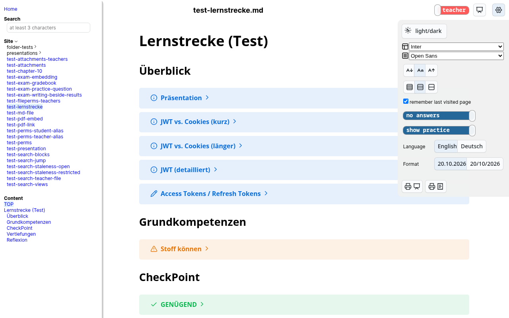
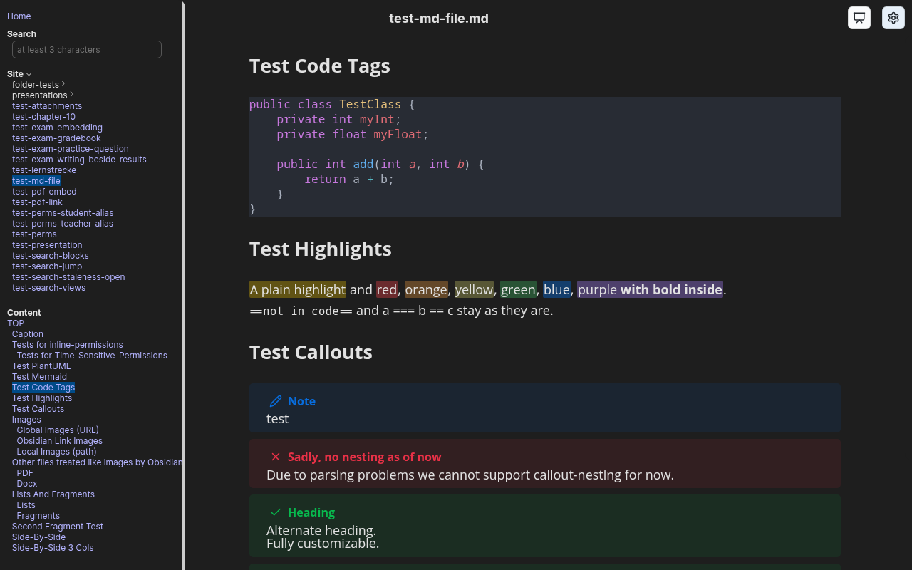
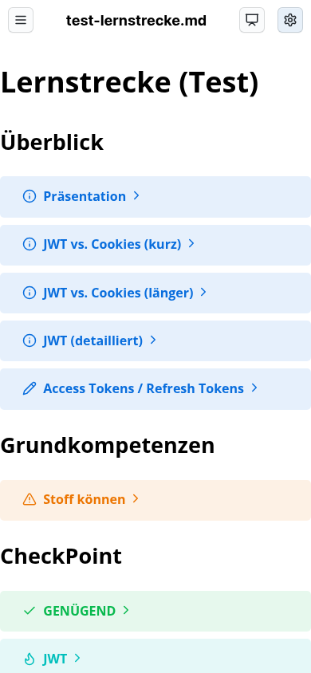
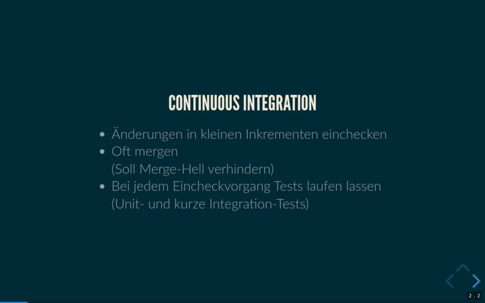
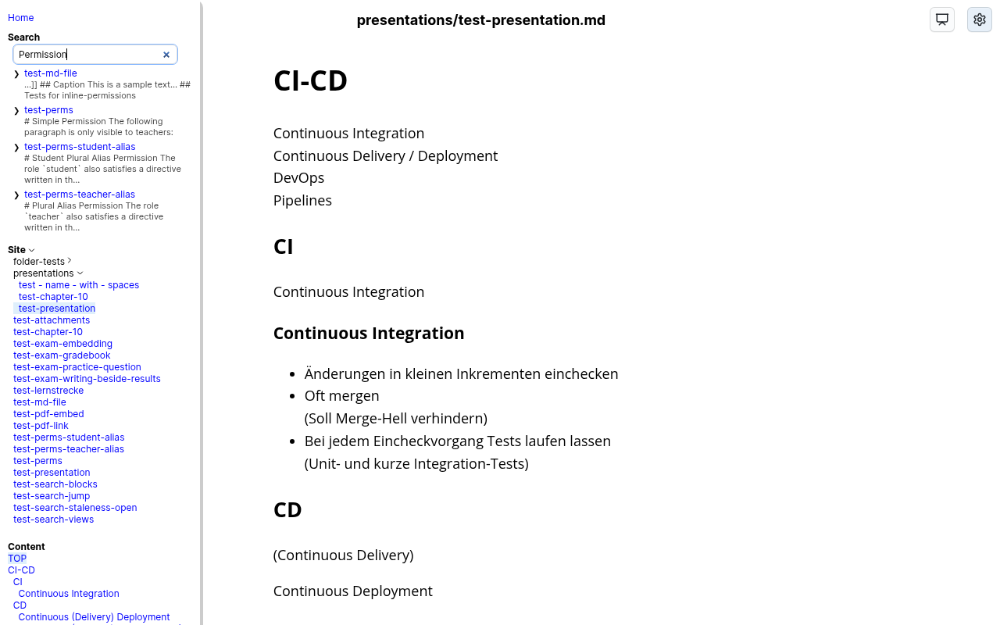
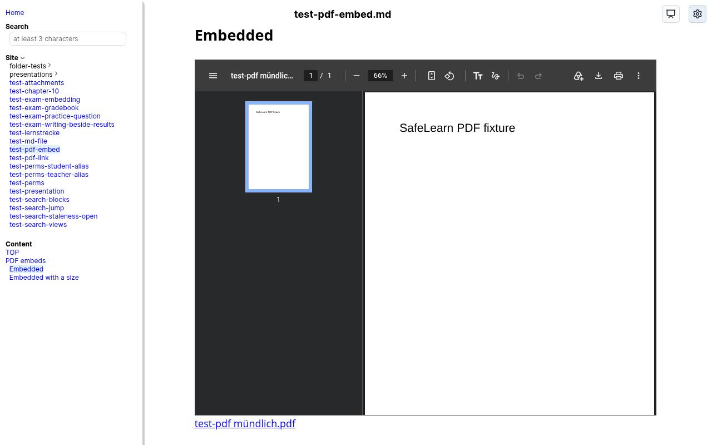

# SafeLearn Repository

As a teacher you probably have to cover a vast field of expertise and to keep up with changes in this very field, constantly updating your teaching materials. Most of the time your materials are scattered over a number of formats and platforms, which doesn't exactly make things easier.

This project is the attempt to unify all teaching materials using Markdown and Obsidian as an editor while using this site as a reader for the students.
As a reader for students it has various benefits, such as responsive design allowing the use of a mobile phone when learning, or customization of the look-and-feel to suit various tastes.

See a working version of this project, hosted by myself, here:
https://safelearn.unterrainer.info

| USER    | PASSWORD | Explanation                       |
| ------- | -------- | --------------------------------- |
| teacher | teacher  | Teacher-user with full access.    |
| student | student  | Student-user with limited access. |

You will not be able to edit the files, just to watch them.
If you'd like to host your own files, read on.

## Three Tiers
SafeLearn is one Docker image that runs in three configurations. Each contains the one below it, so you can start with the first and move up later without touching your Markdown.

| Tier | Difficulty | Configuration | What you get | What you need |
| --- | --- | --- | --- | --- |
| **1 — Publishing** | ★☆☆ Easy | `AUTH=none` | Your Markdown as a website, without a login. Every reader holds the same roles. Ideal as your local live preview, or for public material. | A machine with Docker. |
| **2 — Roles** | ★★☆ Medium | `AUTH=keycloak` | Everyone logs in; classes, teachers and admins each see what is meant for them, time-controlled if you like. Preferences follow a person to every device. | Tier 1, a Keycloak realm, a fork with its GitHub Action. |
| **3 — Database** | ★★★ Advanced | additionally `EXAM_MODULE=on` | Classes, a gradebook, a question pool and online tests, in one SQLite database. | Tier 2, a data directory you back up. |

How to install each of them, and how to choose, is described in [Installation](docs-installation.md). For a few teachers, or for editing live in class, keep the Markdown on a Nextcloud instead of in the repository: every save is online within seconds, and new material stays hidden behind `@@@ teacher` until it is ready — see [Where Your Markdown Lives](docs-installation.md#where-your-markdown-lives).

## Features
The tier a feature needs is noted in brackets; everything without a note works in every tier.

### For Students
* Teaching materials that are always up-to-date, readable everywhere and anytime
	* Read up if they miss a lecture
	* Read ahead if something is interesting
* Responsive design for computers, tablets and phones
* Automatic table of contents, highlighting the heading you are reading
* Full-text search over everything you may read, operated by keyboard if you like
* Customizable
	* Font for the text and for the navigation (OpenDyslexic included)
	* Font size and line spacing
	* Light mode / dark mode
	* Interface in English or German, dates and numbers in Austrian or British format
* Remembers the last opened page (in the browser in tier 1, in the account from tier 2)
* Online tests written in the browser, with a countdown and automatic saving, and their own results (tier 3)

| Settings | Dark mode | On a phone |
| --- | --- | --- |
|  |  |  |

### For Teachers
* One platform for all teaching materials, and everything is Markdown
* One editor ([Obsidian](https://obsidian.md)) that's cool, really good and completely free
	* Full Obsidian-flavor Markdown: callouts, wiki links, embeds, image sizing, the highlight colors
	* Diagrams with Mermaid and PlantUML, syntax highlighting with diff and focus notations
	* PDFs shown inline with `![[handout.pdf]]`, on the page and on a slide, with a link beneath for phones
	* The [SafeLearn plugin](docs-obsidian.md#the-obsidian-plugin) for Obsidian shows SafeLearn's own tags while you write
* Presentations with Reveal.js from the same file, including fragments, columns and a speaker view
* A printable document view of every page
* Customizable document-reading permissions
	* Show documents to different classes (tier 2)
	* Hide teacher notes from students
	* Keep exam questions, answers and practice questions together in one document, and show each only in its view
* Time-based visibility windows per role, with automatic live reloads when a block or file becomes visible or hidden
* Attachments (images, PDFs, …) are only delivered to readers who may see a page that links them
* Switch between teacher and student view
* A local [WYSIWYG container](docs-wysiwyg.md) that shows the changes to your documents the moment you save them (tier 1)
* Administration pages: unreferenced attachments, directory status (tier 2)
* Invitation lists and class lists straight from your school's directory, in the Obsidian plugin (tier 2, with directory search)
* Classes, courses, a gradebook, a question pool, online tests with a live view and a solution for the board, all of it placeable in your pages (tier 3)

| Presentation | Search | PDF inline |
| --- | --- | --- |
|  |  |  |

### Shortcuts
In view-mode, when visiting your web-page containing the rendered Markdown files, you may use the following keyboard-shortcuts:

| Keys                          | Explanation                                                                                                                   |
| ----------------------------- | ----------------------------------------------------------------------------------------------------------------------------- |
| CTRL + ALT + d                | Opens the `print-the-document-as-pdf` view in the same window you are currently in, without opening it in a new tab.          |
| CTRL + ALT + p                | Opens the `print-the-document-as-presentation` view in the same window you are currently in, without opening it in a new tab. |

## Why A Server Of Its Own
From tier 2 on, SafeLearn hides behind a configurable Keycloak authorization server, and thus your material is not publicly available, circumventing various licenses' restrictions.

The reason why it has its own server is server-side authentication as opposed to client-side. When doing client-side you'll send the contents anyways, but hide them until the user is authenticated. That, of course, doesn't help at all avoiding any crawlers looking for unlicensed images. In order to do that you have to go server-side authentication, which means that you're not sending anything as long as the user is not authenticated. That, of course, may only be achieved by manipulating the server itself, which sadly is not possible with GitHub Pages (at least not without a costly Enterprise subscription).

The same holds for permissions: a block a reader may not see is removed on the server, before the page is sent, in every tier.

## Obsidian
As you will probably recognize on your own, the `marked` converter on this site was designed with [Obsidian](https://obsidian.md) as an editor in mind.
It is extended so that it supports most of the features `Obsidian` does.
So there are some intricacies you should be aware of when working with it and serving it with this project.
### Recommended Plugins
* SafeLearn Formatter
	* Shows SafeLearn's own tags (permissions, fragments, columns, …) while you write, hides them in the reading view, and offers commands to insert them. With directory search configured it also builds invitation lists from your school's directory.
* Paste URL Into Selection
	* This allows you to paste an URL while having text selected. The selected text will be the link-text in your inserted link.
* PlantUML
	* Just start a code-block and select `plantuml` as the language. Then start plotting your diagram as you'd do in every other editor.
	  If you like a scroll-linked side-by-side view of your edit- and a read-view, just click on the vertical three-dots-button in the top-right corner and select `Reading-view` while holding `CTRL/CMD`
	* The renderer uses the server `https://plantuml.unterrainer.info/plantuml` by default.
	  If you'd like to use any other server, set your secret accordingly.

## Documentation
### Using It
* [Installation](docs-installation.md) — the three tiers, what each needs, and how to install it.
* [Obsidian Language Extensions](docs-obsidian.md) — the Obsidian-specific syntax SafeLearn understands: callouts, fragments, columns, diagrams, embeds.
* [Permissions](docs-permissions.md) — who may read whole files or parts of them, roles, time windows and the exam/practice/answer views.
* [Local WYSIWYG Container](docs-wysiwyg.md) — a container on your own machine that shows every change the moment you save it.
* [Exam Module](docs-exam-module.md) — tier 3: the switch, where the data lives, backups, classes, the gradebook, the question pool, online tests, and how a page places one of its elements.
* [Search Function](docs-search.md) — how the search field answers a query, why a stale index cannot leak anything, and the keys the result list answers to.

### Hosting It
* [Building](docs-building.md) — forking, the GitHub secrets and the deployment pipeline (tier 2 and 3).
* [Keycloak](docs-keycloak.md) — the Keycloak client, user attributes, the LDAP claim, the directory search client and the plugin login client.
* [Technical Details](docs-technical-details.md) — the software used behind the scenes and some of the URLs you may use.

### Developing It
* [Render Pipeline](docs-render-pipeline.md) — how a Markdown file becomes the HTML your browser receives.
* [Building this Project](docs-building.md) — the image and the Node line.
* [Debugging](docs-debugging.md) — when you've decided to help develop it.
* [Testing](docs-testing.md) — `npm test` starts the server, logs into Keycloak in a real browser and checks every tier.
* [The Realm You Develop Against](docs-development.md) — which accounts and roles the demo realm needs for the tests to run, and why it deliberately has no LDAP; interface language and fonts.
