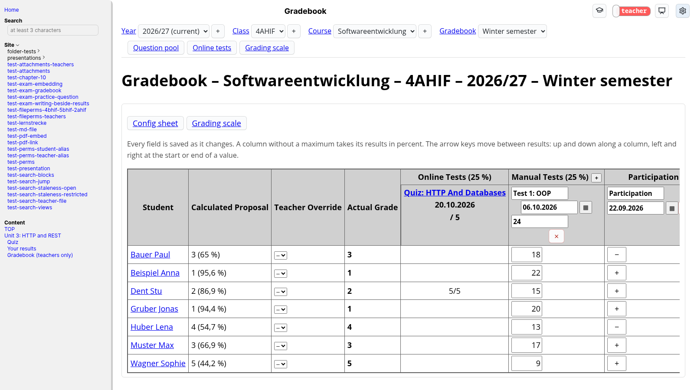
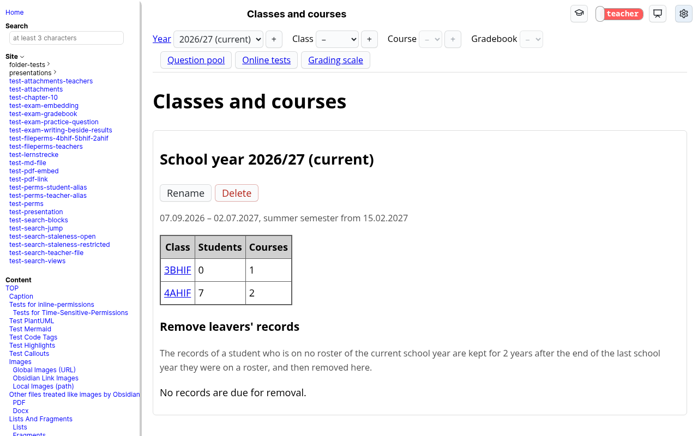
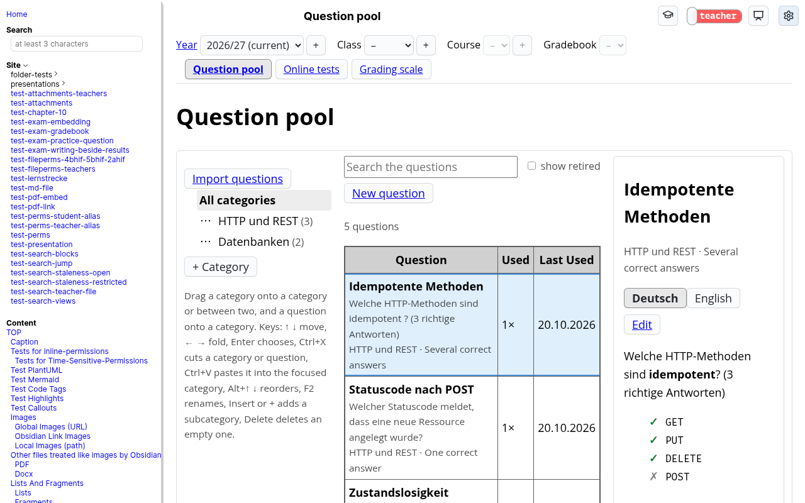
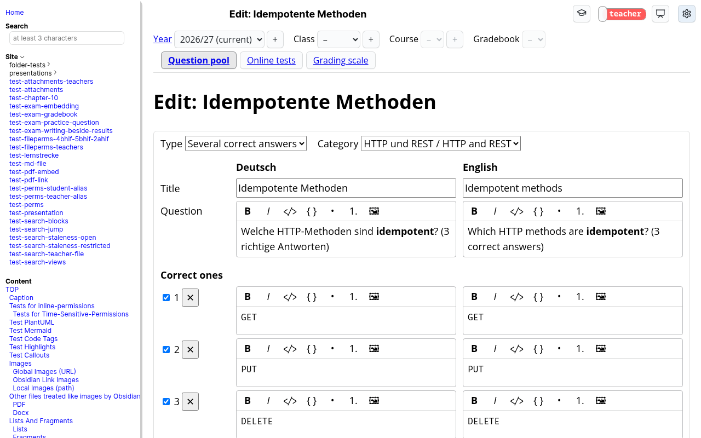
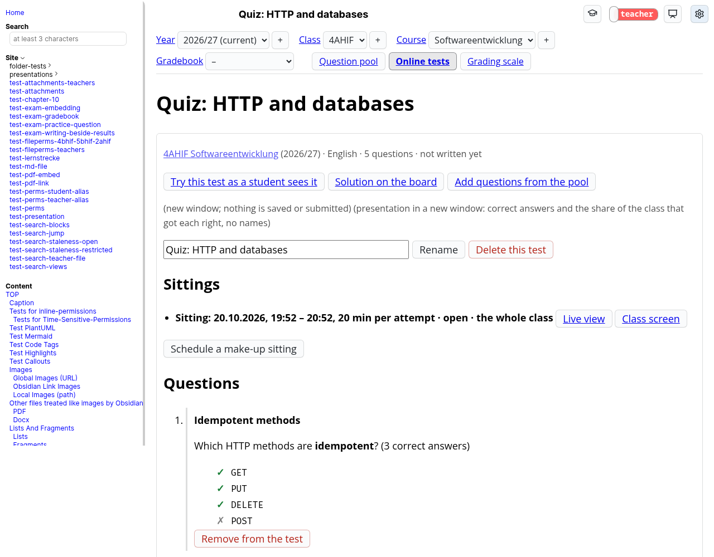
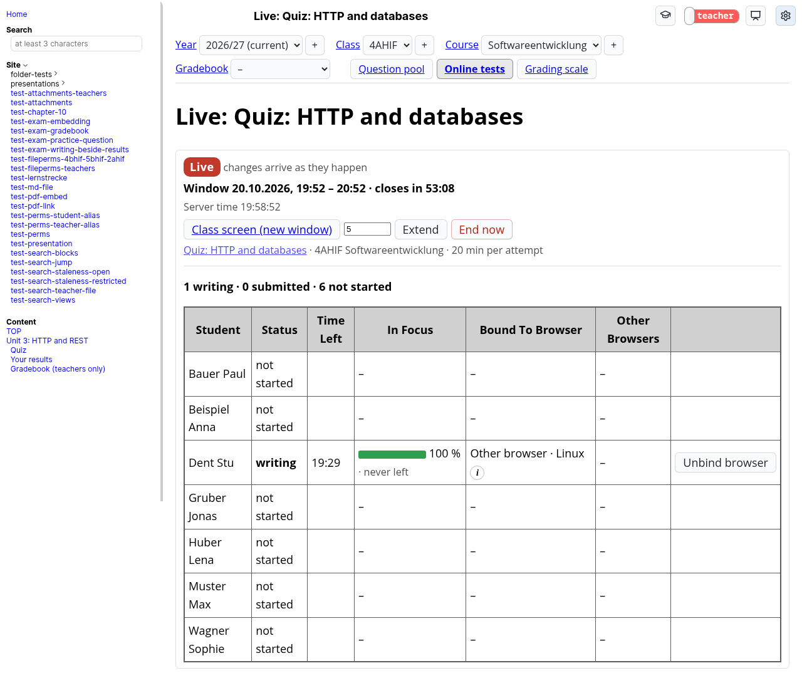
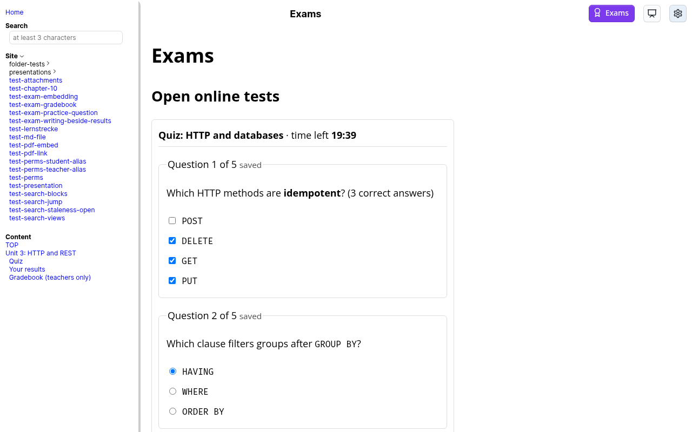
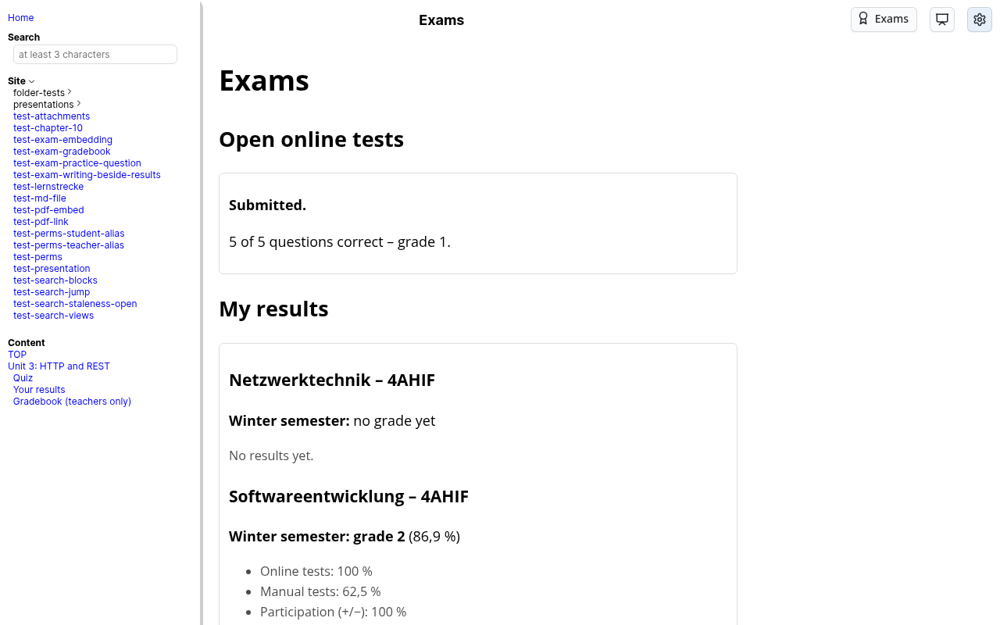
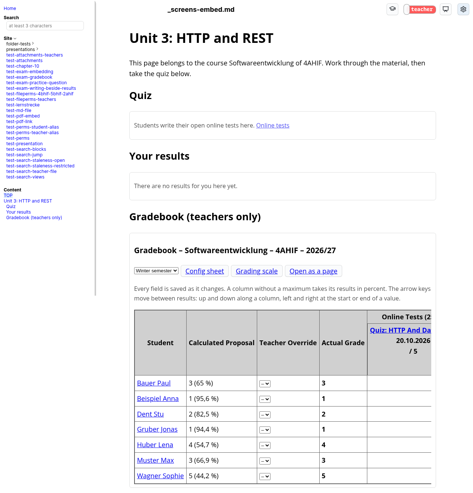
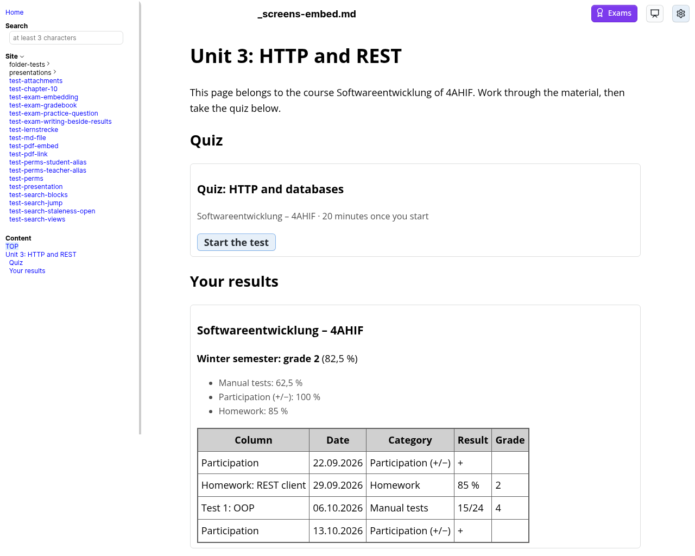

# Exam Module
Here you can find how the exam module is switched on, where it keeps its data, how that data is backed up, and how a page places one of its elements.

[Back](README.md) to the main page.

The module is what makes an instance [tier 3](docs-installation.md#tier-3--database): it needs a login through Keycloak (tier 2) and a data directory. It consists of its foundation (the switch, the database, backups, the teacher/student gate, the embedding syntax), classes and courses at `/exam/`, the change of school year, the gradebook, the question pool with its editor, online tests and the board solution.



## The Switch
The module exists only when the instance's environment says `EXAM_MODULE=on`. Any other value, or none, and the instance is exactly the one it was before the module: its code is not loaded, no database file is opened or created, nothing answers under `/exam/`, and no page links to it.

| Deployment | Module |
| --- | --- |
| Production (`deploy/docker-compose.yml`) | Off until a deployment sets it (secureLectures has it on since 2026-10-17). The compose file passes `EXAM_MODULE` through to the container, and the pipeline fills it from the repository variable `EXAM_MODULE` (Settings → Secrets and variables → Actions → Variables). |
| WYSIWYG container | Always off. Its templates set no `EXAM_MODULE` and mount no data volume, and `test/deployment-config.test.js` keeps it that way. |
| Local `npm start` | Off unless your `.env` says `EXAM_MODULE=on`. |

The start-up log says which it is:

```
Exam module: disabled (EXAM_MODULE is not "on").
Exam module: active, database data/exam.sqlite
Exam module: disabled - the database data/exam.sqlite could not be opened: ...
```

**A module that cannot start never stops the reader.** If the database cannot be opened, the data directory is read-only, a migration fails, the database was written by a newer image, or `SCHOOL_PERIODS` or `EXAM_RETENTION_YEARS` is malformed, the log says why and the instance runs without the module. A request under `/exam/` that fails is answered with a `500` on its own; every other page and session carries on.

Everything under `/exam/` requires a login, exactly like the content. A teacher reaches it through the graduation-cap button in the top bar, which only a session acting as a teacher sees, and only on an instance with the module on. The module's pages use the whole width beside the sidebar rather than the reading column, so a gradebook fits on one screen. A teacher in student view is a student to the module as well: teacher pages and teacher-only elements disappear and teacher actions are refused, until the view is switched back.

## The School's Periods
Sittings can be scheduled and read by the school's teaching periods instead of clock times. The periods come from the deployment, in the environment variable `SCHOOL_PERIODS`, and apply to every class and every day of the instance:

```
SCHOOL_PERIODS=0=07:05-07:55,1=08:00-08:50,2=08:55-09:45,3=10:00-10:50,4=10:55-11:45,5=11:50-12:40,6=12:45-13:35,7=13:40-14:30,8=14:35-15:25,9=15:30-16:20,10=16:25-17:15,11=17:20-18:05,12=18:05-18:50,13=19:00-19:45,14=19:45-20:30,15=20:40-21:25,16=21:25-22:10
```

That is the list secureLectures uses. Each entry is `<number>=<HH:MM>-<HH:MM>`: the period's number and its own start and end in Vienna time, so irregular breaks (11 and 12 back to back, 10 minutes before 13 and 15) are written as they are and nothing is derived from a cadence. Numbers are unique, every period ends after it starts, and in ascending order no period overlaps the one before it; a period may start the minute the previous one ends. Whitespace around an entry is ignored.

| `SCHOOL_PERIODS` | Effect |
| --- | --- |
| Unset or empty | A sitting of an online test is scheduled with the clock-time fields - one **Date**, the time its **start window opens** and the start window's **length in minutes**, since a start window never runs across midnight - and every start window is shown as its day and clock times, `Di 20.10. · Start 11:00–11:10`. |
| A valid list | The form for a sitting of an online test asks for a **date**, **one lesson** (the UI calls a period a lesson), the **minutes after the lesson's start** at which the start window opens (0 up to the lesson's length, default 5) and the **length of the start window** in minutes (default 10), beside the minutes per attempt: lesson 4 (10:55–11:45), 5 minutes, 10 minutes is the start window 11:00–11:10. The form shows the resulting start window and the time the last attempt ends at the latest - the start window's end plus the minutes per attempt, 11:30 with 20-minute attempts. A new sitting proposes today and the first lesson whose default start window (5 to 15 minutes in) has not closed yet; after the last one of the day, the next day's lesson 1. **Exact times instead** switches the form to the clock-time fields (the same date, start time and length) and back. A start window that opens within a lesson is shown as `Di 20.10. · 4. EH · Start 11:00–11:10` in the list of tests, the sittings of a test, the live view and the class screen, with the lesson's clock times (`10:55–11:45`) as the tooltip; one that opens outside every lesson is shown as `Di 20.10. · Start 07:58–08:08` and opens the form in clock times. A sitting stored before start windows existed is read as one: 10:00–11:45 is lesson 3, 0 minutes, 105 minutes. An offline sitting has a form of its own: a **date**, a **start lesson**, the **minutes after its start** (default 0), an **end lesson** from the start lesson on and the sitting's **duration**. Changing a lesson or the minutes sets the duration to the end lesson's end minus the planned start - lessons 4 to 6 (10:55–13:35) are 160 minutes, 5 minutes in 155, as the minutes never move the end; choosing a start lesson after the end lesson moves the end lesson along. The date leaves the duration alone, and a duration typed afterwards stays until a lesson or the minutes change again: a 20-minute short test in lesson 2 is start lesson 2, end lesson 2, 5 minutes and 20 typed in, planned 09:00–09:20. **Exact times instead** switches to a date, a **start**, an **end** and the duration: start and end set the duration (a later start keeps the end), a typed duration moves the end, and an end not after the start does not submit. A planned offline sitting is shown as `Mo. 30.11. · 4.–6. EH · geplant 10:55–13:35 · 160 Min`, or without the lessons when its plan does not lie on them (`Mo. 30.11. · geplant 07:58–08:48 · 50 Min`), and opens its form in the lessons it lies on, otherwise in clock times; once started, its shared window is shown as `Di 20.10. · 3.–4. EH` on period boundaries. Without periods the offline form has the clock-time fields only. |
| Malformed | The module stays off for that run and the log names the entry, e.g. `Exam module: disabled - SCHOOL_PERIODS: the entry "1=8-9" is not of the form <number>=<HH:MM>-<HH:MM>, e.g. 1=08:00-08:50.` The reader keeps serving. |

A sitting is stored as two instants either way, so the database, the API and every rule for sittings are the same with and without periods. Changing the list later only changes how windows are read: a start window that no longer opens within a lesson is shown in clock times, which is when it was held. The gradebook keeps a plain date.

| Deployment | Periods |
| --- | --- |
| Production (`deploy/docker-compose.yml`) | The compose file passes `SCHOOL_PERIODS` through to the container, and the pipeline fills it from the repository variable `SCHOOL_PERIODS`, next to `EXAM_MODULE`. |
| WYSIWYG container | None; it runs without the module. |
| Local `npm start` | Whatever your `.env` says; the harness sets none unless a check restarts with them. |

## Language And Formats

Every page, bar, button and message of the module follows the reader's interface language, and every date, time and number the reader's format (settings menu; see [Interface language and formats](docs-development.md#interface-language-and-formats)). Students' exam content is the exception: questions, answers and explanations in the writing view and the results come in the **course's** language, wrapped in an element with that `lang`, while the controls around them follow the student's own. Refusals of the API are answered in the reader's language too; the English text stays in the log. Dates are entered with the module's own `<sl-date-input>`, which shows `20.10.2026` or `20/10/2026` whatever the operating system is set to.

## The Data
All state lives in one SQLite file, `data/exam.sqlite` relative to the working directory — `/app/data` in the image, the volume `deploy/docker-compose.yml` already mounts from `${DATA_DIR}` for the directory cache. It is opened with `node:sqlite`, which the image's Node 24 ships, so the module adds no dependency.

- **Migrations** are the numbered files in `exam/migrations/` (`001` to `010`, so schema version 10 today), applied in order at start-up, one transaction each. `PRAGMA user_version` records the last one applied. A migration that fails is rolled back on its own and leaves the database at the last version that applied completely; the module is disabled for that run.
- **A downgrade** — an older image on a newer database — is refused: the module is disabled, the file is left untouched, and the log names both versions.
- **People are recorded by their directory username** (the Keycloak `username`, lowercased), never by the Keycloak user id, which changes when an account is deleted and re-imported.
- **Nothing in the data directory is served over HTTP**, by any path, with or without a session.

`EXAM_DB_PATH` overrides the location. It exists for the verification harness, which gives every run a database of its own; a deployment does not set it.

## Backups
The module writes consistent copies with `VACUUM INTO` into `exam-backups/` beside the database. Each copy opens as a database on its own.

| Copy | When | Kept |
| --- | --- | --- |
| `exam-pre-v<N>-<time>.sqlite` | Before the first pending migration away from version `N` | 90 days |
| `exam-daily-<time>.sqlite` | At start-up if the newest is a day old or missing, then once a day | The newest 14 |

They sit beside the database on purpose: a restore finds them right where it needs them. `VACUUM INTO` only reads the database, so taking a copy cannot damage it.

Getting the copies off the host is the operator's job, with whatever that host already backs up with. **Back up `exam-backups/`, not the live `exam.sqlite`:** a file-level backup can catch the database in the middle of a write, with part of it still in the `exam.sqlite-wal` file beside it, while every copy in `exam-backups/` is complete. A backup of the copies holds grades of minors, so wherever it goes, it has to be a place that may hold them.

**Restoring** means stopping the container, replacing `exam.sqlite` with a copy (and deleting `exam.sqlite-wal` and `exam.sqlite-shm` beside it), and starting again. A copy from an older schema version is migrated forward on start, as any older database is.

**Rolling back** the module itself means unsetting `EXAM_MODULE` and redeploying. The data stays in `exam.sqlite`, untouched, and switching the module back on resumes where it was.

**Rolling back to an older image** is different once a newer image has migrated the database: the older image refuses a database at a schema version it does not know, and the module stays disabled. Every migration is such a step - schema 4 (the gradebook as a sheet, from `exam-navigation-and-grid`), for example. Going back takes the previous image *and* the copy `exam-pre-v<N>-<time>.sqlite` that was written just before the migration, `N` being the version the previous image knows (behind schema 4, `exam-pre-v3-<time>.sqlite`), restored as described above. Whatever was recorded after the migration is not in that copy.

## The Module Bar


Every teacher page of the module carries a bar directly under the instance's top bar. From left to right it holds **Year** (the school year), **Class**, **Course** and **Gradebook** (the course's gradebook, winter semester or whole year). Each is a dropdown whose choices are what exists under the positions to its left and what you see: the class position offers only the classes you are entered in (see [Who Sees Which Class](#who-sees-which-class)). Choosing a value opens that page, and positions to its right are left empty until you choose them. With nothing chosen, the bar shows the current school year. Each position's name links to its overview: the year to its classes, the class to its roster and courses, the course to its config sheet, the gradebook to the course's sheet.

**A single choice is chosen for you.** When the class or the course position has nothing chosen and offers exactly one choice, the bar chooses it at once and opens its page. This happens on the module's start page (`/exam/`) and after you choose a year in the bar, and it carries on to the right: a teacher entered in one class with one course lands straight on that course's config sheet; one with several courses lands on the class page with no course chosen; one with several classes stays on the year's overview. A class you choose in the bar yourself is your last word: its class page opens and stays open, even when the class has a single course. It never happens for the gradebook's semester, and never on a page you reached another way: following a position's link (back to the class page, say), emptying a position, or a link on a page stays where you went.

New records are created from the bar too, left to right, with the `+` beside a position: a new school year at any time, a new class once a year is chosen (only for an admin, who alone creates classes), a new course once a class is chosen. The same rules as before apply (a class or course that exists already is refused), and the new record is chosen in the bar afterwards.

At its right end the bar has three buttons, **Question pool**, **Tests** and **Grading scale**, each marked while its page is shown. They keep what is chosen in the bar: the pool opened from the gradebook of `WMC 4BHIF` still has that course chosen, which is the course a test assembled there is for. Tests opens the chosen course's tests, online and offline, or - with no course chosen - the tests of every course of the chosen school year, grouped by class and course. The button of the page being shown is marked, and on these two pages a choice in the bar stays on the page, for what is now chosen.

The bar comes with the page itself, so it costs no request of its own. A student's Exams page (`/exam/my`) and elements placed in a content page have no bar. A student, or a teacher in student view, never gets one, because no teacher page is shown to them.

## Classes And Courses
Teachers manage these at `/exam/`. Everything here belongs to teachers. A student, or a teacher in student view, finds no page there, and every request is refused.

- **School years** are named like `2026/27`. Each has a start date, the first day of the summer semester and an end date. The first year created becomes the current one. A later year can be created in advance and made current when it starts, and exactly one year is current at a time. Once a year is over it is closed, its classes are moved up into the next one, and the records of students who have left are removed after the retention period - see [The Year Change](#the-year-change).
- **A class** belongs to one school year and is named like `5AHIF`. Only an admin creates, renames and deletes a class. When an admin creates it, the module lists every member of the class's directory unit as a checklist, and nobody is ticked, and below it the directory's teachers to enter in the class. On an LDAP realm that unit is the class's OU; on a realm that grants classes as client roles, it is that role. Only the people you tick form the roster. This is what keeps former students out of a 5th-year class whose OU still holds them. Teachers are never offered and can never be added.
- **The teachers of a class** are the directory teachers an admin entered in it (see [Who Sees Which Class](#who-sees-which-class)). The class page lists them for everyone who sees the class; an admin enters one by typing part of the name (see [Finding A Teacher](#finding-a-teacher)) and pressing **Enter teacher** beside the match, and removes one with a second click.
- **The roster** changes only when a teacher of the class changes it. A student who joins the directory unit later is listed under "Add students" but is not added on their own. You can also add someone from the whole directory, or by username when the directory is not available on the instance or is still loading. Removing a student keeps their entry, marked as left, so what is recorded for them stays theirs. "Refresh names" updates names from the directory and never changes who is on the roster.
- **A course** is a class, a subject and the class's school year, and exists once per class however the subject is capitalized. It has no owner, so every teacher entered in its class, and every admin, sees and edits it. Its language (German or English) decides how its tests are presented. Its config sheet weighs the gradebook's seven categories (online tests, manual tests, short tests, presentations, projects, participation, homework) in whole percentages that add up to 100. A new course starts at 20 % for each of online tests, manual tests, short tests, participation and homework, and 0 % for presentations and projects. A course from before short tests existed got 0 % for them and kept its other weights (schema 12), and every course from before presentations and projects got 0 % for both (schema 14), so none of its proposals changed. A category at 0 % is not in use and is hidden everywhere in the gradebook (see below); the config sheet keeps listing it, and says "N columns hidden" beside one that still holds columns. The config sheet also holds the winter semester's share of the year grade (see below), 50 % to begin with.
- **Renaming and deleting.** A school year (in its heading on `/exam/`), a class (in the head of its page, for an admin only) and a course (in the head of its config sheet) each have **Rename**, an inline field with Save and Cancel, and **Delete**, confirmed by a second click. A year can be deleted while it is not the current one and has no classes; a class while it has no courses, and its roster and its teacher entries go with it; a course while it has no gradebook column (an empty one counts), result, semester grade or online test. A refusal names what is in the way, by count, at the button. Renaming a class changes only the module's record, meant for a typo: the roster proposals look the directory up by the new name, so a name the directory does not know proposes nobody.
- **The module's tables** share a few conventions. A click on a row marks it, and marking another unmarks the first, so the eye can follow one row across a wide table. A table wider than the screen scrolls sideways inside its own frame, with its first column (the gradebook: its first four) staying in place. A field that stands on its own is saved as soon as it changes - there is no "Save" button - and shows while it is saving, that it was saved, or, outlined in red with the reason on hover, that it was refused. The config sheet's weights are saved together, and only while they add up to 100 %; until then the sum says how far off they are. Every page with such fields says near its top that they are saved as they change. Actions are buttons - the page's main one marked as primary - and links lead only to something to read. Anything that deletes or takes back asks by a second click on the same button, whose label then says what that click does; the button disarms when the focus leaves it, on Escape, or after 5 seconds. Never a browser dialog.

## Who Sees Which Class
A teacher sees only the classes they are entered in, and everything that belongs to them: the roster, the courses with their config sheets and gradebooks, columns, results, notes and evaluations, the tests with their sittings, live views, attempts, paper correction and handouts, and the pages of the class's students. Every other class appears nowhere for them - not in the bar, not in a year's overview, not in the list of tests, not in a live update - and its pages and API answer exactly as for a record that does not exist (`404`), so a teacher cannot even tell that it exists. An element of the module placed in a content page renders as for a missing record too. School years and the question pool stay visible to every teacher; the pool's usage list names only tests of the teacher's classes and counts the others ("also used in 3 tests of classes you do not see"). A student's own pages are unaffected.

An admin sees every class, entered or not, and does everything there an entered teacher can. Only an admin enters teachers in a class or removes them, on the class page, choosing from the directory's teachers; a username the directory does not hold as a teacher is refused. An entry counts from the teacher's next request, without a new login, and removing a teacher closes their open live views of the class. The list is access control rather than a record of the year, so an admin can change it in a closed year too, while everything else of that year stays read-only. The year's overview shows an admin how many teachers each class has, and lists the classes without any first, marked "No teacher".

**After the deploy that brings this, no teacher sees any class** until an admin enters them: every existing class starts with no teacher. Enter the teachers of the current year's classes right away, from the overview, which lists the classes still without a teacher first. On the safeLearn demo instance, enter the shared demo `teacher` account in the demo classes.

### Finding A Teacher
Wherever an admin picks teachers - entering one on the class page, the teachers of a new class, and the directory's other teachers in the year change - a field above the list narrows it as you type. The input is split at spaces, and a teacher is shown when every piece appears in their family name, given name or username, in any order, case and accents aside: `gru lei` and `franz gru` both find `Gruber-Leitner Franz`, and `höll` finds `Holler Eva`. The narrowing happens in the page, without a request per keystroke. On the class page nothing is listed before you type; in the other two places an empty field shows every teacher, and typing in the year change opens its list of other teachers. When nobody matches, the place says so. A teacher you ticked stays ticked while the field hides them, and is entered when you create the class.

## The Year Change
Everything the module records belongs to one school year. Changing to the next one is three steps, each on a year's overview at `/exam/` and each asked by a second click.

1. **Start the next year from the old one.** Create the new year (bar → new school year) and open its overview. Under *From 2026/27* it offers every class of the year before one level up: `3AHIF` becomes `4AHIF`, while a fifth-year class - or any class whose name does not start with a digit from 1 to 4 - has no successor and is listed as such. For each class you see last year's roster, everyone ticked except those who left during the year, and beside it the directory's current members of the new class, unticked; below them last year's teachers of the class, ticked, and the directory's other teachers, unticked. Untick whoever is not moving up, tick whoever joins, choose the teachers and the courses to copy, and press **Create 4AHIF**. Only the ticked people are put on the roster and only the ticked teachers are entered; last year's class keeps its own teachers. Teachers are never offered for the roster. Because it creates classes, this step is an admin's. A copied course has the old one's subject, language, weights and winter share, and no column, result or test. The class and its courses are created together or not at all. A class that exists already in the new year is listed as done, with a link. Without the directory (not configured, or still loading), last year's roster is offered alone, as in the roster editor.
2. **Close the old year** once its end date has passed and the new year is current (make it current first, in its heading). The old year's overview then shows **Close school year**. A closed year stays readable to its teachers and to the students it holds records of, and nothing in it can be changed any more, not even by the teacher who closed it: its classes, rosters, courses, gradebook columns, results, notes, overrides, tests, sittings, attempts and teacher notes in the live view are refused with *This school year is closed*, whatever page or request tries. Its pages show every control disabled and a note that the year is closed. A closed year cannot be reopened, renamed, re-dated or deleted; a restore from the backup of the day before is the only way back. The database itself enforces this (triggers on every table that belongs to a year), so a route added later cannot forget it.
3. **Remove leavers' records.** A student who is on no roster of the current year has left. Their records are kept for the retention period after the end of the last school year they were on a roster, and then removed here: the current year's overview reports how many students are due and how many results, notes, teacher notes from live views, overrides and comments, online-test attempts, sitting participations and roster entries would be deleted - counts only, never names - and **Remove leavers' records** deletes exactly those. If the counts changed meanwhile (someone edited a roster), the removal is refused and the new report shown. Someone who was never on any roster is due at once. Courses, columns, tests and sittings stay; a column or a test simply has one result fewer. The log records the counts, never who. The deletion cannot be undone; the daily backups still hold the records until they age out after 14 days, and a pre-migration copy taken before it for 90 days (see [Backups](#backups)).

The retention period comes from the deployment:

| `EXAM_RETENTION_YEARS` | Effect |
| --- | --- |
| Unset or empty | Two years: a student who left after 2026/27 (ending 2027-07-02) is due from 2029-07-03. |
| A whole number from 1 to 10 | That many years. |
| Anything else (`two`, `0`, `2.5`) | The module stays off for that run and the log names the variable, e.g. `Exam module: disabled - EXAM_RETENTION_YEARS: "two" is not a whole number of years from 1 to 10.` The reader keeps serving. |

Production passes it through `deploy/docker-compose.yml`, filled by the pipeline from the repository variable `EXAM_RETENTION_YEARS` next to `SCHOOL_PERIODS`; secureLectures leaves it unset. The WYSIWYG container runs without the module and does not set it.

## The Gradebook
Each course has a gradebook, reached from the course's and the class's page (`/exam/courses/<id>/gradebook`). Like classes and courses it belongs to teachers, with one exception: every student sees their own results.

- **The gradebook is a sheet**: one row per student, one column per assessment. Each column belongs to a category - manual tests, short tests, presentations, projects, participation or homework - and has a name, a date and, for a test, a short test or a homework, optionally a maximum. Short tests are the quizzes between the big tests: they count in a category of their own, so a six-point quiz no longer weighs as much as a forty-point test. The column's date decides the semester of every result in it. The categories stand as headings over their columns, in the config sheet's order, and within a category the newest column is furthest right.
- **Only the categories in use are shown.** A category weighted 0 % has no group, no `+` and no category line - not in the sheet, not on a student's page, not in the student's own results, and not as a choice for a new offline test. Its columns and results stay stored and count nowhere; give the category a weight again and they are back as they were. Weights can be changed at any time while the year is open. The one exception is online tests at 0 %: the tests page, sittings and the live view stay as they are, so a test can still be written, for practice say - its column simply does not show in the sheet.
- **A presentation** (Referat) is a column of its own category with a name and a date and no maximum. Each student's field takes one grade from 1 to 5, and shows the grade typed. It counts as the middle of that grade's range on the scale as it is now (with the initial scale 94 % for a 1, 81.5 % for a 2, ...), so it follows a change of the scale and keeps showing the grade typed.
- **Participation** (Mitarbeit) is a column of its own category with a date and no maximum. Each student's field takes a grade from 1 to 5 that counts like a presentation's. For a quick round it also takes three shortcuts: `+` for a 1, `o` for a 3 and `-` (or `−`) for a 5, each one keystroke that is saved at once and then shown as its grade, so the field always shows the grade. Participation marks recorded as `+`/`−` before participation took grades were turned into grades once, by the migration to schema 19: `+` became a 1, `−` a 5, in closed years too, with every column, date and note kept. Since a `+` counted as 100 % and a `−` as 0 % before, and the grades now count at the middle of their range (94 % and 25 % on the initial scale), a proposal that includes participation moved slightly with that migration. A project's `+`/`−` columns were not touched.
- **A project** is a group of its own within the projects category: a heading with its name, below it its `+`/`−` columns, then its end grade, furthest right under the header "Grade". The end grade is typed by the teacher, a grade from 1 to 5 that counts like a presentation's. The `+`/`−` columns are notes for the record, taken while the project runs; they count in no category and never move the end grade - weigh them in when typing it. The `+` in the projects heading adds a project, the `+` in a project's heading adds a `+`/`−` column to it. The project's date decides the semester of its end grade and of all its `+`/`−` columns, whatever their own dates. A project in the sheet adds a third heading row, between the categories and the columns. Clicking a project's name opens its dialog for the name and the date, where it is also deleted - with its `+`/`−` columns and every result in the project, after a second click that says how many. A student sees a project's marks below the project in their results, marked as for the record only.
- **Adding a column** is the `+` in its category's heading, which asks for the name, the date and, where the category has one, the maximum. A column without a name is named by its date. Online tests have no `+`: their columns are the tests themselves (see Online Tests below), shown as text - points out of the number of questions - and never typed into or deleted here; the arrow keys pass over them. A column's header shows only its day (`27.09.`) and its maximum (`/24`), so a column is as narrow as its result fields; its name is shown when hovering anywhere over the header, together with the full date and the maximum or "in percent", and in its dialog. A column named by its date shows that day once. An online test's day links to the test. A category's heading wraps, and an empty category takes a column with a dash no wider than the heading's longest word. Clicking anywhere in a column's header opens the same dialog as the `+`, where its name, date and maximum are changed, each saved as it changes, and where it is deleted; closing the dialog redraws the sheet. The dialog follows the page's light or dark mode. A new maximum recomputes every result in the column from its points, and is refused at the field while a result has more points than the new maximum. A column holding results keeps counting in points or in percent. Deleting a column deletes its results and its notes, after asking by a second click that says how many of each.
- **Every result is a fraction** from 0 to 1, and a student has at most one per column. In a column with a maximum you type the points (`17` of `24`, kept and shown as `17/24`), in one without a percentage; a project's mark is `+` (1) or `−` (0), typed as `+` or `-`; a participation, a presentation or a project's end grade is one digit from `1` to `5`, and participation also takes `+`, `o` and `-` for 1, 3 and 5. **A field is saved as soon as it changes**, when you leave it or press Enter; emptying it removes the result. A value the module refuses (more points than the maximum, a project's mark other than `+` or `−`, a grade other than 1 to 5, or in participation anything but a grade and its three shortcuts) stays in the field, outlined in red with the reason, and the stored result stays as it was. The row's proposal and grade follow each saved field at once. A field still saving when you leave the page makes the browser ask first.
- **The arrow keys** move between results as in a spreadsheet. Down and up go to the same column of the next or previous student, so a test or a participation round (`+`, `o`, `-` or a grade) is entered down the list. Right and left go to the next or previous column of the same student - across category headings too - while the cursor stands at the end or the start of the value, so inside a value they still move the cursor. A field you arrive at has its value selected, and typing replaces it. Moving saves the field you leave; the arrows never change a value. Enter in a result field saves it and moves down like the down arrow, so a column is typed down the class with Enter. Tab and Shift+Tab move along the row.
- **A note per cell.** Every cell - one student in one column, of every kind, online tests included - can hold a plain-text note of up to 4000 characters, for example "You forgot GreetingService.java (-1)" beside a 9/10, or "Not handed in, due Friday" in a cell without a value. A note does not need a result: emptying the value keeps the note, and emptying the note keeps the value. A note counts in no calculation. The sheet gives notes no room except in the **active column**, the one holding the cursor: it opens a note field about 20 characters wide right of each student's result, which grows to six lines while you type in it. When the cursor leaves the column its note fields close again, and a cell holding a note shows a small mark in its corner whose tooltip is the note; clicking the mark puts you into the note. A note field is saved as it changes, like every other field; an empty one removes the note, and one longer than 4000 characters is refused at the field. In the active column the arrows treat the note as a second field of each cell: right at the end of a result goes into its note, right at the end of the note to the next column's result, left back the same way. Up and down go to the previous or next student's note, but only from the note's first or last line; Enter in a note starts a new line and moves nothing. An online test's cell cannot be typed into, but a click on it opens its note, for every student on the roster, whether they wrote the test or not.
- **The sheet keeps the student and the grade in view**: the name, the Matura toggle, the proposal, the override and the grade stay on the left, under short headings whose long form ("Calculated proposal", "Teacher override", "Actual grade") shows on hover, while the columns scroll sideways inside the sheet. The override is a field of the row like any other, saved as it changes.
- **What the student sees of a result** is the column's name and date beside it, and the cell's note on a line of its own below it, with its line breaks. A column in which they have only a note is shown to them with a dash as the result and the note. A category weighted 0 % hides its notes with its results. The teacher's page of a student shows the notes the same way, read-only. A remark about the whole semester belongs in the semester comment. Results recorded before the sheet existed (schema 3) were placed into columns by the migration to schema 4: one column per course, kind, date, maximum and note, named by the note or by the kind and date, with every result and proposal unchanged.
- **The proposal** for a semester is computed whenever it is shown, never stored. Each category (online tests, manual tests, short tests, presentations, projects, participation, homework) is the mean of that semester's results in it, a project's `+`/`−` marks left out; the proposal is the mean of the categories weighted by the course's config sheet, and the grading scale turns it into a grade. A category without results is left out and the other weights are scaled up, so a course without online tests yet grades by the other three.
- **The year grade** - the summer semester's proposal - is the winter semester's result times its share plus the summer semester's own result times the rest. The share is set per course on the config sheet, in whole percent (50 % to begin with). The summer semester's own result counts summer results only, exactly as the winter semester counts its own. While the winter semester has no override, its proposal counts; once it has one, it counts as the middle of that grade's range on the scale (with the initial scale 94 % for a 1, 81.5 % for a 2, 69 % for a 3, 56.5 % for a 4, 25 % for a 5). A semester without results leaves the year to the other. The year view of the sheet shows the winter grade (marked when overridden) beside the year proposal, followed by the summer's columns only.
- **The grading scale** is one for all courses, at `/exam/scale`: from 88 % a 1, from 75 % a 2, from 63 % a 3, from 50 % a 4, below a 5, to begin with. A result exactly on a threshold gets the better grade. A change applies to every proposal at once. The scale is saved as it changes, its four thresholds together and only while each lies above 0 and at most 100 with at most one decimal, below the one of the grade before it; until then the line under the scale says why it is not saved.
- **An override** replaces the proposal for one student's semester, with an optional comment. Teachers keep seeing the proposal beside it; removing the override makes the proposal the grade again. The comment reaches the student only when "The student sees the comment" is ticked.
- **Grade colours.** Wherever a row stands for a grade it is coloured by it: a **5 red**, a **1 or 2 green**, a 3, a 4 or no grade not at all. In the sheet each student's row follows their grade for the semester or year shown (the override, or else the proposal), and changes as soon as a result or an override is saved; the sheet of students who left is coloured the same way. On a student's page the rows of the categories, the winter grade, the proposal and the actual grade each take their own grade, and in the results - on a student's page and in the student's own results - each result's row takes the grade of that result, a project's marks staying uncoloured. The grading scale colours its rows 1 and 2 green and 5 red and is thereby the legend of these colours. The grade is always shown in the row, and the row clicked last keeps its blue highlight.
- **A test's evaluation** shows at a glance how the class did in one test: how many 1s to 5s, each as a bar in the grade colours with its number beside it, the average grade (one decimal) and the average percentage, and how many students have a result and how many on the roster have none yet. It exists for every column of online tests, manual tests and short tests - offline tests included - and not for homework, presentations, projects or participation. It counts exactly what the sheet shows: an online test's submitted attempts only (someone still writing counts as without a result), an offline test's results with its factor A:B applied. A student who left counts with their result, never as missing. It opens as a popup in two places: the small `▤` button in the column's header, beside the header's own button or link, and the Evaluation button on the test's page (`/exam/tests/<id>`), there once the test has a column in the sheet - for an online test from its first sitting on, for an offline test from the start. Both show the same numbers, as they are when it opens. Escape, its Close button or a click beside it closes it, and the page stays as it was. Only teachers see it.
- **Matura candidates** are marked in the sheet of a fifth-year class (a class whose name starts with `5`; below that there is no toggle and nobody is highlighted): the narrow `M` column beside the name grants or withdraws, with one click, the Keycloak client role `examparticipant-<subject>-<language>` on the `safeLearn` client - the course's subject in lower case and its language, so `examparticipant-wmc-en` for an English `WMC` course and `examparticipant-wmc-de` for a German one, each shared by every class's `WMC` course in that language. The first grant of a subject and language creates the role; changing a course's language switches it to the other role, so its candidates have to be marked again. The button is pressed while the student holds it. It needs the directory-service client's write rights (`manage-users`, and `manage-clients` for creating the role - see `docs-keycloak.md`); without them a click is refused with a message about that setup beside the sheet and nothing changes. It is disabled while the directory is still being fetched, and not there in a closed year, for those who left, or on an instance without directory access. A candidate's name is highlighted wherever the module shows the course's students - in the sheet, on their own page and in the links to them, in a test's participant lists and in the live view of a sitting (never on the class's screen) - by a coloured name cell in a table and a coloured name elsewhere, with "Matura candidate" said to screen readers and on hover. The class's roster highlights a candidate of any of the class's courses and names those subjects on hover. A change shows on the next load of any view; a student's own session carries the role from their next login. What the role makes visible in documents is up to the role directives there.
- **Students who left the roster** stand below the sheet, read-only, with what was recorded for them. A student's own page in a course (`/exam/courses/<id>/students/<username>`, from their name in the sheet) shows each semester's categories, proposal and grade, the override and the comment - saved as they change - and their results by column, read-only. At its top it leads back to the sheet and to the students before and after in the sheet's order, keeping the semester.
- **A student's own results** are on the Exams page (`/exam/my`), below the open tests, or wherever a page places a `safelearn-results` block: per course their results with each column's name and date, the category fractions and the grade. While no override exists that is the proposal; once one does, the student sees the override and no longer the proposal. The year grade appears once the summer semester has begun. No request can name another student: the route answers about the session's own identity only.

## The Question Pool


All teachers share one pool of questions, browsed at `/exam/pool` (the bar's **Question pool** button). Like everything else here it belongs to teachers: a student, or a teacher in student view, finds no page there, and the API and the images refuse them.

- **A question** has a type - several correct answers, exactly one correct answer, true/false, or free text - its text in German and in English, a category, and the images it embeds. A choice question (the first three) has each answer in both languages with a correct flag. It is worth one point and is graded all-or-nothing, so the hint in the text saying how many answers are correct ("(2 richtige Antworten)") matters and is kept.
- **A free-text question** (`freetext`) is answered in the student's own words. It has no answers and no correct flags. Instead it has a **model solution** in German and in English, which says what a full answer contains. The module does not grade it, a teacher does, so it is meant for short tests on paper. **An online test holds no free-text question.** The server refuses one in a new test or added to a test, naming it, and a question that an online test not yet begun holds cannot be changed to free text until the teacher takes it out of that test. A test begun before a question became free text keeps its copy of the choice question it was.
- **The browser** has three columns: the category tree with the number of questions in each on the left; in the middle a search over names, texts and answers in both languages, a **type selector** (all types or one, combined with the search and the category), and the matching questions - each with its category, type, and how often and when it was last used - in a list that scrolls on its own; and on the right the question clicked last, in German or English with the correct answers marked - a free-text question with its model solution instead - and every test it was used in, with the course and the date. The tree and the question on the right stay in view while the list scrolls, and so does the clicked question's row. On a narrow screen the columns stack. Retired questions are left out unless **show retired** is ticked; then they are listed, greyed and marked.
- **Images** are stored in the database, not as files, so the daily backup covers them, and are served only by the module (`/exam/api/images/<id>`): to teachers, and to a student while they have an open attempt at a test showing the image. They are never cached. An image a test shows cannot be deleted from the pool.
- **With a course chosen in the bar**, a click anywhere on a question's row chooses it for a test, and a second click unchooses it; chosen rows are coloured green, and the row clicked last keeps its blue edge and its preview. The chosen questions become a test of that course: give it a name and use **Create test**, or add them to one of the course's tests nobody has written yet. A free-text question has no box there and says that online tests cannot hold it; a click on its row only shows the preview. Without a course chosen, a click only shows the preview.
- **The database is the pool's only source.** It was filled once from the Moodle export, and from then on the module's question editor and the Markdown import (both below) change it. There is no re-import from Moodle and no export, and an import only adds questions.

### The Question Editor


Teachers fix and add questions online. **Edit** on a question's preview opens the editor (`/exam/pool/questions/<id>`). **New question**, always beside the search, creates one in the chosen category (`/exam/pool/questions/new?category=<id>`), or, with none chosen, opens the editor with an empty category choice that has to be made before saving; **New question** in a category's ⋯ menu in the tree creates one there. Saving or leaving the editor returns to the browser with the question's category chosen.

- **Both languages side by side**, one row per field: the title, the question text, and each answer as a pair of a German and an English text with one correct flag for both. Answers are added and removed; there is no order to set, since every attempt shuffles them. Type and category are chosen above; a new category there moves the question to the end of it. A true/false question has no answer texts: it only says whether the statement is true, and its answers are always Richtig/Falsch and True/False. A free-text question shows its **model solution**, German and English side by side, in place of the answers. Switching the type to free text hides the answers and keeps them until the save, which drops them.
- **Formatted text without markup.** Texts are edited in a small field with bold, italic, inline code, code block, bulleted and numbered list, and image. Text pasted from a web page or a document keeps its words, paragraphs, lists, bold, italic and code, and loses everything else. The server cleans every save with the renderer's sanitizer, as the import did: no inline style, no script, no image from outside the module.
- **Checked before anything is stored.** Every title and text in both languages, every answer's text in both languages, at least two answers, and correct flags that fit the type (exactly one for one correct answer, at least one for several), or for a free-text question its model solution in both languages. A change to free text is refused, naming the tests, while an online test not yet begun holds the question. A refused save lists every problem and marks its field; nothing is stored.
- **Images** come from the image button, or are pasted or dropped into a text, a model solution's included. Only PNG, JPEG, GIF and WebP up to **2 MB** are accepted, recognized by their content and not by their name. An image is uploaded at once and becomes the question's on save; one never saved is deleted after a day. An image a test shows stays served to that test even after the text no longer uses it; one no test shows is deleted with the save that drops it.
- **Two teachers at once.** A save is refused if the question was saved by somebody else since the editor opened it. The input stays in the editor, and the current version opens in a new tab.
- **Tests keep their version.** Saving changes the pool only: every test keeps the questions it was assembled with, written or not. After a save, the editor lists the tests not yet written that hold the question, each with **Update this test**, which brings it to the saved version with the same questions in the same order. A test written meanwhile is refused.
- **Retire versus delete.** A question that was never part of a test can be deleted, with its answers and images. A used one cannot: **Retire** hides it from the browser and from new tests and keeps its tests and its usage history; **Revive** brings it back. Any teacher may do either to any question.
- **Categories** are maintained in the browser's own tree. Each category has one **⋯** button at the start of its row, before its name, so a long name or a deep path never pushes it out of view. It opens a small menu: **New question**, **New subcategory…**, **Rename…** and, only for a category that holds no question - retired ones included - and no subcategory, **Delete**, which deletes on a second click. The menu opens from the button by Enter, Space or ↓ as well, moves by ↑/↓, and closes with Escape, Tab or a click outside it. New subcategory opens a small popup for the German and English name, and **+ Category** at the end of the tree one for a new top-level category; a double click on a name or Rename renames in the same popup (Enter saves, Escape cancels, a refusal stays in the popup). A category dragged onto another becomes its last subcategory; dragged between two, it stands there, shown by a line. A question row dragged from the list onto a category moves the question there; an editor open on it then refuses to save over the move. On a tablet a drag starts after a press of 300 ms, so a swipe still scrolls. Never under itself or below, and two categories under the same parent cannot share a German name; a refusal is shown at the category. Everything also works by keyboard, as listed under the tree: ↑/↓ move, ←/→ fold and unfold, Ctrl+X cuts the focused category or question row and Ctrl+V on a category puts it in there, Alt+↑/Alt+↓ move a category among its siblings, F2 renames, Insert or `+` adds a subcategory, Delete arms Delete in the category's menu and a second Delete deletes. The former page `/exam/pool/categories` redirects to `/exam/pool`.

### Importing Questions
Teachers add batches of new questions from a Markdown file, typically one Claude wrote: **Import questions** above the tree opens `/exam/pool/import`.

1. **Download the format description** there and give it to Claude together with the topic. It describes the format `safelearn-questions/1` (a category per `#` heading, a question per `##` heading with its English title and type, a `### de` and a `### en` section with the text and the answers as a task list, `- [x]` correct and `- [ ]` wrong, or for `type: freetext` the text followed by `#### solution` and the model solution instead of answers), every rule the import checks, the pool's conventions, and the pool's categories as they are at download, so new questions are filed under existing ones. To ask for other conventions, edit the downloaded file before handing it on.
2. **Choose the file** Claude wrote, or drop it onto the field. It is checked before anything is stored: every rule of the editor, the same answers with the same marks in both languages, the hint with the number of correct answers at the end of every multiple-answer question's text in both languages ("(2 richtige Antworten)" / "(2 correct answers)", and "1" if a single-answer question carries one), a model solution in both languages and no task list for a free-text question and no `#### solution` for any other, no images and no HTML, at most **200 questions** and **1 MB**, and not exactly the same file as an earlier import. A file with any problem cannot be imported. Every problem is listed with its line and the question's title; **Copy problems** copies the list to hand back to Claude.
3. **A clean file shows a preview**: the questions per category and type, the categories that will be created, and questions whose German text equals one already in the pool (imported anyway, for you to check). **Import n questions** imports all of them in one step, or none. Questions go to the end of their categories; nothing in the pool or in any test changes. Images are not imported; add them in the editor afterwards.

**Imported questions are marked "not reviewed"**: an amber stripe and a badge in their rows, and above their preview where they came from, with **Mark as reviewed**, which moves on to the next one. Saving a question in the editor clears the mark as well. **Not reviewed (n)** beside **show retired** lists only them, and the browser opens that way after an import. They can be put into tests like any other; the test assembly says how many of the chosen questions are not reviewed yet.

**Past imports** are listed on the import page with date, teacher, file, questions and how many are still not reviewed. **Take back**, confirmed by a second click, deletes an import's questions and the categories it created that are empty afterwards, as long as none of its questions is in a test. A taken-back file can be imported again.

### The One-Time Import
The import reads the German original and the English translation of the Moodle export (`WMC - Fragenpool - thematisch.xml`, `WMC - Question Pool - by topic (EN).xml`). Moodle gives the questions no shared id, so the two files are paired by position, and every pair has to agree in type, number of answers, correct-answer pattern and category. If any pair disagrees, nothing is imported and every disagreeing position is listed. `essay` questions are dropped and counted. Text is sanitized with the renderer's own sanitizer, without Moodle's inline styles; images embedded as `@@PLUGINFILE@@` files or inline data are moved into the database. A second import is refused and changes nothing.

It runs by hand, inside the container, after the module is switched on:

```bash
docker cp "WMC - Fragenpool - thematisch.xml" <container>:/tmp/de.xml
docker cp "WMC - Question Pool - by topic (EN).xml" <container>:/tmp/en.xml
docker exec <container> node exam/import-moodle-pool.mjs /tmp/de.xml /tmp/en.xml --dry-run
docker exec <container> node exam/import-moodle-pool.mjs /tmp/de.xml /tmp/en.xml
```

`--dry-run` verifies and prints the report without touching the database; `--db <path>` names another database than the module's own. The report holds counts only. On the export as of 2026-10-16 it reads 94 questions in 22 categories (77 with several correct answers, 14 with one, 3 true/false), 9 essays dropped, and 7 images.

## Online Tests
| A test's page | The live view | A student writing | After submitting |
| --- | --- | --- | --- |
|  |  |  |  |

Short multiple-choice tests are assembled from the pool, written in safeLearn, and graded on the server. The list of a course's tests, online and offline together, is behind the bar's **Tests** button (`/exam/tests`); each test has a page of its own (`/exam/tests/<id>`). Everything about a test belongs to teachers, except writing it.

The list puts the newest tests on top: tests without a sitting first (the one created last at the very top), then the others by the start of their first sitting, latest first. A make-up does not move a test. Each row is coloured by where its test stands: **red** while one of its sittings is open right now, **amber** while a sitting opens within the next 6 days, counted in calendar days in Vienna time whatever the hour - on a Monday every day up to Sunday, not next Monday (also a sitting later today, and a planned offline sitting past its time that has not been started), **green** once every sitting is over, and **slate** for later or no sitting yet. A legend above the list names the colours, and each row names its state as its tooltip.

- **A test** is assembled in the question browser with a course chosen in the bar (see above). It copies every chosen question - both languages, the answers, the correct flags, the links to its images - so editing or retiring a pool question later changes no test and no grade. Its page shows the questions in the course's language with the correct answers marked. **Try this test as a student sees it**, on the test's page, opens the test in a new window exactly as a student gets it - shuffled, in the course's language, with the first sitting's countdown, behind **Start the test in full screen** and without the sidebar and the top bar's buttons - but nothing is saved and nothing is submitted: **Submit** (asking once more, as for a student) or the countdown running out ends the try, leaves full screen, brings the page's chrome back and offers **Start the preview again**, which shows a freshly shuffled try behind the start button. No attempt is started and nothing reaches the gradebook. Only a teacher can open it. **Solution on the board**, also on the test's page, opens the solution as a presentation in a new window (`/exam/tests/<id>/solution`): a title slide, then one slide per question in the test's own order and the course's language, the correct answers marked and the share of the submitted attempts that answered the question correctly, followed by how many answered it correctly, how many wrong and how many left it blank (`75 % · 18 richtig · 4 falsch · 2 leer`), and beside every answer how many submitted attempts chose it. Correct is the grade's rule - exactly the correct answers chosen -, blank is no answer chosen, everything else is wrong, a partly correct choice included; the three counts add up to the submitted attempts, and an attempt still being written is in none of them. No names, no individual answers; without a submitted attempt the share and all counts are left out. A student and a teacher in student view find nothing there. Until somebody has started writing it, a test can be renamed, have questions removed or added, and be deleted with its sittings and the notes in its gradebook column; afterwards only its name can change.
- **A sitting** is when a test is written: a **start window** (opens, closes) - the time in which a student can start - and the minutes an attempt takes, which may be more than the start window: a 10-minute start window with 20-minute attempts is fine, since every attempt runs its full minutes from its own start. The sitting is open from the start window's opening until the start window has closed and the last running attempt is over - at the latest the start window's end plus the minutes per attempt, plus any writing time added -, and over from then on; reviews, rescheduling and everything else that waits for a sitting to be over wait for that. With the school's periods configured, the start window is chosen as a date, a lesson, the minutes after its start and a length (see [The School's Periods](#the-schools-periods)). The first sitting is written by the whole class, or by the students ticked. Every later one is a **make-up sitting**, planned behind the **Schedule a make-up sitting** button below the sittings: a later chance to write the test, with the same minutes per attempt as the first sitting. Nobody is chosen for it: it is for **everybody in the class who has not written the test yet** - who has no attempt, running or submitted. Until its start window opens this follows the class as it stands: a student who joins the class, or who does not start in the first sitting or in another make-up, is in it without anybody doing anything, and a student who starts elsewhere is no longer in it. A make-up can be planned before the first sitting, for example for a student known to be ill. From the moment its start window opens its participants are fixed. Its form names the students who have already written, each with a box to **write the test again** (a retake, marked "Retake" in the sitting's summary and its live view); the boxes can be changed until the make-up opens. A retake keeps their first result until they start in the make-up - then their first attempt is deleted with its answers and review in the same step, and only the new one counts; a retake who never starts keeps the first result. A student whose first attempt is still running continues that one. Anybody else who has submitted cannot write again. Make-ups planned before this rule with chosen students follow it from the update on, unless they had opened already. A sitting can be changed or deleted until it opens. One that is over can be **rescheduled**: the form proposes the next weekday with the same lesson, minutes after its start and length - or the same start time and length - and shows the minutes per attempt and the participants, which stay; students who have left the class since are dropped. Rescheduling deletes the sitting's attempts with their answers and results, and leaves make-up sittings as they are. A sitting nobody wrote any teacher can reschedule; one with attempts only an admin can, with a second click on **Save** that names how many attempts go - they can be brought back only from a backup (see [Backups](#backups)). The test's column in the gradebook is dated by the first sitting's start, which decides its semester - a make-up in the summer semester still counts in the winter semester if that is where the first sitting was.
- **Writing.** A student sees a test they have not started only while the start window of a sitting they take part in is open, and one they started until they submit it or its time runs out, also after the start window has closed: on the Exams page `/exam/my` (the **Exams** button in the top bar of every page, left of the view switch, violet while a test is open for them; `/exam/my/tests` and `/exam/results` lead there too; the list follows a stream of its own, so a test appears the moment its start window opens or its sitting is created, and goes when the start window closes - or, once started, at the attempt's deadline - or the sitting is deleted, without a reload) and wherever a page places a `safelearn-test` block. The only way to start it is **Start the test in full screen**, below the request to stay in full screen and not switch tabs until it is submitted: the button puts the page into full screen and starts their one attempt at the test - there is no other way in, no setting to turn it off, and nothing the teacher needs to announce. A browser that refuses full screen (an iPhone has none) starts the attempt anyway. The attempt lasts the sitting's full minutes per attempt from its start, whenever in the start window it was started; the start window's end does not cut it short. Questions and answers come in an order shuffled for each student, in the course's language. Every change of an answer is saved at once, a countdown shows the time left by the server's clock, and a reload - or the browser closed and opened again - resumes the attempt with its answers and the time left, behind **Continue in full screen**: the questions appear after that click, while the countdown runs on above it. **Submit** asks once more. At the deadline the server submits whatever was saved, whether the page is open or not, and refuses anything later. While a test is written on the Exams page, its results are hidden; they come back with the new result as soon as the attempt is submitted. Once the attempt is submitted - by the student or by the server at the deadline - the page leaves full screen by itself and shows the result; a page that is not in full screen at that moment stays as it is.
- **Weights.** Every question of a test carries a weight, a whole number from 1 to 10, 1 when chosen. It is set on the test's page beside each question, saved as it changes, and the page shows the test's total weight. A weight can be changed as long as the questions can - until the first attempt starts - and is part of the snapshot from then on. A test from before weights existed weighs every question 1, so every result stays as it was.
- **Grading** is all-or-nothing per question: a question counts only if exactly the correct answers are chosen, and then with its weight. The points are the sum of the weights of the questions that scored, out of the total weight: with weights 1, 1, 1 and 3 and only the three light ones right, 3/6, a result of 50 %. The sheet, the result after submitting and the review show the points out of the total weight; the review shows each question's weight where they do not all weigh 1. After submitting, the student sees their points and grade - and neither which answers were right nor the questions again. A participant who never started has no result, not a zero.
- **Nothing to steal.** No answer the writing page receives says which answer is correct, or where it stood in the pool: the answers reach the browser as random tokens valid for one attempt only.
- **One browser per attempt.** An attempt is bound to the browser that started it, by a cookie that survives a restart of the server. The same account opening it in another browser is refused, and the teacher sees the refusal. If a laptop fails, the teacher clicks **Unbind browser** in the live view, and the next browser to open it continues with the saved answers and the time left.
- **Leaving the page** - another tab, another window - is counted and timed and shown to the teacher ("left 3×, 47 s"). It never changes the grade; what to make of it is the teacher's decision.
- **Leaving full screen** (Esc, or a tab switch, which ends it too) shows the student a bar with **Back to full screen** above the questions; it never covers them, and answering and submitting go on. The teacher sees the time out of full screen in the suspicious signal ("out of full screen 1×, 25 s"), but only for stretches the focus log and hidden by timing do not count already; a reload counts as out until the student continues in full screen. A browser that refused full screen is shown as **full screen not available** instead.
- **No way off the page while writing.** For the whole attempt - from the start, behind **Continue in full screen** after a reload, and out of full screen after Esc - the page around it hides the sidebar (nav tree, search, Home), the burger, the top bar's buttons on the right (Exams, the view switch, the presentation view, the settings) and the settings menu; the top bar keeps only the page title. A reload of the Exams page during the attempt is rendered that way from the first byte, so nothing flashes up; a content page that places the test hides them once the attempt is shown. A corpus change that would hot-reload the page is skipped while the attempt is open and not caught up afterwards, so the result stays; the next page the student opens is current. After submitting, everything is back without a reload. A teacher's try hides the same parts, from the first byte of its page, and brings them back when it ends by Submit or at its deadline - but a corpus change still hot-reloads it, so a teacher editing the test alongside sees the new version (behind the start button again). While the attempt or a teacher's try is in full screen, a violet frame runs around the whole screen, so a teacher walking past sees at a glance that a test is written and still in full screen; it goes the moment the page leaves full screen and is never shown behind the start buttons, on the result or on an offline handout. It takes no clicks.
- **The tick rate.** The writing page counts its drawn frames and the runs of a 250 ms timer, and the server keeps the page's rate as a share of the student's own: the baseline is the median frame rate of the attempt's first six normal heartbeats, so a 60 Hz and a 144 Hz display both read about 100 %. A stretch below half of it - one the focus log, hidden by timing and out of full screen do not count already - is **Tickrate Down!**, counted and timed. Like every signal it is the teacher's to judge, never the student's to see, and it changes no grade.
- **The live view** (`/exam/sittings/<id>/live`, linked from the test and the test list from the moment a sitting is scheduled, so it can be opened before the class starts, and still after it is over, to look back at each participant's final status and focus record) shows at the top whether the sitting is **Live**, not open yet or over, its start window with the time until it opens or closes, the time the last participant's time runs out at the latest (`time runs out at 11:30 at the latest`: the start window's end plus the minutes per attempt while it is open, then the latest deadline of the attempts still running, or that everyone's time has run out), and the server's time in your own time zone. While it is open, its head offers **End now**, confirmed by a second click, which closes the start window if it is still open and submits every running attempt with its saved answers, as at a deadline; **Extend start window** by 5 to 120 minutes, offered while the start window is open, which lets students start that much longer and changes no running attempt; and **Extend writing time** by 1 to 120 minutes, offered while anyone is writing, which moves the deadline of every attempt running at that moment - not of one started later, and there is no extension for one student. Below, every participant: not started, writing with the time left, or submitted; a bar with the share of their attempt so far they kept the page in focus - green above 98 %, yellow from 70 %, red below - with how often and how long they left it, in seconds below a minute and in minutes and seconds from then on (`left 3×, 4 min 12 s`); the browser the attempt is bound to, shortened to browser, version and system (`Firefox 131 · Windows`), with the full browser string on mouse-over and behind the small **i** beside it for a tablet - "waiting for the next browser" after an unbind, and "unknown" for an attempt bound before browser strings were recorded; refused browsers with the browser refused last; and **Unbind browser**, which takes effect on one click. The browser strings are shown to teachers only, never on the class screen or to a student, and go with their attempt. Beside the focus bar, the **suspicious** cell (a manipulated browser, hidden by timing, out of full screen, full screen not available, no heartbeat) and the **tick rate** column: the current share while writing (`97 %`), the red **Tickrate Down! 1×, 40 s** once it was down, with the share below it while writing, and after the attempt the figures as they stood. Within each status the rows are ordered by the time away by the focus log plus the time hidden by timing, out of full screen and with the tick rate down, longest first - each heartbeat counted in one of them at most. A submitted participant's row is **green**; a row with a suspicious sign or a tick rate down has an **amber stripe** at its left edge, with the signs as its tooltip - it only flags the row, and changes neither the order nor the status. A legend above the table names both. The class screen shows no colours. It updates as things happen, over a stream of its own that only a teacher's session can open and that ends when the session switches to the student view. If the stream cannot be kept open, the view fetches the state every 5 seconds instead.
- **Discard a test.** When a test goes wrong while it is being written - a broken question, the wrong test opened, the room's network down - or the whole class failed it and it is to be written again, **Discard test** takes it back to the state before its first sitting. Any teacher can do it, not only an admin: while the first sitting is open in its live view, next to **End now**, and on the test's page below its sittings from the first sitting's opening on, also after the test is over. The second click names how many results go ("Click again: delete 3 results and discard the test"); if a student started meanwhile, the request is refused and the count is fetched again. Discarding deletes every attempt of the test, running or submitted, with its answers, every sitting of the test - make-up sittings planned for later included - the notes in its gradebook column and the teacher notes on its participants. It cannot be undone, except from a backup (see [Backups](#backups)). The test keeps its name and questions and follows the pool again, taking each question's current version; a question deleted from the pool meanwhile is no longer part of it. With no sitting left it has no gradebook column and no results, and it can be renamed, changed, deleted or scheduled again like a new test. A student who is writing it leaves full screen and is told that the teacher discarded the test; nothing they send for it is accepted any more. The live view says the test was discarded and leads back to the test. Before the first sitting opens, changing or deleting the sitting does the job, and discarding is refused; it is also refused while a make-up is open, and in a closed school year. An **offline test** is discarded the same way on its page once one of its sittings has been started and none is running: its sittings and attendance go, and so do the results entered in its column, which stays in the sheet, empty, with its date until a new sitting is planned.
- **A teacher note per participant.** At the end of every row of the live view - and of the attendance table of an offline sitting - is a field for a note only teachers see, for example "Looked at the neighbour's screen twice, check against Huber". Up to 4000 characters, line breaks kept, saved as it changes with the same marks as a field of the sheet; emptying it removes the note, a longer text is refused and the stored note stays. The note belongs to the student and the test, not to one sitting: every sitting of the test shows the same note, a make-up sitting included, and it stays there after the sitting is over and can still be changed. Any teacher can write it, and it reaches every other open live view of the test at once. While a note field has the focus the rows hold still, and a change from another teacher shows once you leave the field. It is never sent to a student - not on their Exams page, not while writing, not in their results, not over any student route - and the class screen carries none, not even in its data. It is kept apart from the cell note of the test's column in the sheet: the sheet and the student's results show only the cell note, the live view only the teacher note. It counts in nothing: no order, status, colour, grade or proposal reads it. In a closed year it is shown with its field disabled, and the removal of leavers' records counts and deletes teacher notes as a kind of their own.
- **The class screen** (`/exam/sittings/<id>/screen`, the link *class screen* in the list of tests and on the test's page, and *Class screen* on the live view, each opening a new window and offered only until the sitting is over) is for the projector: no navigation and no list of names, only the test, whether the sitting is live, in large figures the time until it opens, until its start window closes or until the last participant's time runs out, its start window and that latest end, the server's time, and how many are writing, have submitted and have not started. It fetches the state every 5 seconds rather than holding a stream, so its counts follow a start or a submission within seconds however long it stays open; if a fetch fails it says it is waiting for the connection and goes on, and if the session has ended it reloads into the login like every module page. It is opened from your own session, so only a teacher can show it.
- **An admin's corrections.** What students have written stays as it is for a teacher. A teacher who is also an **admin** (the Keycloak role `admin`, not in student view) can take it back, each with a second click on the same button: on a written test's page, **Remove from the test** takes a question out of the test and out of every attempt, and every submitted attempt is scored again over the questions left, so the gradebook and the students' results follow (the last question cannot go); **Delete this test** deletes it with its sittings and every attempt, and its column leaves the gradebook. In the live view, **Delete attempt** deletes one student's attempt with its answers; the student counts as not started and can write the test again while a sitting of theirs is open. None of this can be undone except from a backup (see [Backups](#backups)).
- **In the gradebook** every online test with a sitting is a column of the online-test category, named by the test and dated by its first sitting. A course without online tests computes exactly as before. A result is changed only by the test itself; a teacher who disagrees overrides the semester grade.

## Offline Tests
Long tests handed in elsewhere (classroom50, a repository) and short tests on paper are written in the classroom, not in safeLearn. The module still does everything around them: the window on the projector, the attendance, the handout each student reads, make-ups and the gradebook column. They are listed beside the online tests, marked **offline**.

- **An offline test** is created in a course's list of tests with **New offline test**: a name, its minutes, and whether it counts as a **test** or a **short test** - only those of the two the course uses; with both at 0 % the button is not there. It has handouts or nothing - or, created in the question browser, questions (see **Tests on paper from the pool** below), never both. Its gradebook column is created with it - an ordinary column of that category, named by the test, dated by the start of its first sitting (by the planned date until then), edited like any other column, its header linking to the test. Renaming the test renames the column. Deleting the test deletes the column too, with any notes in it, and is refused while the column holds a result - notes alone do not keep it. The column itself is deleted only with its test.
- **Handouts.** An offline test can name one or two handouts, A and B: Markdown files of the corpus, chosen in a dialog that shows the corpus's tree with a search field over it (part of the file name, in any letter case). The test keeps the file's path. A path that no longer resolves - the file was renamed, moved or deleted - is shown in red, and the sitting cannot be started until another file is chosen or the handout removed; the module never guesses where the file went. Choosing a file that the class can already read under its own directive asks once more with a warning - it is allowed, but then the handout is no secret. **Preview** opens the handout exactly as a participant sees it, **Solution** (offered when the file holds a `#variant-private` or `#optional` block) opens it as a page of running text - not as a presentation, a handout is prose - with the `#variant-private` and `#optional` blocks shown and the `#variant-public` blocks hidden - for the next lesson's discussion, with no student's name and no result in it. Both are a teacher's alone; a student and a teacher in student view find nothing there.
- **Handout variables.** A handout written once for every class marks what changes from test to test with a placeholder in Obsidian's comment syntax: `#### Test - %%var CLASS%% - %%var DATE%% - Quarkus REST Basics`, `PIN: %%var FRANKLYN_PIN%%`, `Submit on GitHub Classroom: %%var SUBMISSION_LINK%%`. A variable is an inline comment whose whole content is `var` and a name - an upper-case letter followed by upper-case letters, digits or `_`; any other comment stays a comment, and a mark in code is none. The test's page has a **Variables** section with one field per name found in its handouts, read from the files every time the page is shown, in the order the names first appear, A before B, each once. The values are **one list for the test**, shared by both handouts. A field is saved when it changes, at any time - during the window too, so a wrong PIN is corrected and the students see the new value on reload. A value is one line of at most 500 characters, without `%%` and without `@@@`; an empty field is no value. Two names are filled by the module and shown read-only: `CLASS`, the course's class (`4BHIF`), and `DATE`, the date of the sitting as `14.11.2026` - the day it was started, or the day it is planned for before. A participant's handout shows the date of their own sitting, so a make-up shows its own day; the preview and the solution page show the first started sitting's date, or the first planned one's. The participant's handout, the preview and the solution page show each variable replaced by its value, rendered with the rest of the file, so inline Markdown and a bare URL (a link) work. A name without a value is shown as `‹NAME›`, in red on the test's page and on the sitting's page, and **the sitting cannot be started** until it has one. A name added to a file later appears as an empty field and blocks the next start, a sitting already open keeps running; a value whose name has gone from both files is kept, not shown, and comes back with the name. Everywhere else - the file's own page, search, the attachment check and the Obsidian plugin - a variable stays a comment and is hidden.
- **A sitting** of an offline test is planned for a date and time with a **duration of its own** (1 to 600 minutes), for the whole class or the students ticked, and does **not** open by the clock. With the school's periods it is planned by start lesson, minutes after its start and end lesson, or by start and end time (see [The School's Periods](#the-schools-periods)). The test's minutes are only the proposal for its first sitting - a long test of 100 minutes can be planned over lessons 4 to 6 with 160 -, and changing them later leaves the sittings already planned as they are. It opens when a teacher presses **Start** on its attendance page (`/exam/sittings/<id>/live`): the window runs from that moment for the sitting's minutes - planned with 160 and started at 10:57, it runs to 13:37 -, and the column is dated by that day. Until then it can be changed or deleted, its duration too; once it is over it can still be deleted in an emergency, never while it runs. It is not rescheduled - plan a make-up instead. Once started, its single **Extend** moves the shared window's end and **End now** closes it, for everybody; there is no start window, no separate writing time and no extension for one student. A **make-up** proposes the duration of the first sitting and its form lists the durations of the earlier sittings (`Earlier sittings: sitting 160 min`), so the teacher can keep to it or plan it shorter. It is planned without choosing anybody: it is for everybody in the class who was not marked present in a started sitting, following the class and the attendance of the earlier sittings until it is started - a student corrected to present afterwards drops out, a student who joins comes in - and fixed from its start. Its form names who was present, each with a box to write the test again (a retake, marked in its attendance table); safeLearn takes no answers on paper, so the teacher types the retake's new result over the first one, and their group at the make-up is the one that counts for the factor A:B. A participant who does not come is simply marked absent. Nobody is ever given a make-up automatically.
- **The attendance table** is the sitting's page: every participant with **present** ticked and, with two handouts, the buttons **A** and **B**, the row coloured by its group. Everyone starts present in group A, so the teacher unticks who is missing and clicks B for every second student. Each change is saved as it is made and counts from the student's next request: a latecomer ticked present sees the sitting and the handout at once, a student moved to B gets handout B, a student unticked loses the handout and its files. A student forgotten in the table (present by default) is served the handout - the table is where to check.
- **Printing.** A short written test is printed and written on paper. Each resolving handout has a **Print** button beside **Preview** and, where it has a solution, a **Print solution** button beside **Solution**, on the test's page and on the handout line of every sitting's page. Each opens one handout as a printable document in a new tab - the print view (`?document`) without top bar, navigation or anything of the module around it. The handout's print shows what the preview shows (the public variant, without `#variant-private`, `#optional` and `@@@ teacher` blocks), the solution's print what the solution page shows, both with their variables filled. A print holds one copy of one handout, A and B are never combined; the number of copies is set in the browser's print dialog. `DATE` on a print from the test's page is the preview's - the first started sitting, else the first planned one -, on a print from a sitting's page that sitting's, so a make-up on another day prints its own date. **A print is refused while one of its handout's variables has no value**, since `‹NAME›` cannot be corrected on paper: the buttons are disabled with the names beside them in red, and the print's address itself answers with a refusal naming them. Unlike for the start, `DATE` counts as missing while the test has no sitting at all, so printing needs at least a planned one; and only the handout's own variables count, so a missing value of B does not stop A's paper. A teacher can print at any time - before the start, during the window and after it; a student and a teacher in student view find nothing there.
- **What a student sees.** While the window is open, a present participant sees the sitting on their Exams page (the Exams button turns violet) with the time left and, with a handout, **Open the handout**. The handout is rendered **live from the file**, for that student as a student: the file's own whole-file directive is set aside, `@@@ #variant-public` blocks are shown, `#variant-private` and `#optional` blocks hidden whatever the student's own view switches say, blocks for other roles (`@@@ teacher`, another class) hidden as on any page. The handout shows nothing an ordinary page would show a student only in the private-variant or optional view, so a test file with its solutions in `#variant-private` blocks can be handed out as it is. A file that carries one question as a `#variant-private` and a `#variant-public` version hands out the public version, as an ordinary page does for a student. A correction made to the file during the test reaches the students on their next reload. The file itself stays hidden in the navigation tree, in search and on its own URL. Its images and files are served to the student while the handout is - except those referenced only inside a block the handout hides, a `#variant-private` or `#optional` block among them - and refused the moment the window closes, the sitting is ended, or the student is marked absent or moved to the other group. An open handout page replaces its content with a notice when the window closes - what was on screen until then could have been copied anyway.
- **The factor A:B.** When one handout turned out harder than the other, the teacher evens it out in the column's dialog in the sheet, without retyping a single result. An offline test with two handouts has a slider there between **A** and **B**: in the middle both groups count as entered; each step towards a letter raises that group by 0.05, up to ×2.00, and the ratio is shown beside it (`A 1,00 : B 1,20`). **1:1** puts it back. Only one group is ever raised. A raised group's result counts as the fraction entered times the factor, capped at 100 % - points and percent columns alike - in the category, the proposal, the year grade and the student's results; the points stay stored and shown as typed, and the field shows the value that counts beside them (`18 → 90 %`). The header of such a column carries **A:B**, and its tooltip the ratio. The group that counts for a student is their group in the latest started sitting of the test they were present at (a make-up included); present in none, they count as A. So a regrouping in the attendance table, or a moved slider, changes the counted result at once. A student of the raised group sees on their results page `18/24 · ×1,20 (group B) → 90 %`. With only one handout the slider is not offered and no factor counts, but a stored one is kept for when handout B comes back.
- **Tests on paper from the pool.** A short test - or a long one - can be composed from pool questions instead of a handout, so its questions are reused and their use shows in the pool. In the question browser with a course chosen, the form for a new test offers **online** or **on paper**; on paper asks for the minutes and whether it counts as a test or a short test, and takes free-text questions as well as choice questions (an online test takes no free-text question, so their rows have a box only when on paper is chosen). The chosen questions are group A's. The test's page lists each group's questions in their order with **↑**/**↓** and **Remove**, each with its **weight** (1 to 10) and, for a free-text question, its **answer lines** (1 to 40, 6 when chosen), and each group's total weight. **Choose questions for group A/B** opens the browser for that group with its questions ticked; saving sets exactly the ticked ones. A question may be in both groups. While group B holds a question the test has two groups - the attendance table offers A and B and the factor A:B applies as for two handouts; emptying B leaves one group, emptying A while B holds questions makes B's questions A's. Until its first sitting is **started**, the test shows and prints its questions as the pool holds them now - a typo fixed in the pool is fixed on the sheet. From the start its questions are fixed as they were then, model solutions included, also for make-ups; weights and answer lines stay changeable, and every result follows. A test whose last question was deleted from the pool cannot be started, and says so.
- **The sheet and its solution** are printed per group with **Print sheet** and **Print solution**, on the test's page and on every sitting's page, each in a new tab without anything of the module around it. Both are in the course's language: the test's name, the class, the date (as a handout's `DATE`: the sitting's on a sitting's page, the first started or else first planned one on the test's page) and, with two groups, the group, then a line for the name, and the group's questions numbered from 1 with their weights. A choice question shows its answers with an empty box each (true and false for a true/false question), a free-text question its empty answer lines. The solution ticks the correct boxes and puts each free-text question's model solution in place of its lines. Nothing of these tests is shown on screen to a student: their Exams page shows the open sitting with its name and time left only, and every print and correction route refuses them.
- **The correction table** is on the test's page (and reached from the column's dialog in the sheet): one row per student marked present in a started sitting, grouped by the group that counts for them, with a field per question of that group. Every question is graded with a whole grade from 1 to 5, choice questions included; a field is saved as it changes, marked like the sheet's fields, and the arrow keys and Enter move between the fields as in the sheet. A grade belongs to its question: moving a student to the other group keeps their grades, and they count again once the student is back. A retake at a make-up is graded over the earlier grades in the same row.
- **The result** of a test on paper is computed, never typed. A grade counts as the middle of its band on the grading scale as it is now - with 88/75/63/50, a 1 is 94 %, a 2 81.5 %, a 3 69 %, a 4 56.5 % and a 5 25 % - and the result is their weighted mean: weights 1, 2 and 1 with the grades 1, 2 and 5 give (94 + 2 × 81.5 + 25) / 4 = 70.5 %, a 3. A student has a result only once every question of their group has a grade; until then the field is empty, not a zero. The factor A:B applies on top (70.5 % in a group raised by 1.20 counts as 84.6 %, and the correction table shows both). A change of a grade, a weight or the scale changes the result at once. The test's column in the sheet shows the result as a percentage and cannot be typed into; its dialog has no maximum and no delete, but leads to the correction table, and its name, date, notes and factor work as on any column. Deleting the test is refused while a grade is stored; discarding it deletes its grades, and the second click counts the students graded. The removal of leavers' records counts their grades as results. The student's results page shows the result like any result of its category, not the grades per question.
- **The class screen** of an offline sitting shows the test, whether it has started, the window and the time left in large figures and the clock - no counts, no names and nothing that differs between the groups.

### Copying A Test

Every test's page offers **Copy to a course**, online and offline alike, in every state of the test and also in a closed year. The form asks for the target course - any course of a class the teacher is entered in, in a school year that is not closed, the test's own course included for a second variant -, the new name, preset to the test's, and for an offline test the gradebook category, of those the target uses. A target that uses neither tests nor short tests takes no offline copy, and the form says so.

The copy is a new test that has not begun: no sitting, attempt, grade or note. Its questions come from the pool as it holds them now, not from the source's snapshot, so a question corrected since shows corrected; until its first sitting opens it follows the pool like any test. Per group it keeps the source's order, each question's weight and, on paper, group B and each free-text question's answer lines. An offline test also keeps its duration, its handouts and the variables a teacher set; `CLASS` and `DATE` are filled for the copy. An offline copy gets its own column in the target's gradebook, named by the copy. Each copied question's usage is recorded for the target course.

A question the pool no longer holds, a retired one and, for an online test, one that has become free-text is left out. The copy's page names them once, with the reason. An emptied group A takes group B's questions. When the source had questions and none can be copied, the copy is refused with their names and nothing is created. After copying, the teacher lands on the copy's page with its course chosen in the bar, and changes it there like any test not yet begun. The source does not change.

## Student Photos
A teacher sees each student's official photo before the name: in the gradebook sheet, in the heading of a student's page, in the live view of online and offline sittings (where attendance and group A/B are set), in the correction table of a test on paper and in the class's roster. A student without a photo shows the initials of family and given name in the same place. Hovering or focusing a photo shows it at its stored size, 134 × 200 for a WebUntis photo. Photos are not printed, and the class's screen shows none.

**Who sees them.** Only a session holding the client role `student-images` of the instance's Keycloak client (`safeLearn` in the demo realm) **and** seeing a class whose roster holds the student - a roster entry marked as left counts. An admin sees every class, so an admin with the role sees every photo. The role stays necessary: being a teacher or an admin is not enough, and the usual rule that an admin passes every role check does not apply. A teacher with the role asking for the photo of a student of none of their classes gets `404`, as for a student without a photo. A session without the role sees initials everywhere, and the lists it loads do not say which students have a photo. A photo is served only by `GET /exam/photos/<username>`, behind that check, with `Cache-Control: private` and a version in the URL, so the browser keeps it until it is replaced and no shared cache stores it. Nothing of it is a static file.

**Importing.** The page `/exam/photos` is there for a session that holds `student-images` and acts as an admin. The module bar offers it to that session only, as "Photos". It reads the export file of the WebUntis tool (`tools/webuntis-photos.md`) or a set of JPEG/PNG files, and scales every image in the browser to at most 600 px on the longer side. The server matches every photo to a directory person who is not a teacher: a file named after a username (`mmuster.jpg`) matches that username; otherwise class, family name and given names have to fit one person of that class, ignoring case, accents and the order of several given names. The page lists what matched, what fits several people (pick one, or nobody) and what matched nobody, before anything is stored. Only the ticked and picked ones are stored, one request each, and the page reports how many. A new photo replaces the one a student had. The server stores only JPEG or PNG images of at most 256 KB and 600 px, judged by their own header, and only for a student the directory holds.

**Holding and deleting.** The photos are rows of the table `student_photo` in `exam.sqlite`, about 5 KB each. The page shows how many are held per class, and lists those whose person the directory no longer holds. It deletes those, one class's, or all, each after a confirmation that names the number; a number that changed meanwhile deletes nothing. Neither the directory refresh nor the retention purge deletes a photo on its own, because a directory that is briefly incomplete would otherwise cost an export to get back. A deleted photo is no longer served from that moment on, but [the backups](#backups) still hold it until they rotate.

## Placing An Element In A Page
| A teacher's view: a note for the test, the gradebook in place | A student's view: the test to start and their own results |
| --- | --- |
|  |  |

A page places an element with a fenced block whose info string is `safelearn-<kind>`, with the element's parameters as `key: value` lines:

````
```safelearn-test
test: 12
```
````

The kinds are `test`, `results`, `gradebook` and `live`.

| Kind | Parameters | Shows |
| --- | --- | --- |
| `test` | `test` (its id, as in the address of the test's page), or none | For a student, that test while it is open for them - or, without a parameter, every test open for them right now, across their courses, so one page serves every class. Starting, writing, submitting and the result happen in place. A teacher sees a note |
| `live` | `sitting` (its id, as in the address of its live view) | The live view of that sitting. Teacher-only |
| `results` | `subject` (optional) | The reader's own results, in the current school year, for that subject or for all their courses |
| `gradebook` | `class` and `subject`, optionally `year` (like `2026/27`, the current year otherwise); or `course` (its id) | A course's sheet for teachers, with its own semester choice since a content page has no module bar. Teacher-only |

A block naming a course by class and subject keeps working from one school year to the next: next year it shows next year's course of that name.

````
```safelearn-gradebook
class: 4BHIF
subject: WMC
```
````

- **The block goes through the permission filter like any other content.** One inside `@@@ teacher` is gone for a student before it is ever looked at. That is presentation, not protection: every request an element makes is decided by the module on the server again.
- **Teacher-only kinds** (`gradebook`, `live`) render nothing for a session that does not act as a teacher, wherever they sit.
- **With the module off**, a block renders to a short notice for teachers — "only available on an instance with the exam database" — and to nothing for everyone else. The notice carries no data and makes no request. This is what the WYSIWYG container shows.
- **With the module on**, a block renders to a placeholder, and the module's script (`/exam/assets/exam-client.js`, loaded only by pages that carry one) mounts the element into it. The page is server-rendered and revealed as always; the element shows its own loading and error state.
- **The presentation and document views** render every block as they would with the module off.
- **A block of an unknown kind** renders nothing. A block written inside a longer fence — an example of the syntax, like the one above — stays text.

In Obsidian, the blocks show as ordinary code blocks.
