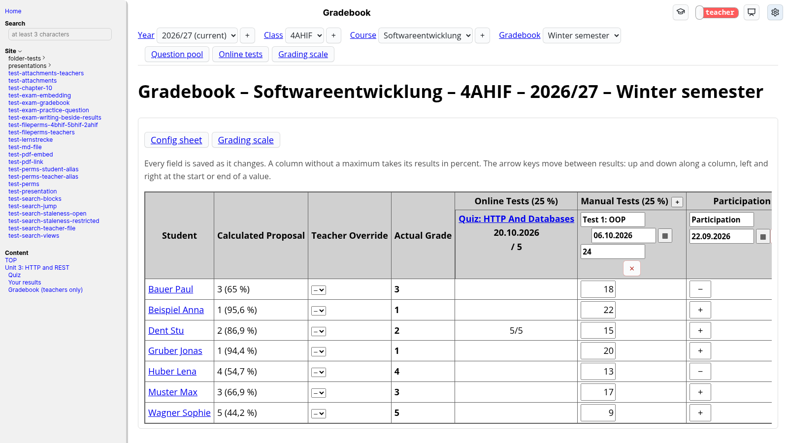
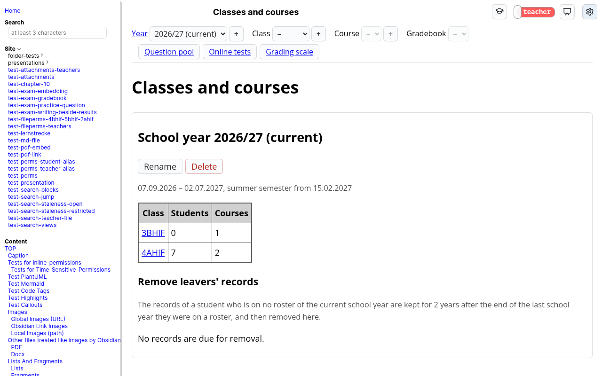
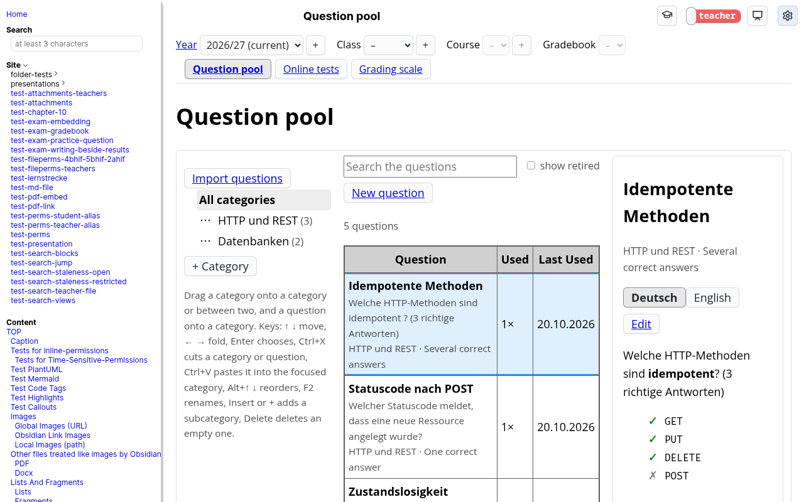
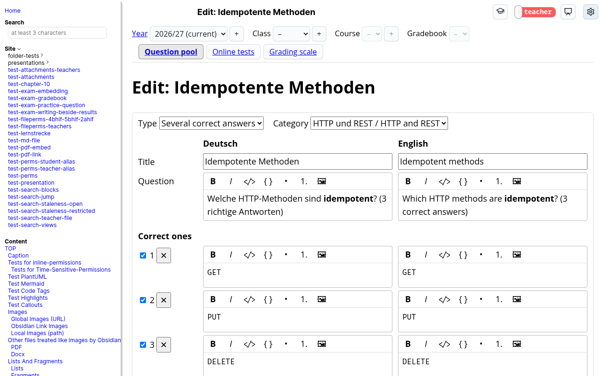
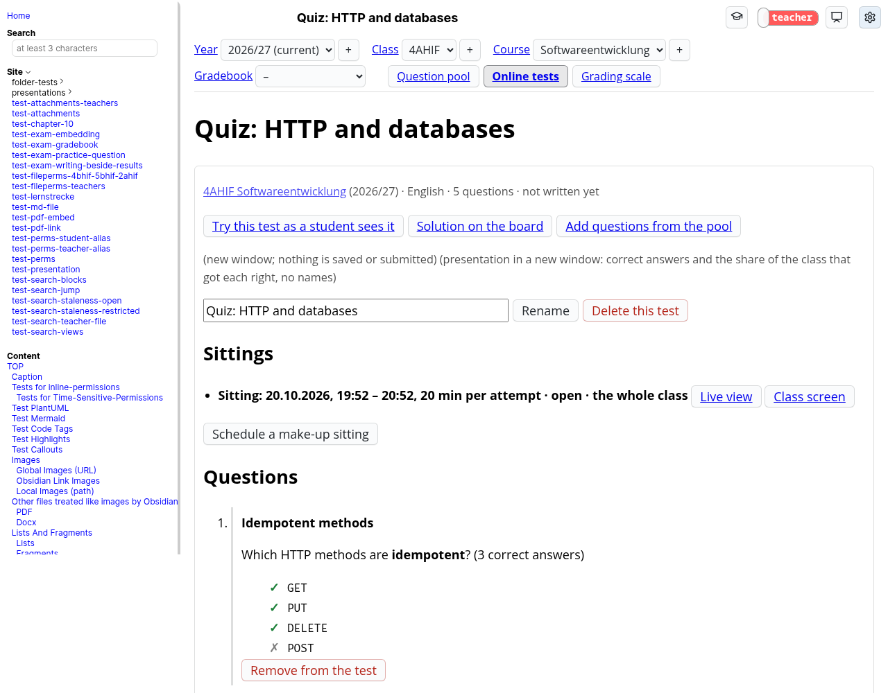
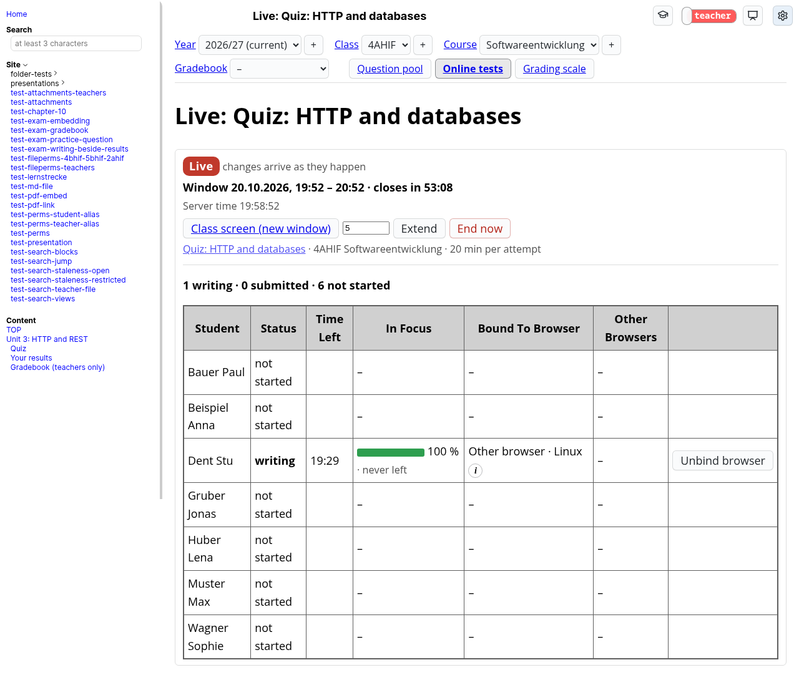
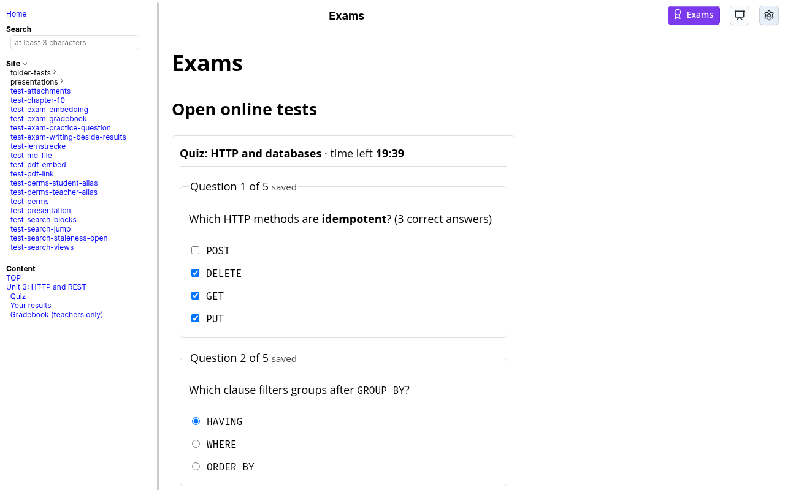
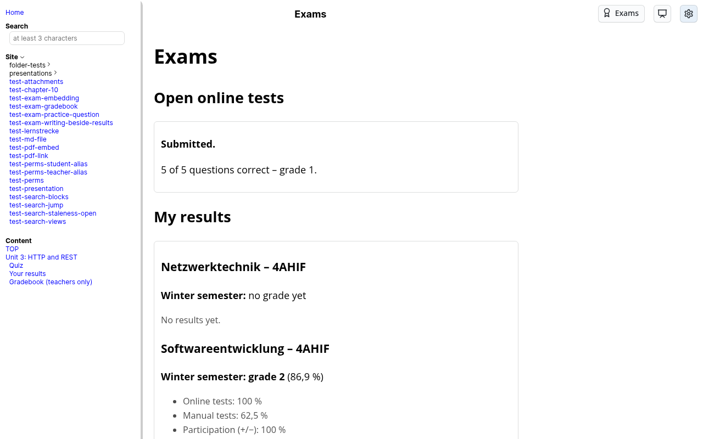
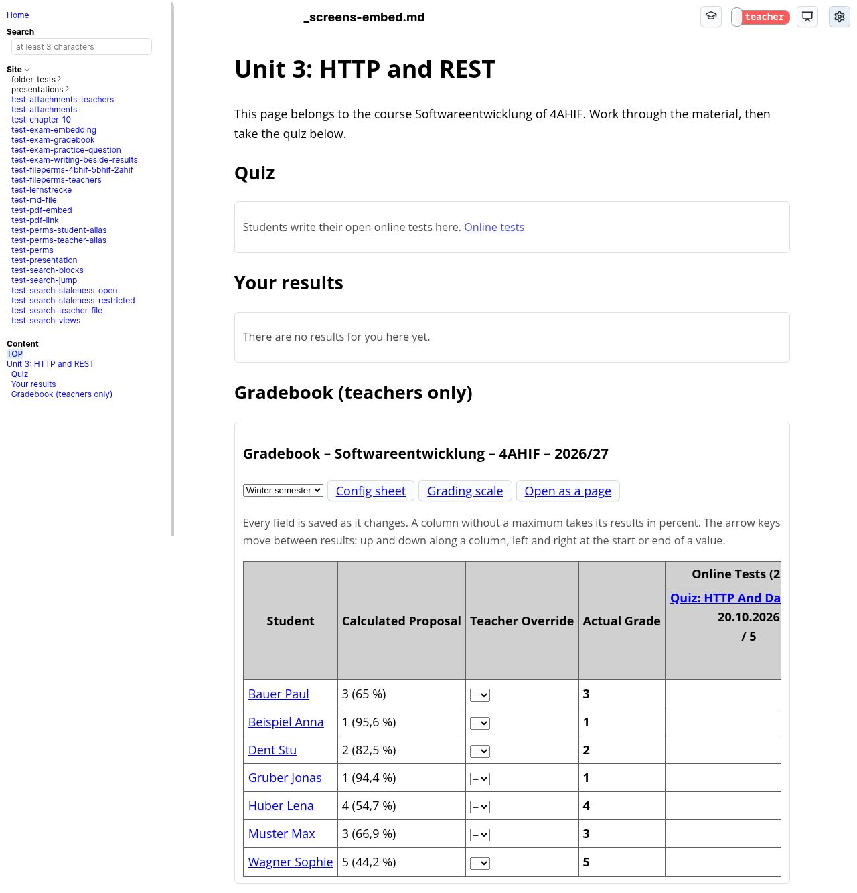
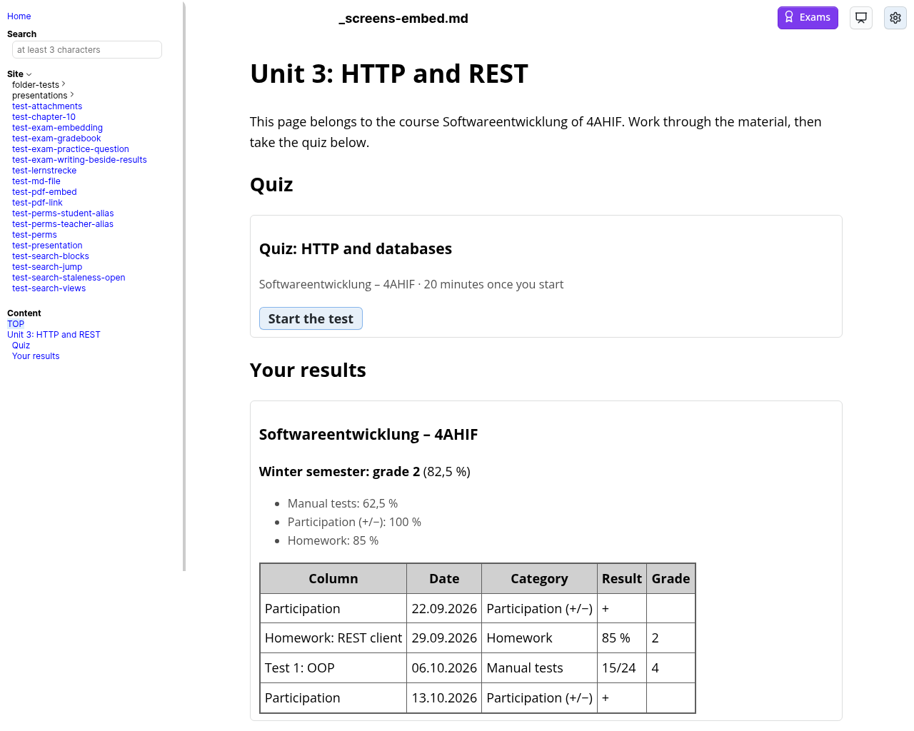

# Exam Module
Here you can find how the exam module is switched on, where it keeps its data, how that data is backed up, and how a page places one of its elements.

[Back](README.md) to the main page.

The module is what makes an instance [tier 3](docs-installation.md#tier-3--database): it needs a login through Keycloak (tier 2) and a data directory. It consists of its foundation (the switch, the database, backups, the teacher/student gate, the embedding syntax), classes and courses at `/exam/`, the change of school year, the gradebook, the question pool with its editor, online tests and the board solution.



## The Switch
The module exists only when the instance's environment says `EXAM_MODULE=on`. Any other value, or none, and the instance is exactly the one it was before the module: its code is not loaded, no database file is opened or created, nothing answers under `/exam/`, and no page links to it.

| Deployment | Module |
| --- | --- |
| Production (`deploy/docker-compose.yml`) | Off until a deployment sets it (secureLectures has it on since 2026-10-17). The compose file passes `EXAM_MODULE` through to the container, and the pipeline fills it from the repository variable `EXAM_MODULE` (Settings → Secrets and variables → Actions → Variables). |
| WYSIWYG container | Always off. Its templates set no `EXAM_MODULE` and mount no data volume, and `test/deployment-config.test.js` keeps it that way. |
| Local `npm start` | Off unless your `.env` says `EXAM_MODULE=on`. |

The start-up log says which it is:

```
Exam module: disabled (EXAM_MODULE is not "on").
Exam module: active, database data/exam.sqlite
Exam module: disabled - the database data/exam.sqlite could not be opened: ...
```

**A module that cannot start never stops the reader.** If the database cannot be opened, the data directory is read-only, a migration fails, the database was written by a newer image, or `SCHOOL_PERIODS` or `EXAM_RETENTION_YEARS` is malformed, the log says why and the instance runs without the module. A request under `/exam/` that fails is answered with a `500` on its own; every other page and session carries on.

Everything under `/exam/` requires a login, exactly like the content. A teacher reaches it through the graduation-cap button in the top bar, which only a session acting as a teacher sees, and only on an instance with the module on. The module's pages use the whole width beside the sidebar rather than the reading column, so a gradebook fits on one screen. A teacher in student view is a student to the module as well: teacher pages and teacher-only elements disappear and teacher actions are refused, until the view is switched back.

## The School's Periods
Sittings can be scheduled and read by the school's teaching periods instead of clock times. The periods come from the deployment, in the environment variable `SCHOOL_PERIODS`, and apply to every class and every day of the instance:

```
SCHOOL_PERIODS=0=07:05-07:55,1=08:00-08:50,2=08:55-09:45,3=10:00-10:50,4=10:55-11:45,5=11:50-12:40,6=12:45-13:35,7=13:40-14:30,8=14:35-15:25,9=15:30-16:20,10=16:25-17:15,11=17:20-18:05,12=18:05-18:50,13=19:00-19:45,14=19:45-20:30,15=20:40-21:25,16=21:25-22:10
```

That is the list secureLectures uses. Each entry is `<number>=<HH:MM>-<HH:MM>`: the period's number and its own start and end in Vienna time, so irregular breaks (11 and 12 back to back, 10 minutes before 13 and 15) are written as they are and nothing is derived from a cadence. Numbers are unique, every period ends after it starts, and in ascending order no period overlaps the one before it; a period may start the minute the previous one ends. Whitespace around an entry is ignored.

| `SCHOOL_PERIODS` | Effect |
| --- | --- |
| Unset or empty | Sittings are scheduled with the clock-time fields - one **Date** and the times it **Opens** and **Closes**, since a sitting never runs across midnight - and every window is shown in clock times. |
| A valid list | The sitting form asks for a **date**, a **from lesson** and a **to lesson** (the UI calls a period a lesson); the window opens at the start of the from period and closes at the end of the to period. A new sitting proposes today and the period running now, or the next one; after the last period of the day, the next day's period 1. **Exact times instead** switches the form to the clock-time fields (the same date, and the times it opens and closes) and back. A window that lies on period boundaries is shown as `Di 20.10. · lessons 3–4` in the list of tests, the sittings of a test, the live view and the class screen, with its clock times (`10:00–11:45`) as the tooltip; any other window - an older one, one off the periods - keeps its clock times and opens the form in clock times. |
| Malformed | The module stays off for that run and the log names the entry, e.g. `Exam module: disabled - SCHOOL_PERIODS: the entry "1=8-9" is not of the form <number>=<HH:MM>-<HH:MM>, e.g. 1=08:00-08:50.` The reader keeps serving. |

A sitting is stored as two instants either way, so the database, the API and every rule for sittings are the same with and without periods. Changing the list later only changes how windows are read: a sitting that no longer lies on the new periods is shown in clock times, which is when it was held. The gradebook keeps a plain date.

| Deployment | Periods |
| --- | --- |
| Production (`deploy/docker-compose.yml`) | The compose file passes `SCHOOL_PERIODS` through to the container, and the pipeline fills it from the repository variable `SCHOOL_PERIODS`, next to `EXAM_MODULE`. |
| WYSIWYG container | None; it runs without the module. |
| Local `npm start` | Whatever your `.env` says; the harness sets none unless a check restarts with them. |

## Language And Formats

Every page, bar, button and message of the module follows the reader's interface language, and every date, time and number the reader's format (settings menu; see [Interface language and formats](docs-development.md#interface-language-and-formats)). Students' exam content is the exception: questions, answers and explanations in the writing view and the results come in the **course's** language, wrapped in an element with that `lang`, while the controls around them follow the student's own. Refusals of the API are answered in the reader's language too; the English text stays in the log. Dates are entered with the module's own `<sl-date-input>`, which shows `20.10.2026` or `20/10/2026` whatever the operating system is set to.

## The Data
All state lives in one SQLite file, `data/exam.sqlite` relative to the working directory — `/app/data` in the image, the volume `deploy/docker-compose.yml` already mounts from `${DATA_DIR}` for the directory cache. It is opened with `node:sqlite`, which the image's Node 24 ships, so the module adds no dependency.

- **Migrations** are the numbered files in `exam/migrations/` (`001` to `010`, so schema version 10 today), applied in order at start-up, one transaction each. `PRAGMA user_version` records the last one applied. A migration that fails is rolled back on its own and leaves the database at the last version that applied completely; the module is disabled for that run.
- **A downgrade** — an older image on a newer database — is refused: the module is disabled, the file is left untouched, and the log names both versions.
- **People are recorded by their directory username** (the Keycloak `username`, lowercased), never by the Keycloak user id, which changes when an account is deleted and re-imported.
- **Nothing in the data directory is served over HTTP**, by any path, with or without a session.

`EXAM_DB_PATH` overrides the location. It exists for the verification harness, which gives every run a database of its own; a deployment does not set it.

## Backups
The module writes consistent copies with `VACUUM INTO` into `exam-backups/` beside the database. Each copy opens as a database on its own.

| Copy | When | Kept |
| --- | --- | --- |
| `exam-pre-v<N>-<time>.sqlite` | Before the first pending migration away from version `N` | 90 days |
| `exam-daily-<time>.sqlite` | At start-up if the newest is a day old or missing, then once a day | The newest 14 |

They sit beside the database on purpose: a restore finds them right where it needs them. `VACUUM INTO` only reads the database, so taking a copy cannot damage it.

Getting the copies off the host is the operator's job, with whatever that host already backs up with. **Back up `exam-backups/`, not the live `exam.sqlite`:** a file-level backup can catch the database in the middle of a write, with part of it still in the `exam.sqlite-wal` file beside it, while every copy in `exam-backups/` is complete. A backup of the copies holds grades of minors, so wherever it goes, it has to be a place that may hold them.

**Restoring** means stopping the container, replacing `exam.sqlite` with a copy (and deleting `exam.sqlite-wal` and `exam.sqlite-shm` beside it), and starting again. A copy from an older schema version is migrated forward on start, as any older database is.

**Rolling back** the module itself means unsetting `EXAM_MODULE` and redeploying. The data stays in `exam.sqlite`, untouched, and switching the module back on resumes where it was.

**Rolling back to an older image** is different once a newer image has migrated the database: the older image refuses a database at a schema version it does not know, and the module stays disabled. Every migration is such a step - schema 4 (the gradebook as a sheet, from `exam-navigation-and-grid`), for example. Going back takes the previous image *and* the copy `exam-pre-v<N>-<time>.sqlite` that was written just before the migration, `N` being the version the previous image knows (behind schema 4, `exam-pre-v3-<time>.sqlite`), restored as described above. Whatever was recorded after the migration is not in that copy.

## The Module Bar


Every teacher page of the module carries a bar directly under the instance's top bar. From left to right it holds **Year** (the school year), **Class**, **Course** and **Gradebook** (the course's gradebook, winter semester or whole year). Each is a dropdown whose choices are what exists under the positions to its left. Choosing a value opens that page, and positions to its right are left empty until you choose them. With nothing chosen, the bar shows the current school year. Each position's name links to its overview: the year to its classes, the class to its roster and courses, the course to its config sheet, the gradebook to the course's sheet.

New records are created from the bar too, left to right, with the `+` beside a position: a new school year at any time, a new class once a year is chosen, a new course once a class is chosen. The same rules as before apply (a class or course that exists already is refused), and the new record is chosen in the bar afterwards.

At its right end the bar has three buttons, **Question pool**, **Online tests** and **Grading scale**, each marked while its page is shown. They keep what is chosen in the bar: the pool opened from the gradebook of `WMC 4BHIF` still has that course chosen, which is the course a test assembled there is for. Online tests opens the chosen course's tests, or - with no course chosen - the tests of every course of the chosen school year, grouped by class and course. The button of the page being shown is marked, and on these two pages a choice in the bar stays on the page, for what is now chosen.

The bar comes with the page itself, so it costs no request of its own. A student's Exams page (`/exam/my`) and elements placed in a content page have no bar. A student, or a teacher in student view, never gets one, because no teacher page is shown to them.

## Classes And Courses
Teachers manage these at `/exam/`. Everything here belongs to teachers. A student, or a teacher in student view, finds no page there, and every request is refused.

- **School years** are named like `2026/27`. Each has a start date, the first day of the summer semester and an end date. The first year created becomes the current one. A later year can be created in advance and made current when it starts, and exactly one year is current at a time. Once a year is over it is closed, its classes are moved up into the next one, and the records of students who have left are removed after the retention period - see [The Year Change](#the-year-change).
- **A class** belongs to one school year and is named like `5AHIF`. When you create it, the module lists every member of the class's directory unit as a checklist, and nobody is ticked. On an LDAP realm that unit is the class's OU; on a realm that grants classes as client roles, it is that role. Only the people you tick form the roster. This is what keeps former students out of a 5th-year class whose OU still holds them. Teachers are never offered and can never be added.
- **The roster** changes only when a teacher changes it. A student who joins the directory unit later is listed under "Add students" but is not added on their own. You can also add someone from the whole directory, or by username when the directory is not available on the instance or is still loading. Removing a student keeps their entry, marked as left, so what is recorded for them stays theirs. "Refresh names" updates names from the directory and never changes who is on the roster.
- **A course** is a class, a subject and the class's school year, and exists once per class however the subject is capitalized. It has no owner, so every teacher sees and edits every course. Its language (German or English) decides how its tests are presented. Its config sheet weighs the gradebook's four categories (online tests, manual tests, participation, homework) in whole percentages that add up to 100. A new course starts at 25 % each. The config sheet also holds the winter semester's share of the year grade (see below), 50 % to begin with.
- **Renaming and deleting.** A school year (in its heading on `/exam/`), a class (in the head of its page) and a course (in the head of its config sheet) each have **Rename**, an inline field with Save and Cancel, and **Delete**, confirmed by a second click. A year can be deleted while it is not the current one and has no classes; a class while it has no courses, and its roster goes with it; a course while it has no gradebook column (an empty one counts), result, semester grade or online test. A refusal names what is in the way, by count, at the button. Renaming a class changes only the module's record, meant for a typo: the roster proposals look the directory up by the new name, so a name the directory does not know proposes nobody.
- **The module's tables** share a few conventions. A click on a row marks it, and marking another unmarks the first, so the eye can follow one row across a wide table. A table wider than the screen scrolls sideways inside its own frame, with its first column (the gradebook: its first four) staying in place. A field that stands on its own is saved as soon as it changes - there is no "Save" button - and shows while it is saving, that it was saved, or, outlined in red with the reason on hover, that it was refused. The config sheet's weights are saved together, and only while they add up to 100 %; until then the sum says how far off they are. Every page with such fields says near its top that they are saved as they change. Actions are buttons - the page's main one marked as primary - and links lead only to something to read. Anything that deletes or takes back asks by a second click on the same button, whose label then says what that click does; the button disarms when the focus leaves it, on Escape, or after 5 seconds. Never a browser dialog.

## The Year Change
Everything the module records belongs to one school year. Changing to the next one is three steps, each on a year's overview at `/exam/` and each asked by a second click.

1. **Start the next year from the old one.** Create the new year (bar → new school year) and open its overview. Under *From 2026/27* it offers every class of the year before one level up: `3AHIF` becomes `4AHIF`, while a fifth-year class - or any class whose name does not start with a digit from 1 to 4 - has no successor and is listed as such. For each class you see last year's roster, everyone ticked except those who left during the year, and beside it the directory's current members of the new class, unticked. Untick whoever is not moving up, tick whoever joins, choose the courses to copy, and press **Create 4AHIF**. Only the ticked people are put on the roster; teachers are never offered. A copied course has the old one's subject, language, weights and winter share, and no column, result or test. The class and its courses are created together or not at all. A class that exists already in the new year is listed as done, with a link. Without the directory (not configured, or still loading), last year's roster is offered alone, as in the roster editor.
2. **Close the old year** once its end date has passed and the new year is current (make it current first, in its heading). The old year's overview then shows **Close school year**. A closed year stays readable to its teachers and to the students it holds records of, and nothing in it can be changed any more, not even by the teacher who closed it: its classes, rosters, courses, gradebook columns, results, overrides, tests, sittings and attempts are refused with *This school year is closed*, whatever page or request tries. Its pages show every control disabled and a note that the year is closed. A closed year cannot be reopened, renamed, re-dated or deleted; a restore from the backup of the day before is the only way back. The database itself enforces this (triggers on every table that belongs to a year), so a route added later cannot forget it.
3. **Remove leavers' records.** A student who is on no roster of the current year has left. Their records are kept for the retention period after the end of the last school year they were on a roster, and then removed here: the current year's overview reports how many students are due and how many results, overrides and comments, online-test attempts, sitting participations and roster entries would be deleted - counts only, never names - and **Remove leavers' records** deletes exactly those. If the counts changed meanwhile (someone edited a roster), the removal is refused and the new report shown. Someone who was never on any roster is due at once. Courses, columns, tests and sittings stay; a column or a test simply has one result fewer. The log records the counts, never who. The deletion cannot be undone; the daily backups still hold the records until they age out after 14 days, and a pre-migration copy taken before it for 90 days (see [Backups](#backups)).

The retention period comes from the deployment:

| `EXAM_RETENTION_YEARS` | Effect |
| --- | --- |
| Unset or empty | Two years: a student who left after 2026/27 (ending 2027-07-02) is due from 2029-07-03. |
| A whole number from 1 to 10 | That many years. |
| Anything else (`two`, `0`, `2.5`) | The module stays off for that run and the log names the variable, e.g. `Exam module: disabled - EXAM_RETENTION_YEARS: "two" is not a whole number of years from 1 to 10.` The reader keeps serving. |

Production passes it through `deploy/docker-compose.yml`, filled by the pipeline from the repository variable `EXAM_RETENTION_YEARS` next to `SCHOOL_PERIODS`; secureLectures leaves it unset. The WYSIWYG container runs without the module and does not set it.

## The Gradebook
Each course has a gradebook, reached from the course's and the class's page (`/exam/courses/<id>/gradebook`). Like classes and courses it belongs to teachers, with one exception: every student sees their own results.

- **The gradebook is a sheet**: one row per student, one column per assessment. Each column belongs to a category - manual tests, participation or homework - and has a name, a date and, for a test or a homework, optionally a maximum. The column's date decides the semester of every result in it. The categories stand as headings over their columns, in the config sheet's order, and within a category the newest column is furthest right.
- **Adding a column** is the `+` in its category's heading, which asks for the name, the date and, where the category has one, the maximum. A column without a name is named by its date. Online tests have no `+`: their columns are the tests themselves (see Online Tests below), shown as text - points out of the number of questions - and never typed into or deleted here; the arrow keys pass over them. A column's name, date and maximum are edited in its header. A new maximum recomputes every result in the column from its points, and is refused while a result has more points than the new maximum. A column holding results keeps counting in points or in percent. Deleting a column (×) deletes its results, after asking when it has any.
- **Every result is a fraction** from 0 to 1, and a student has at most one per column. In a column with a maximum you type the points (`17` of `24`, kept and shown as `17/24`), in one without a percentage; a participation mark is `+` (1) or `−` (0), typed as `+` or `-`. **A field is saved as soon as it changes**, when you leave it or press Enter; emptying it removes the result. A value the module refuses (more points than the maximum, a mark other than `+` or `−`) stays in the field, outlined in red with the reason, and the stored result stays as it was. The row's proposal and grade follow each saved field at once. A field still saving when you leave the page makes the browser ask first.
- **The arrow keys** move between results as in a spreadsheet. Down and up go to the same column of the next or previous student, so a test or a round of `+`/`−` is entered down the list. Right and left go to the next or previous column of the same student - across category headings too - while the cursor stands at the end or the start of the value, so inside a value they still move the cursor. A field you arrive at has its value selected, and typing replaces it. Moving saves the field you leave; the arrows never change a value. Tab and Shift+Tab move along the row.
- **The sheet keeps the student and the grade in view**: the name, the proposal, the override and the grade stay on the left while the columns scroll sideways inside the sheet. The override is a field of the row like any other, saved as it changes.
- **What the student sees of a result** is the column's name and date beside it. A remark about one student's result belongs in the semester comment. Results recorded before the sheet existed (schema 3) were placed into columns by the migration to schema 4: one column per course, kind, date, maximum and note, named by the note or by the kind and date, with every result and proposal unchanged.
- **The proposal** for a semester is computed whenever it is shown, never stored. Each category (online tests, manual tests, participation, homework) is the mean of that semester's results in it; the proposal is the mean of the categories weighted by the course's config sheet, and the grading scale turns it into a grade. A category without results is left out and the other weights are scaled up, so a course without online tests yet grades by the other three.
- **The year grade** - the summer semester's proposal - is the winter semester's result times its share plus the summer semester's own result times the rest. The share is set per course on the config sheet, in whole percent (50 % to begin with). The summer semester's own result counts summer results only, exactly as the winter semester counts its own. While the winter semester has no override, its proposal counts; once it has one, it counts as the middle of that grade's range on the scale (with the initial scale 94 % for a 1, 81.5 % for a 2, 69 % for a 3, 56.5 % for a 4, 25 % for a 5). A semester without results leaves the year to the other. The year view of the sheet shows the winter grade (marked when overridden) beside the year proposal, followed by the summer's columns only.
- **The grading scale** is one for all courses, at `/exam/scale`: from 88 % a 1, from 75 % a 2, from 63 % a 3, from 50 % a 4, below a 5, to begin with. A result exactly on a threshold gets the better grade. A change applies to every proposal at once. The scale is saved as it changes, its four thresholds together and only while each lies above 0 and at most 100 with at most one decimal, below the one of the grade before it; until then the line under the scale says why it is not saved.
- **An override** replaces the proposal for one student's semester, with an optional comment. Teachers keep seeing the proposal beside it; removing the override makes the proposal the grade again. The comment reaches the student only when "The student sees the comment" is ticked.
- **Students who left the roster** stand below the sheet, read-only, with what was recorded for them. A student's own page in a course (`/exam/courses/<id>/students/<username>`, from their name in the sheet) shows each semester's categories, proposal and grade, the override and the comment - saved as they change - and their results by column, read-only. At its top it leads back to the sheet and to the students before and after in the sheet's order, keeping the semester.
- **A student's own results** are on the Exams page (`/exam/my`), below the open tests, or wherever a page places a `safelearn-results` block: per course their results with each column's name and date, the category fractions and the grade. While no override exists that is the proposal; once one does, the student sees the override and no longer the proposal. The year grade appears once the summer semester has begun. No request can name another student: the route answers about the session's own identity only.

## The Question Pool


All teachers share one pool of multiple-choice questions, browsed at `/exam/pool` (the bar's **Question pool** button). Like everything else here it belongs to teachers: a student, or a teacher in student view, finds no page there, and the API and the images refuse them.

- **A question** has a type - several correct answers, exactly one correct answer, or true/false - its text and each answer in German and in English, a correct flag per answer, a category, and the images it embeds. Every question is worth one point and is graded all-or-nothing, so the hint in the text saying how many answers are correct ("(2 richtige Antworten)") matters and is kept.
- **The browser** has three columns: the category tree with the number of questions in each on the left; in the middle a search over names, texts and answers in both languages and the matching questions - each with its category, type, and how often and when it was last used - in a list that scrolls on its own; and on the right the question clicked last, in German or English with the correct answers marked and every test it was used in, with the course and the date. The tree and the question on the right stay in view while the list scrolls, and so does the clicked question's row. On a narrow screen the columns stack. Retired questions are left out unless **show retired** is ticked; then they are listed, greyed and marked.
- **Images** are stored in the database, not as files, so the daily backup covers them, and are served only by the module (`/exam/api/images/<id>`): to teachers, and to a student while they have an open attempt at a test showing the image. They are never cached. An image a test shows cannot be deleted from the pool.
- **With a course chosen in the bar**, a click anywhere on a question's row chooses it for a test, and a second click unchooses it; chosen rows are coloured green, and the row clicked last keeps its blue edge and its preview. The chosen questions become a test of that course: give it a name and use **Create test**, or add them to one of the course's tests nobody has written yet. Without a course chosen, a click only shows the preview.
- **The database is the pool's only source.** It was filled once from the Moodle export, and from then on the module's question editor and the Markdown import (both below) change it. There is no re-import from Moodle and no export, and an import only adds questions.

### The Question Editor


Teachers fix and add questions online. **Edit** on a question's preview opens the editor (`/exam/pool/questions/<id>`). **New question**, always beside the search, creates one in the chosen category (`/exam/pool/questions/new?category=<id>`), or, with none chosen, opens the editor with an empty category choice that has to be made before saving; **New question** in a category's ⋯ menu in the tree creates one there. Saving or leaving the editor returns to the browser with the question's category chosen.

- **Both languages side by side**, one row per field: the title, the question text, and each answer as a pair of a German and an English text with one correct flag for both. Answers are added and removed; there is no order to set, since every attempt shuffles them. Type and category are chosen above; a new category there moves the question to the end of it. A true/false question has no answer texts: it only says whether the statement is true, and its answers are always Richtig/Falsch and True/False.
- **Formatted text without markup.** Texts are edited in a small field with bold, italic, inline code, code block, bulleted and numbered list, and image. Text pasted from a web page or a document keeps its words, paragraphs, lists, bold, italic and code, and loses everything else. The server cleans every save with the renderer's sanitizer, as the import did: no inline style, no script, no image from outside the module.
- **Checked before anything is stored.** Every title and text in both languages, every answer's text in both languages, at least two answers, and correct flags that fit the type (exactly one for one correct answer, at least one for several). A refused save lists every problem and marks its field; nothing is stored.
- **Images** come from the image button, or are pasted or dropped into a text. Only PNG, JPEG, GIF and WebP up to **2 MB** are accepted, recognized by their content and not by their name. An image is uploaded at once and becomes the question's on save; one never saved is deleted after a day. An image a test shows stays served to that test even after the text no longer uses it; one no test shows is deleted with the save that drops it.
- **Two teachers at once.** A save is refused if the question was saved by somebody else since the editor opened it. The input stays in the editor, and the current version opens in a new tab.
- **Tests keep their version.** Saving changes the pool only: every test keeps the questions it was assembled with, written or not. After a save, the editor lists the tests not yet written that hold the question, each with **Update this test**, which brings it to the saved version with the same questions in the same order. A test written meanwhile is refused.
- **Retire versus delete.** A question that was never part of a test can be deleted, with its answers and images. A used one cannot: **Retire** hides it from the browser and from new tests and keeps its tests and its usage history; **Revive** brings it back. Any teacher may do either to any question.
- **Categories** are maintained in the browser's own tree. Each category has one **⋯** button at the start of its row, before its name, so a long name or a deep path never pushes it out of view. It opens a small menu: **New question**, **New subcategory…**, **Rename…** and, only for a category that holds no question - retired ones included - and no subcategory, **Delete**, which deletes on a second click. The menu opens from the button by Enter, Space or ↓ as well, moves by ↑/↓, and closes with Escape, Tab or a click outside it. New subcategory opens a small popup for the German and English name, and **+ Category** at the end of the tree one for a new top-level category; a double click on a name or Rename renames in the same popup (Enter saves, Escape cancels, a refusal stays in the popup). A category dragged onto another becomes its last subcategory; dragged between two, it stands there, shown by a line. A question row dragged from the list onto a category moves the question there; an editor open on it then refuses to save over the move. On a tablet a drag starts after a press of 300 ms, so a swipe still scrolls. Never under itself or below, and two categories under the same parent cannot share a German name; a refusal is shown at the category. Everything also works by keyboard, as listed under the tree: ↑/↓ move, ←/→ fold and unfold, Ctrl+X cuts the focused category or question row and Ctrl+V on a category puts it in there, Alt+↑/Alt+↓ move a category among its siblings, F2 renames, Insert or `+` adds a subcategory, Delete arms Delete in the category's menu and a second Delete deletes. The former page `/exam/pool/categories` redirects to `/exam/pool`.

### Importing Questions
Teachers add batches of new questions from a Markdown file, typically one Claude wrote: **Import questions** above the tree opens `/exam/pool/import`.

1. **Download the format description** there and give it to Claude together with the topic. It describes the format `safelearn-questions/1` (a category per `#` heading, a question per `##` heading with its English title and type, a `### de` and a `### en` section with the text and the answers as a task list, `- [x]` correct and `- [ ]` wrong), every rule the import checks, the pool's conventions, and the pool's categories as they are at download, so new questions are filed under existing ones. To ask for other conventions, edit the downloaded file before handing it on.
2. **Choose the file** Claude wrote, or drop it onto the field. It is checked before anything is stored: every rule of the editor, the same answers with the same marks in both languages, the hint with the number of correct answers at the end of every multiple-answer question's text in both languages ("(2 richtige Antworten)" / "(2 correct answers)", and "1" if a single-answer question carries one), no images and no HTML, at most **200 questions** and **1 MB**, and not exactly the same file as an earlier import. A file with any problem cannot be imported. Every problem is listed with its line and the question's title; **Copy problems** copies the list to hand back to Claude.
3. **A clean file shows a preview**: the questions per category and type, the categories that will be created, and questions whose German text equals one already in the pool (imported anyway, for you to check). **Import n questions** imports all of them in one step, or none. Questions go to the end of their categories; nothing in the pool or in any test changes. Images are not imported; add them in the editor afterwards.

**Imported questions are marked "not reviewed"**: an amber stripe and a badge in their rows, and above their preview where they came from, with **Mark as reviewed**, which moves on to the next one. Saving a question in the editor clears the mark as well. **Not reviewed (n)** beside **show retired** lists only them, and the browser opens that way after an import. They can be put into tests like any other; the test assembly says how many of the chosen questions are not reviewed yet.

**Past imports** are listed on the import page with date, teacher, file, questions and how many are still not reviewed. **Take back**, confirmed by a second click, deletes an import's questions and the categories it created that are empty afterwards, as long as none of its questions is in a test. A taken-back file can be imported again.

### The One-Time Import
The import reads the German original and the English translation of the Moodle export (`WMC - Fragenpool - thematisch.xml`, `WMC - Question Pool - by topic (EN).xml`). Moodle gives the questions no shared id, so the two files are paired by position, and every pair has to agree in type, number of answers, correct-answer pattern and category. If any pair disagrees, nothing is imported and every disagreeing position is listed. `essay` questions are dropped and counted. Text is sanitized with the renderer's own sanitizer, without Moodle's inline styles; images embedded as `@@PLUGINFILE@@` files or inline data are moved into the database. A second import is refused and changes nothing.

It runs by hand, inside the container, after the module is switched on:

```bash
docker cp "WMC - Fragenpool - thematisch.xml" <container>:/tmp/de.xml
docker cp "WMC - Question Pool - by topic (EN).xml" <container>:/tmp/en.xml
docker exec <container> node exam/import-moodle-pool.mjs /tmp/de.xml /tmp/en.xml --dry-run
docker exec <container> node exam/import-moodle-pool.mjs /tmp/de.xml /tmp/en.xml
```

`--dry-run` verifies and prints the report without touching the database; `--db <path>` names another database than the module's own. The report holds counts only. On the export as of 2026-10-16 it reads 94 questions in 22 categories (77 with several correct answers, 14 with one, 3 true/false), 9 essays dropped, and 7 images.

## Online Tests
| A test's page | The live view | A student writing | After submitting |
| --- | --- | --- | --- |
|  |  |  |  |

Short multiple-choice tests are assembled from the pool, written in safeLearn, and graded on the server. The list of a course's tests is behind the bar's **Online tests** button (`/exam/tests`); each test has a page of its own (`/exam/tests/<id>`). Everything about a test belongs to teachers, except writing it.

- **A test** is assembled in the question browser with a course chosen in the bar (see above). It copies every chosen question - both languages, the answers, the correct flags, the links to its images - so editing or retiring a pool question later changes no test and no grade. Its page shows the questions in the course's language with the correct answers marked. **Try this test as a student sees it**, on the test's page, opens the test in a new window exactly as a student gets it - shuffled, in the course's language, with the first sitting's countdown - but nothing is saved and submitting is switched off; no attempt is started and nothing reaches the gradebook. Only a teacher can open it. **Solution on the board**, also on the test's page, opens the solution as a presentation in a new window (`/exam/tests/<id>/solution`): a title slide, then one slide per question in the test's own order and the course's language, the correct answers marked and the share of the submitted attempts that answered the question correctly - no names, no individual answers; without a submitted attempt the share is left out. A student and a teacher in student view find nothing there. Until somebody has started writing it, a test can be renamed, have questions removed or added, and be deleted with its sittings; afterwards only its name can change.
- **A sitting** is when a test is written: a window (opens, closes) and the minutes an attempt takes, which have to be fewer than the window. With the school's periods configured, the window is chosen as a date and a range of periods (see [The School's Periods](#the-schools-periods)). The first sitting is written by the whole class, or by the students ticked. Every later one is a **make-up sitting**, planned behind the **Schedule a make-up sitting** button below the sittings: a later chance to write the test for students who missed the first one. Only the students ticked for it can write it, with the same minutes per attempt as the first sitting, and whoever has already submitted cannot write again. A sitting can be changed or deleted until it opens. One that is over can be **rescheduled**: the form proposes the next weekday with the same lessons - or the same clock times - and shows the minutes per attempt and the participants, which stay; students who have left the class since are dropped. Rescheduling deletes the sitting's attempts with their answers and results, and leaves make-up sittings as they are. A sitting nobody wrote any teacher can reschedule; one with attempts only an admin can, with a second click on **Save** that names how many attempts go - they can be brought back only from a backup (see [Backups](#backups)). The test's column in the gradebook is dated by the first sitting's start, which decides its semester - a make-up in the summer semester still counts in the winter semester if that is where the first sitting was.
- **Writing.** A student sees a test only while a sitting they take part in is open and they have not submitted it: on the Exams page `/exam/my` (the **Exams** button in the top bar of every page, left of the view switch, violet while a test is open for them; `/exam/my/tests` and `/exam/results` lead there too; the list follows a stream of its own, so a test appears the moment its sitting opens or is created, and goes when it closes or is deleted, without a reload) and wherever a page places a `safelearn-test` block. Starting it starts their one attempt at the test; it lasts the sitting's duration, but never beyond the window's end. Questions and answers come in an order shuffled for each student, in the course's language. Every change of an answer is saved at once, a countdown shows the time left by the server's clock, and a reload - or the browser closed and opened again - resumes the attempt with its answers and the time left. **Submit** asks once more. At the deadline the server submits whatever was saved, whether the page is open or not, and refuses anything later. While a test is written on the Exams page, its results are hidden; they come back with the new result as soon as the attempt is submitted.
- **Grading** is all-or-nothing per question: a question counts only if exactly the correct answers are chosen. After submitting, the student sees their points and grade - and neither which answers were right nor the questions again. A participant who never started has no result, not a zero.
- **Nothing to steal.** No answer the writing page receives says which answer is correct, or where it stood in the pool: the answers reach the browser as random tokens valid for one attempt only.
- **One browser per attempt.** An attempt is bound to the browser that started it, by a cookie that survives a restart of the server. The same account opening it in another browser is refused, and the teacher sees the refusal. If a laptop fails, the teacher clicks **Unbind browser** in the live view, and the next browser to open it continues with the saved answers and the time left.
- **Leaving the page** - another tab, another window - is counted and timed and shown to the teacher ("left 3×, 47 s"). It never changes the grade; what to make of it is the teacher's decision.
- **The live view** (`/exam/sittings/<id>/live`, linked from the test and the test list from the moment a sitting is scheduled, so it can be opened before the class starts, and still after it is over, to look back at each participant's final status and focus record) shows at the top whether the sitting is **Live**, not open yet or over, its window with the time until it opens or closes, and the server's time in your own time zone. While it is open, its head offers **End now**, confirmed by a second click, which closes the window and submits every running attempt with its saved answers, as at a deadline; and **Extend** by 5 to 120 minutes, which moves only the window's end - an attempt cut short by the window gains the time, the minutes per attempt stay. Below, every participant: not started, writing with the time left, or submitted; a bar with the share of their attempt so far they kept the page in focus - green above 98 %, yellow from 70 %, red below - with how often and how long they left it, in seconds below a minute and in minutes and seconds from then on (`left 3×, 4 min 12 s`); the browser the attempt is bound to, shortened to browser, version and system (`Firefox 131 · Windows`), with the full browser string on mouse-over and behind the small **i** beside it for a tablet - "waiting for the next browser" after an unbind, and "unknown" for an attempt bound before browser strings were recorded; refused browsers with the browser refused last; and **Unbind browser**, which takes effect on one click. The browser strings are shown to teachers only, never on the class screen or to a student, and go with their attempt. It updates as things happen, over a stream of its own that only a teacher's session can open and that ends when the session switches to the student view. If the stream cannot be kept open, the view fetches the state every 5 seconds instead.
- **The class screen** (`/exam/sittings/<id>/screen`, the link *class screen* in the online tests' list and on the test's page, and *Class screen* on the live view, each opening a new window and offered only until the sitting is over) is for the projector: no navigation and no list of names, only the test, whether the sitting is live, the time until it opens or closes in large figures, its window, the server's time, and how many are writing, have submitted and have not started. It fetches the state every 5 seconds rather than holding a stream, so its counts follow a start or a submission within seconds however long it stays open; if a fetch fails it says it is waiting for the connection and goes on, and if the session has ended it reloads into the login like every module page. It is opened from your own session, so only a teacher can show it.
- **An admin's corrections.** What students have written stays as it is for a teacher. A teacher who is also an **admin** (the Keycloak role `admin`, not in student view) can take it back, each with a second click on the same button: on a written test's page, **Remove from the test** takes a question out of the test and out of every attempt, and every submitted attempt is scored again over the questions left, so the gradebook and the students' results follow (the last question cannot go); **Delete this test** deletes it with its sittings and every attempt, and its column leaves the gradebook. In the live view, **Delete attempt** deletes one student's attempt with its answers; the student counts as not started and can write the test again while a sitting of theirs is open. None of this can be undone except from a backup (see [Backups](#backups)).
- **In the gradebook** every test with a sitting is a column of the online-test category, named by the test and dated by its first sitting. A course without online tests computes exactly as before. A result is changed only by the test itself; a teacher who disagrees overrides the semester grade.

## Placing An Element In A Page
| A teacher's view: a note for the test, the gradebook in place | A student's view: the test to start and their own results |
| --- | --- |
|  |  |

A page places an element with a fenced block whose info string is `safelearn-<kind>`, with the element's parameters as `key: value` lines:

````
```safelearn-test
test: 12
```
````

The kinds are `test`, `results`, `gradebook` and `live`.

| Kind | Parameters | Shows |
| --- | --- | --- |
| `test` | `test` (its id, as in the address of the test's page), or none | For a student, that test while it is open for them - or, without a parameter, every test open for them right now, across their courses, so one page serves every class. Starting, writing, submitting and the result happen in place. A teacher sees a note |
| `live` | `sitting` (its id, as in the address of its live view) | The live view of that sitting. Teacher-only |
| `results` | `subject` (optional) | The reader's own results, in the current school year, for that subject or for all their courses |
| `gradebook` | `class` and `subject`, optionally `year` (like `2026/27`, the current year otherwise); or `course` (its id) | A course's sheet for teachers, with its own semester choice since a content page has no module bar. Teacher-only |

A block naming a course by class and subject keeps working from one school year to the next: next year it shows next year's course of that name.

````
```safelearn-gradebook
class: 4BHIF
subject: WMC
```
````

- **The block goes through the permission filter like any other content.** One inside `@@@ teacher` is gone for a student before it is ever looked at. That is presentation, not protection: every request an element makes is decided by the module on the server again.
- **Teacher-only kinds** (`gradebook`, `live`) render nothing for a session that does not act as a teacher, wherever they sit.
- **With the module off**, a block renders to a short notice for teachers — "only available on an instance with the exam database" — and to nothing for everyone else. The notice carries no data and makes no request. This is what the WYSIWYG container shows.
- **With the module on**, a block renders to a placeholder, and the module's script (`/exam/assets/exam-client.js`, loaded only by pages that carry one) mounts the element into it. The page is server-rendered and revealed as always; the element shows its own loading and error state.
- **The presentation and document views** render every block as they would with the module off.
- **A block of an unknown kind** renders nothing. A block written inside a longer fence — an example of the syntax, like the one above — stays text.

In Obsidian, the blocks show as ordinary code blocks.
