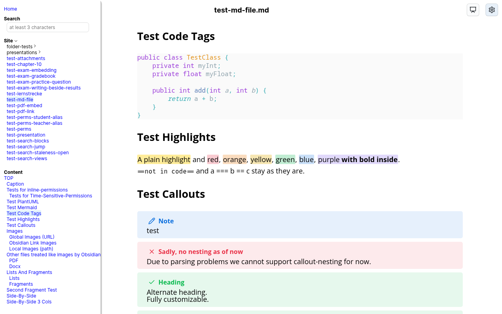
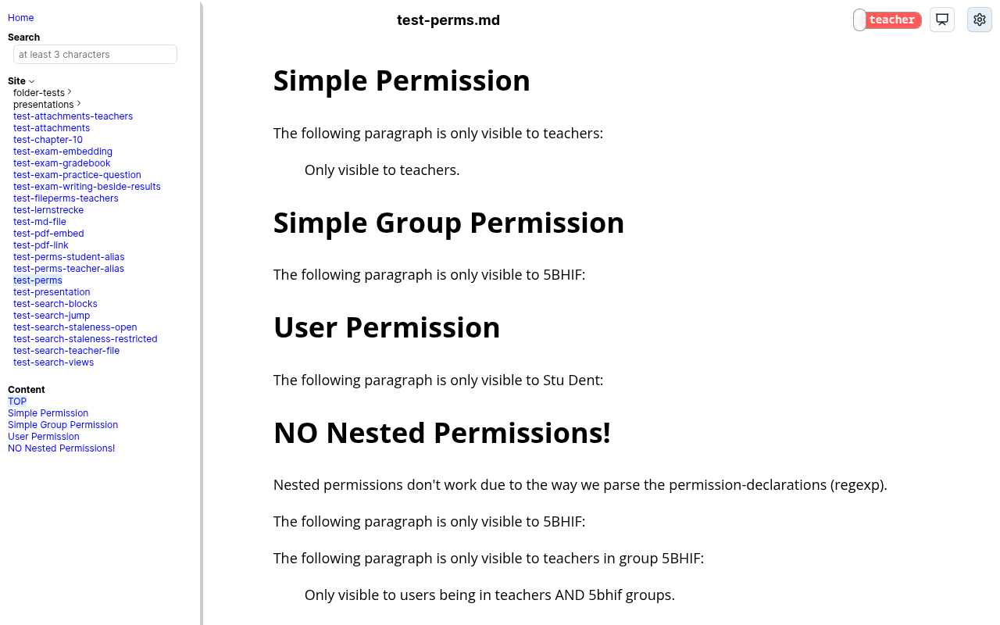
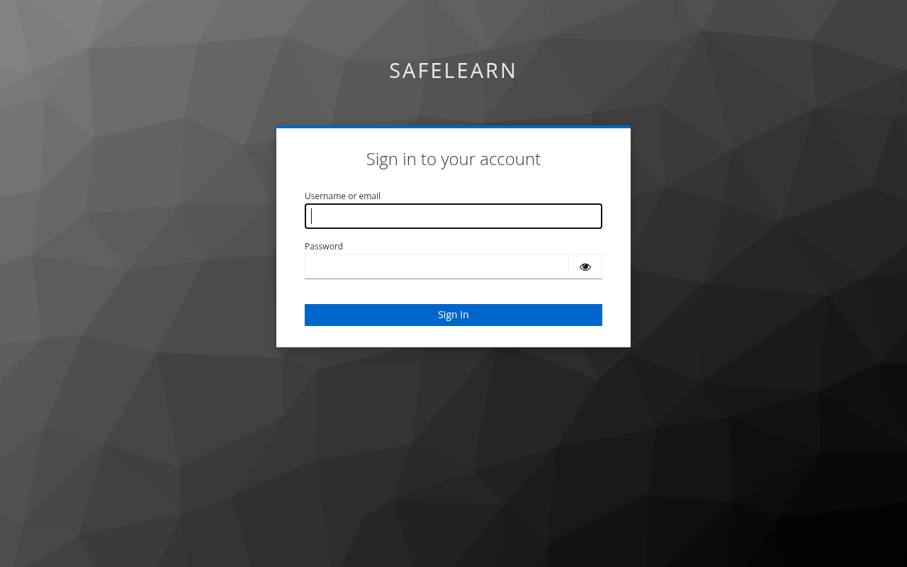
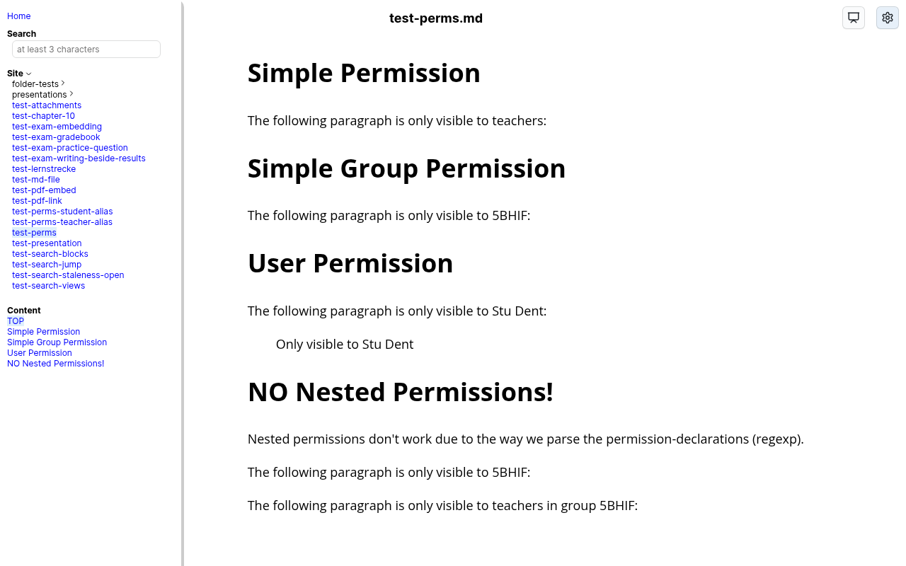
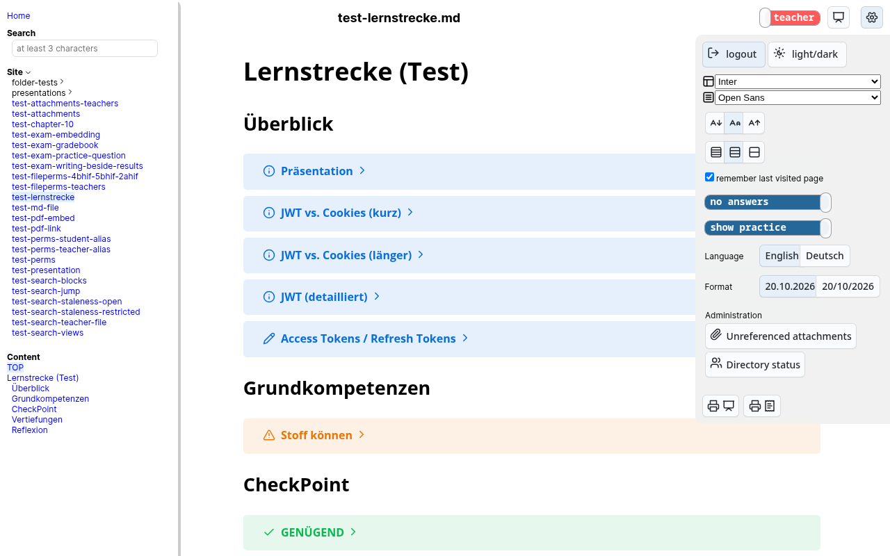
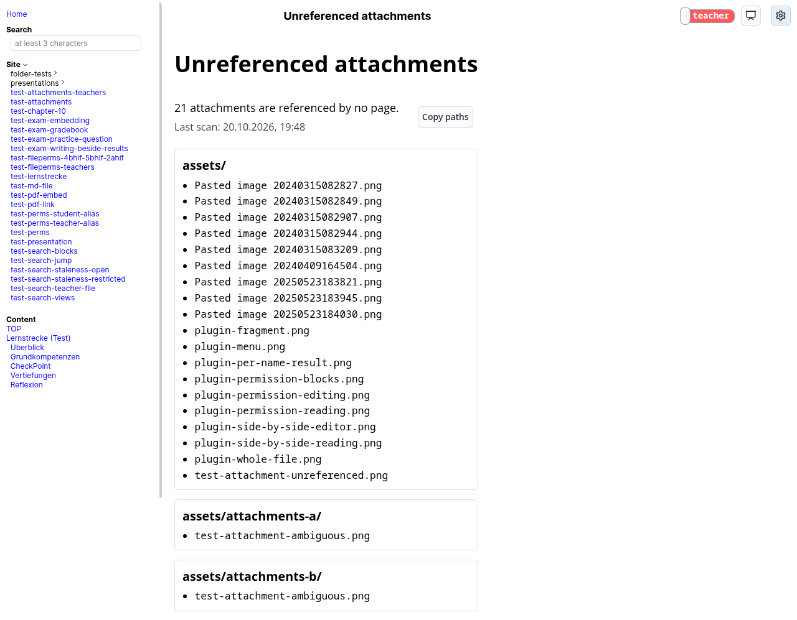

# Installation
SafeLearn is one Docker image that runs in three configurations, called **tiers**. Each tier contains the one below it, so you can start small and move up later without touching your Markdown files. This page tells you which tier fits, what each one needs, and how to install it.

[Back](README.md) to the main page.

## Choosing A Tier

| | **Tier 1 — Publishing** | **Tier 2 — Roles** | **Tier 3 — Database** |
| --- | --- | --- | --- |
| Difficulty | ★☆☆ Easy | ★★☆ Medium | ★★★ Advanced |
| In one sentence | Your Markdown as a website, no login | Everyone logs in and sees what their role allows | Tier 2 plus online tests and a gradebook |
| Switch | `AUTH=none` | `AUTH=keycloak` (the default) | `AUTH=keycloak` and `EXAM_MODULE=on` |
| You need | A machine with Docker | Tier 1, a Keycloak realm with a client, a fork of this repository with its GitHub Action | Tier 2, a persistent data directory you back up |
| Login | None | Keycloak (optionally federated with your school's LDAP/AD) | Keycloak |
| Who sees what | Every reader holds the same roles (`READER_ROLES`) | Per person: class, teacher, admin, … | Per person |
| Reader preferences | In the reader's browser (two cookies) | In the person's Keycloak account, so they follow them to every device | In the Keycloak account |
| Teacher/student view switch | Only if `READER_ROLES` makes every reader a teacher | ✔ | ✔ |
| [Administration pages](#administration-pages) | — | ✔ | ✔ |
| Directory search for the [Obsidian plugin](docs-obsidian.md#the-obsidian-plugin) | — | Optional, with a second Keycloak client | Optional |
| [Exam module](docs-exam-module.md): classes, gradebook, question pool, online tests | — | — | ✔ |
| Data to back up | Your Markdown only | Your Markdown only | Markdown **and** `exam-backups/` |

Everything a reader experiences — the rendered pages, presentations, the printable document view, search, the table of contents, fonts, dark mode, permissions inside the content — is the same in every tier. What changes is *who* the reader is.

Rules that hold in every tier:

- **`AUTH=none` is never a fallback.** An instance with `AUTH=keycloak`, or with no `AUTH` at all, that cannot read its `keycloak.json` refuses to start instead of publishing your material openly.
- **Tier 3 needs tier 2.** `EXAM_MODULE=on` together with `AUTH=none` refuses to start: grades without knowing who a reader is make no sense, and SafeLearn does not store passwords itself.
- **Moving up is a configuration change.** Your `md/` directory, the image and the permission directives stay the same. Readers' preferences start fresh after the move from tier 1 to tier 2, because they move from the browser into the account.

## Tier 1 — Publishing


**What you get:** your Markdown corpus as a website — navigation tree, rendered pages, presentations, search, reader settings — without any login. **What you don't get:** per-person permissions, preferences that follow a reader across devices, the administration pages and the exam module.

Tier 1 is the right choice for two things:

- **Your own preview while writing.** This is the [WYSIWYG container](docs-wysiwyg.md): it runs on your machine with `READER_ROLES=teacher`, watches your files, and refreshes the open page in your browser every time you save in Obsidian.
- **A public site.** Material that may be read by anyone, published with `READER_ROLES` empty, so that everything you restricted with `@@@` stays hidden.

### Requirements
- A machine with [Docker](https://docker.com) and Docker Compose (any Linux server, a Raspberry Pi 4, or Docker Desktop on your own computer).
- Your Markdown files in a directory on that machine.

That's all. No Keycloak, no `keycloak.json`, no `SESSION_SECRET`, no GitHub Action. The public image `gufalcon/safe-learn` already contains the application; your Markdown is mounted into it.

### Steps
1. Copy the directory `wysiwyg-container-linux` (or `wysiwyg-container-windows`, see [WYSIWYG](docs-wysiwyg.md#windows-explanation)) of this repository to the machine.
2. Edit its `.env`:
   - `LOCAL_DEV_MD_DIR` — the absolute path of your Markdown directory.
   - `PUBLIC_START_PAGE` — the page `/` leads to, e.g. `/md/index.md`. It has to exist.
   - `WEBSERVER_PORT` and `PUBLIC_SERVER_URL` — the port and the address under which readers reach it.
   - `AUTH=none` — already the default there.
   - `READER_ROLES` — see the next section. **For a public site, leave it empty.**
   - `AUTOSCAN=true` — picks up changed files without a restart. Keep it on if you update the files in place (e.g. with `git pull` or `rsync`).
3. Run `./up.sh`. Open `PUBLIC_SERVER_URL` in a browser.

For a site others reach over the internet, put it behind the reverse proxy you already use for HTTPS (nginx, Traefik, Caddy, …). SafeLearn itself speaks plain HTTP on its port.

### What `READER_ROLES` decides
Without a login there is nobody to take roles from, so every reader of a tier-1 instance holds the same roles: the comma-separated list in `READER_ROLES`.

| `READER_ROLES` | Every reader sees |
| --- | --- |
| empty or missing | Only what is not restricted. Every `@@@` block and every restricted file is hidden. **The right value for a public site.** |
| `4bhif` | Additionally the content addressed to class `4bhif`. |
| `teacher` | Everything a teacher sees, and the teacher/exam/answer view switches. **Only for your own preview** — whoever reaches the instance reads your teacher notes. The instance logs a warning at start-up. |



A block addressed to a single person by name is never shown without a login. The details are in [Permissions](docs-permissions.md) and [WYSIWYG](docs-wysiwyg.md#what-reader_roles-does).

### What a reader keeps
Light/dark mode, fonts, font size, line spacing, the view switches and the last visited page are kept in the reader's own browser, as the cookies `safelearn_config` and `safelearn_last`. Another browser or device starts with the defaults.

## Tier 2 — Roles


**What you get:** everything from tier 1, and every reader logs in. What a person sees depends on their roles — their class, `teacher`, `admin`, or any role you invent — and every role may carry a time window, so an exam's solution appears the moment the exam is over. Teachers switch between their own view and the student view. Preferences are stored in the person's Keycloak account and follow them to every device. Teachers get the [administration pages](#administration-pages).

Because the server checks the login *before* it renders anything, no page, image or attachment ever leaves the server for someone who may not read it — not even for search engines or crawlers. That is the reason SafeLearn runs its own server instead of being a static site.

| Logged in as a teacher, teacher view on | Logged in as a student |
| --- | --- |
|  |  |

### Requirements
- Everything tier 1 needs, on a server your readers can reach.
- A **Keycloak** server (a current version is recommended) with a realm and a confidential client for SafeLearn. Roles can be plain client roles you assign by hand, or come from your school's LDAP/Active Directory through Keycloak's user federation, so that you never maintain accounts yourself. [Keycloak](docs-keycloak.md) describes the client, the user attributes for the preferences and the `ldap` claim.
- A **private fork** of this repository on GitHub, whose GitHub Action builds an image with your Markdown and deploys it.
- A **Docker Hub** account (or another registry) for that image. Keep the image private: it contains your material.
- **SSH access** from GitHub's runners to your server, optionally through WireGuard or OpenVPN.

### Steps
1. **Set up Keycloak.** Create the client and the user attributes as described in [Keycloak](docs-keycloak.md#keycloak-setup), and add `<your server URL>/*` as a valid redirect URI. Assign the role `teacher` to the teachers and whatever class roles your directives use.
2. **Fork and configure.** Follow [Building](docs-building.md): create the fork, merge this repository as the `public` remote, enter the GitHub secrets (`KEYCLOAK_FILE`, `SESSION_SECRET`, `SERVER_URL`, the Docker Hub and SSH ones, …).
3. **Prepare the server.** Create the deploy directory and the data directory (`DEPLOY_DIR`, `DATA_DIR`) and give the SSH user write access to them.
4. **Push to `master`.** The action builds the image, pushes it and starts the container on your server with `AUTH=keycloak`. The deployment always states `AUTH=keycloak` explicitly, so a mistake in its configuration can never turn your site public.
5. From now on, every push to `master` publishes your changes. Merging `public/master` brings in SafeLearn's updates.

For a small team, or to edit during a lesson, consider keeping the Markdown on a Nextcloud instead, mounted into the container: see [Where Your Markdown Lives](#where-your-markdown-lives).

The container keeps its sessions in memory: run exactly one, and expect every restart or deployment to log everybody out once (see [Building](docs-building.md#sessions-live-in-the-container)).

### Optional: directory search
The [Obsidian plugin](docs-obsidian.md#the-obsidian-plugin) can list classes and pick people from your directory — for invitation lists, for example — and teachers get a **Directory status** page. Both need a second, read-only Keycloak client and the two secrets `DIRECTORY_SERVICE_CLIENT_ID` and `DIRECTORY_SERVICE_CLIENT_SECRET`; see [Directory search client](docs-keycloak.md#directory-search-client). Without them everything else works, and the directory features stay quiet.

### Administration pages
A teacher finds an **Administration** section in the settings menu, with two read-only pages:

- **Unreferenced attachments** (`/admin/attachments`) lists every file under `md/` that no page links to, grouped by folder, with a button that copies their paths — ready for a `git rm`.
- **Directory status** (`/admin/directory`) shows how far the directory cache has got, with directory search configured.

| Settings menu of a teacher | Unreferenced attachments |
| --- | --- |
|  |  |

## Tier 3 — Database


**What you get:** everything from tier 2, plus the [exam module](docs-exam-module.md), kept in one SQLite database on your server:

- **Classes and courses** per school year, with rosters taken from your directory (only the students you tick, so former students stay out).
- **A gradebook** per course, with weighted categories, a grade proposal per semester and for the year, and overrides.
- **A question pool** with an editor, categories, two languages, images, and import from Moodle XML.
- **Online tests** assembled from the pool: scheduled sittings (by your school's periods, if you configure them), shuffled questions, a countdown, automatic submission at the deadline, a live view for the teacher, a screen for the projector, and a solution to show on the board. Results go into the gradebook on their own.
- **Elements in your pages**: a test, a student's own results, a gradebook or a live view can be placed into any Markdown page with a fenced block.
- **The change of school year**: classes move up with their students, closed years become read-only, and leavers' records are removed after a retention period.

| Classes and courses | Question pool | Question editor |
| --- | --- | --- |
|  |  |  |

| A test and its sitting | The teacher's live view | A student writing |
| --- | --- | --- |
|  |  |  |

| Placed in a page, as a teacher sees it | The same page, as a student sees it |
| --- | --- |
|  |  |

### Requirements
- A working tier 2.
- The data directory (`DATA_DIR`) from tier 2 on persistent storage. The database `exam.sqlite` and its automatic copies in `exam-backups/` live there.
- A backup of `exam-backups/` off the server, to a place that may hold grades of minors. The module takes the copies itself (daily and before every database migration); getting them off the host is your job. See [Backups](docs-exam-module.md#backups).
- Students need to be told apart from teachers and assigned to classes, either through the LDAP federation or through client roles in Keycloak (see [Classes And Courses](docs-exam-module.md#classes-and-courses)).

### Steps
1. In your fork, open **Settings → Secrets and variables → Actions → Variables** and add the repository **variables** (not secrets):

   | Variable | Value |
   | --- | --- |
   | `EXAM_MODULE` | `on` |
   | `SCHOOL_PERIODS` | Optional. Your school's periods, e.g. `1=08:00-08:50,2=08:55-09:45,…`, so sittings are scheduled by period instead of clock time. See [The School's Periods](docs-exam-module.md#the-schools-periods). |
   | `EXAM_RETENTION_YEARS` | Optional. How many years a leaver's records are kept, 1 to 10. Empty means 2. |

2. Push, or start the action by hand. The container's log says `Exam module: active, database data/exam.sqlite`.
3. A teacher now has a graduation-cap button in the top bar. Create the school year, the classes and the courses there.

**If something is wrong, the reader keeps running.** A malformed variable, a database that cannot be opened or a failed migration disables the module for that run and says why in the log; every page outside `/exam/` is served as before. Switching the module off again (`EXAM_MODULE` empty) leaves the database untouched, and switching it on resumes where it was.

## Where Your Markdown Lives
Independent of the tier, there are two ways for your files to reach the server.

| | **In the repository** (the default) | **On the server, shared through Nextcloud** |
| --- | --- | --- |
| How an edit gets published | Commit and push; the GitHub Action builds a new image and deploys it | Save in Obsidian; the Nextcloud client syncs the file, and the server shows it within seconds |
| Time until readers see it | Minutes, and everyone is logged out by the redeploy | Seconds, without a restart; open pages reload by themselves |
| Previewing before students see it | The [WYSIWYG container](docs-wysiwyg.md) | `@@@ teacher` (see below) — no container needed |
| History | Every commit | Nextcloud's file versions, plus a scheduled commit to a backup repository |
| Conflicts | Merges, pull requests, reviews | Nextcloud's "conflicted copy" files, which you resolve by hand |
| Fits best | More than about 20 people editing, or when you want review | A few teachers, and changes during a lesson |

### Best practice: the corpus on Nextcloud
With the corpus on the server, every save is live. That is what makes it the better choice for a small team and for teaching: you fix a typo or add an example while the class is reading, and the page in front of them updates.

It also replaces the WYSIWYG container, if you make one habit of it: **write everything new inside `@@@ teacher` first.**

```
@@@ teacher
## Next week's exercise
...
@@@
```

While the block is there, you and your colleagues see the new material on the real site, logged in as teachers, with the real fonts, diagrams and presentations — and students see nothing of it. When it is ready, remove the two `@@@` lines, and it appears for the class the moment the file is synced. The same goes for a whole file: `@@@ teacher` on its first line keeps it, and its entry in the navigation tree, from students. A [time window](docs-permissions.md) does the same job on a schedule, for example to publish a solution after a test.

Above about 20 people editing the same corpus, the repository is the better place again: Nextcloud keeps no review, and the conflicts that two people saving the same file produce become frequent enough to be a burden.

### Setting it up
The repository's pipeline bakes `md/` into the image. To mount it from the server instead:

1. **A folder on the server** for the corpus, for example `/srv/safelearn/md`, readable by the container.
2. **Nextcloud reaches that folder** as external storage of type *Local* (app *External storage support*), shared with the teachers who write. Each of them syncs it with the Nextcloud desktop client and opens the synced folder as their Obsidian vault.
3. **The container mounts it read-only and watches it.** In `deploy/docker-compose.yml`:

   ```yaml
       environment:
         # The corpus is mounted rather than baked into the image, so the watcher
         # is what makes an edit visible. Without it a change needs a restart.
         - AUTOSCAN=true
       volumes:
         # The corpus, edited through Nextcloud. Read-only: SafeLearn never writes into it.
         - /srv/safelearn/md:/app/md:ro
   ```

   `AUTOSCAN` is passed here as a literal on purpose, since the corpus cannot work without it.
4. **Optionally**, remove `COPY md/ /app/md` from the `Dockerfile` (the mount hides it anyway, but the image no longer carries your material), add `/md/` to `.gitignore`, and limit the GitHub Action's `on.push.paths` to what reaches the image, so a content change no longer triggers a build.
5. **A backup with history.** A cron job on the server that commits the folder every few hours and pushes it to a private repository gives you the history the repository used to give you. Keep its `.git` directory *outside* the synced folder (`git clone --separate-git-dir=…`), so Nextcloud never syncs it, and exclude the sync client's files (`.nextcloudsync.log`, `.sync_*.db*`, `*.part`) and Obsidian's per-person `.obsidian/workspace*.json`.

Two things to know:

- **Sync clients leave files behind** — logs, lock files, "conflicted copy" duplicates. SafeLearn serves no attachment that no page links to, so none of them reach a reader. A conflicted copy of a Markdown page, however, is a page and shows up in the navigation tree. Resolve conflicts promptly; teachers find leftovers in **Administration → Unreferenced attachments**.
- **One person's Obsidian settings are not everyone's.** `.obsidian/` is synced along with the vault. Agree on the plugins (at least [SafeLearn Formatter](docs-obsidian.md#the-obsidian-plugin)), and let the workspace files differ.

## Combinations That Refuse To Start
The instance ends at start-up with a message naming the problem, rather than running in a state you did not ask for:

| Configuration | Why |
| --- | --- |
| `AUTH` is anything but `keycloak`, `none` or unset | A typo must not decide whether the site is public. |
| `AUTH=keycloak` (or unset) without a readable `keycloak.json` | Same reason. The message names `AUTH=none` as the deliberate alternative. |
| `AUTH=keycloak` (or unset) without `SESSION_SECRET` | There is no built-in secret, because it would be the same in every instance built from this public repository. |
| `AUTH=none` with `EXAM_MODULE=on` | The exam module has to know who a reader is. |
