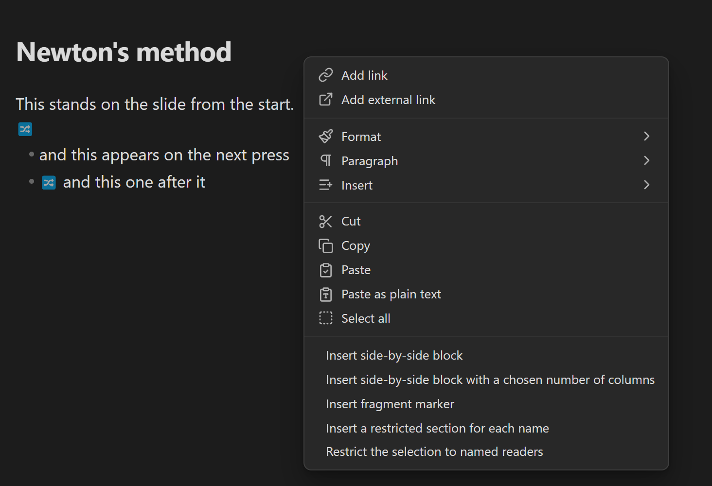
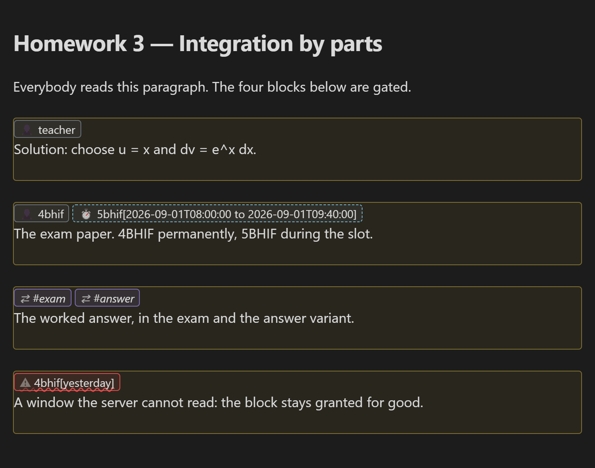
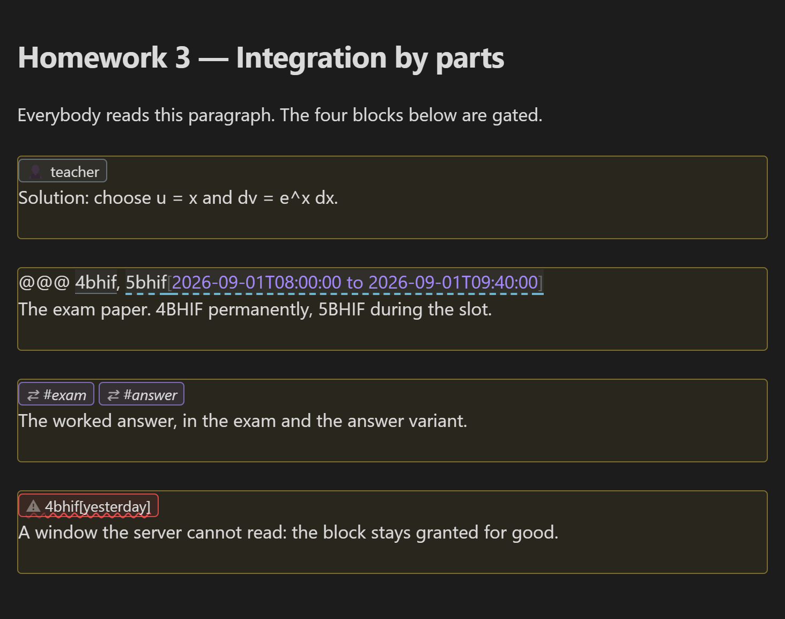
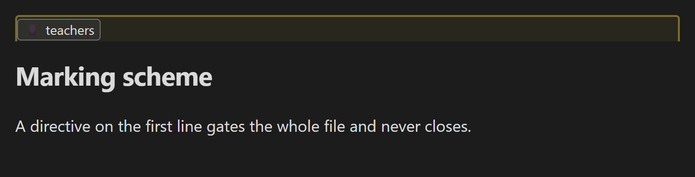
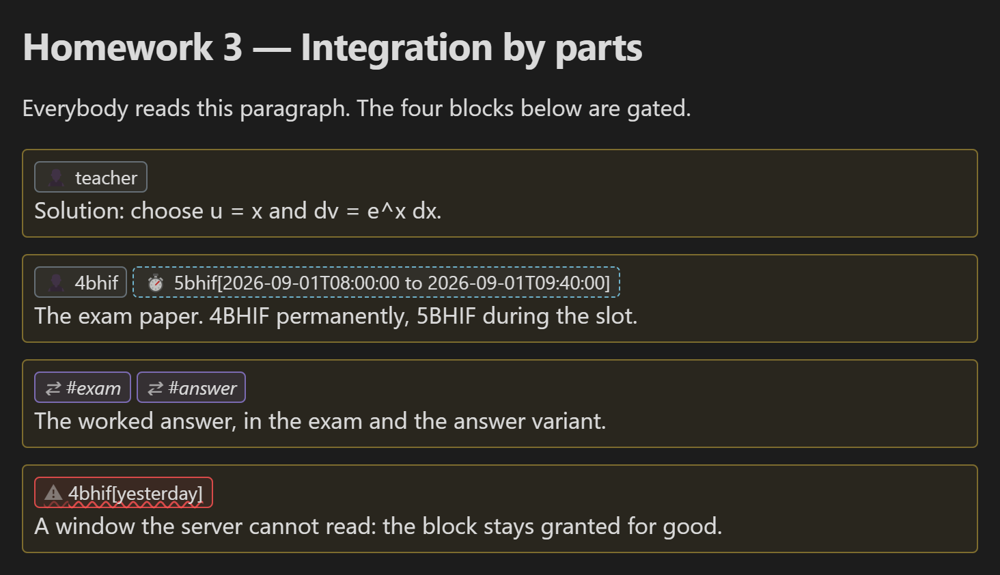
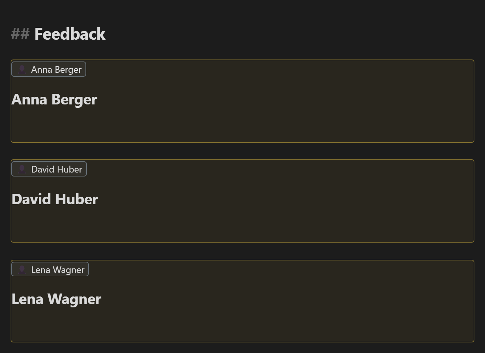
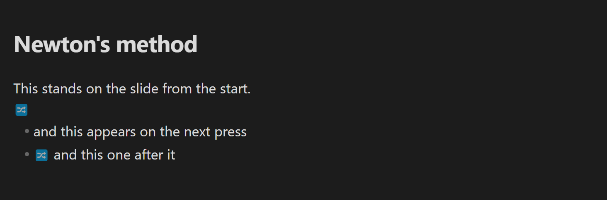
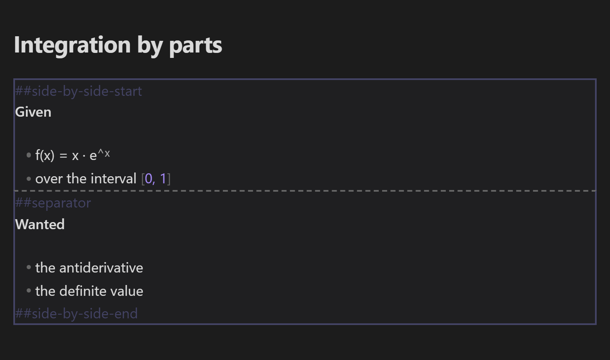
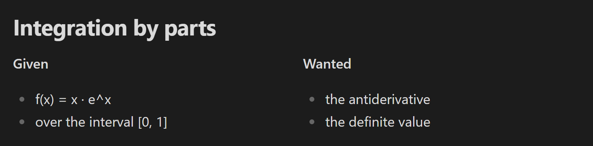
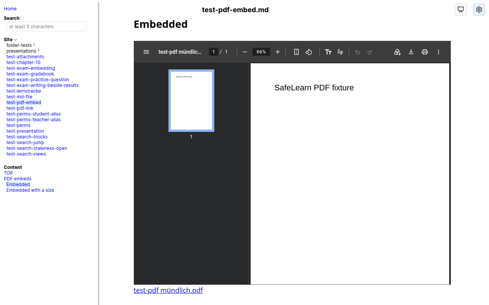

# Obsidian Extensions
Here you can find the technical intricacies of the Obsidian-specific language extension.

[Back](README.md) to the main page.
## The Obsidian Plugin
Everything on this page is a tag that instructs the server and that a reader never gets to see. **SafeLearn Formatter** is the companion plugin that shows you what the server will do with those tags *while you write them*. It changes nothing in your file, and it enforces nothing — every permission is still decided here, on the server.

It is an Obsidian community plugin with its own repository: [safeLearn-Obsidian-plugin](https://github.com/UnterrainerInformatik/safeLearn-Obsidian-plugin).
### Installing It
Settings → **Community plugins** → **Browse** → search for `SafeLearn Formatter` → **Install**, then **Enable**.

Nothing has to be configured to write and read the tags: that half of the plugin is local, and stays local whatever else is set.

The one thing that is not is [picking people from your school's directory](#it-picks-the-people-for-you) — point the plugin at a safeLearn instance and log in under Settings → **SafeLearn Formatter**, and the dialog that asks for a list of names offers you the directory instead. Leave it unset and it is the plain field it always was.

Working on the plugin itself rather than using it? [docs-testing.md](docs-testing.md#pointing-your-own-vault-at-a-checkout) has the route that loads a checkout instead.
### It Writes The Tags For You
Right-click in the editor and open **SafeLearn**, or use the command palette, where the same five stand under *SafeLearn Formatter*. Each marker lands on a line of its own.



| Command | What it writes |
| --- | --- |
| **Side-by-side block** | Two columns. |
| **Side-by-side, n columns…** | Asks how many, defaults to three. |
| **Fragment marker** | `##fragment` above the block the cursor is in. |
| **Restricted section per name…** | One restricted `@@@` block per name, in surname order — paste a class list straight in, and optionally content every block starts with. |
| **Restrict selection…** | Wraps what you selected in a directive. |
### It Shows A Restricted Block As A Block
The `@@@` line stands as the heading of the block it opens, and every entry in it is shown as what it is: a plain chip is a permanent grant, a dashed one carries a time window, a red one is a window the server **cannot read** (it drops the window and grants the block permanently — nothing else anywhere tells you), and an italic one is a view switch rather than an audience.



Put the cursor in that line and its own characters are back, editable, while every other block keeps its heading. Nothing is written into the document either way.



A directive on the [first line](docs-permissions.md) gates the whole file. It has no closing marker, so its frame is drawn with the lower edge left off.



In the reading view the tags are gone and the headings remain — which is close to what a reader who is allowed in will get.


### It Writes A Section Per Student
*Restricted section per name…* takes a pasted class list and writes one block per person, each with a heading **inside** the block. A heading above it would stay on the page for everybody, so a document meant to show each student only their own section would show all of them the names of all the others.



Below the names there is an optional field for content every section starts with. Paste a grading grid, a feedback table or a checklist there once and every student's section is created holding it, rather than you jumping into each one to paste it. Left empty, each section gets a single blank line. A line starting with `@@@` is refused there, because it would end the section early and leave the rest of the grid readable by everyone.

`admin`, `teacher`, `teachers`, `student` and `students` are [reserved](docs-permissions.md): a display name equal to one of them is read as the role instead. The command writes your names unchanged and tells you when one of them was such a name.
### It Picks The People For You
With a safeLearn instance configured and a login held, *Restricted section per name…* and *Restrict selection…* stop asking you to type the list and let you pick it instead. Typing in the search field searches the school directory; typing in the class filter narrows a list of classes to check, and checking more than one shows the people from any of them.

Click anybody in the results to move them into the **chosen** list below, or click **Add visible** to move over everybody the results are currently showing — which is how you take a whole class, however many people are in it, in one click rather than thirty.

The chosen list is what gets inserted, and it stays in front of you the whole time:

- Click somebody there to take them back out.
- Somebody you chose under a class filter that no longer shows them stays on the list, and is counted on it, rather than disappearing into a mark you cannot see.
- Choosing the same person twice leaves them on the list once.

The chosen list keeps the directory's order, so the class you took over stands together while you pick. The sections are **written** in surname order, then first name — umlauts beside their base letter, a double surname under its first word — the way a class list is read.

Somebody the directory has no entry for — a guest, or a student not yet enrolled — gets their block written by hand afterwards, alongside the ones the command wrote.

If the directory cannot be reached, or a search fails on the server, that is said above the search field as soon as it happens rather than looking like an empty match, and the plain text field appears below the picker so the dialog can still be answered. With no instance configured, or with one configured but not logged in, the dialog is unchanged: the text field alone, one name per line, and no network activity.
### It Shows Fragments And Columns
A `##fragment` stands as an icon in the editor, and is its own characters again with the cursor in it.



A side-by-side block is drawn as the region it is while you write it, and rebuilt as the columns the server makes of it when you read it.





The plugin recognizes no more than the server does: its rules are taken from this project's own parser, and `npm run test:obsidian` runs both over the same tags — see [testing](docs-testing.md).
## Globally Unique File Names
Obsidian uses quick-links like so:
```markdown
# The next line will insert a link to a file.
[[md-file-name-without-extension]]

# The next line will insert an image.
![[image-file-name-with-extension]]
```
In order to be able to do that, you are not allowed to have two files with the exact same file-name within a vault. Even if they are located in different directories.
Same goes for images and other assets.
If you have two files, for example, named `test`, then you'll have to add the complete path in links to any of the two `test` files.

So plan your file-names carefully.
You'll be rewarded with a much faster and smoother editing-experience.
## Callouts
Contrary to GitHub or standard MD, Obsidian supports [callouts](https://help.obsidian.md/Editing+and+formatting/Callouts), which are basically colorfully rendered boxes with headings and content (cards, one might say).
Those look great, especially when dealing with long text-flow or when interspersing text with info-points or homework-reminders.

Examples:
```markdown
# A note.
> [!note]
> content
```


```markdown
# A Warning with 'BOO!' in the heading, instead of the default 'Warning'.
>[!warning] BOO!
>content
```


```markdown
# A collapsable callout
>[!tip]-
>content
```


```markdown
# A collapsable callout with 'some long text' as heading.
>[!quote]- some long text
>content
```


You get the idea.
You can see all the variations [here](https://help.obsidian.md/Editing+and+formatting/Callouts).

They all work with one exception:

## Highlights And Their Colors
Text between two `==` is [highlighted](https://obsidian.md/help/syntax), just as in Obsidian.
Since Obsidian 1.14 a highlight can carry one of six colors: put the color's emoji directly after the opening `==`. The emoji selects the color and is not shown.

```markdown
==Default highlight==
==🔴Red== ==🟠Orange== ==🟡Yellow== ==🟢Green== ==🔵Blue== ==🟣Purple==
```

Obsidian's own `==` suggestions and the formatting menu write exactly this, so whatever you color in the editor is colored on the page, in light and dark mode and in the presentation view.
A highlight stays on one line, may contain other formatting (`==🔵**bold** and a [link](...)==`), and is left alone inside code.
## Properties (Frontmatter)
Obsidian keeps a note's [properties](https://obsidian.md/help/properties) in a YAML block at the very top of the file, between two `---` lines. safeLearn strips that block before anything else reads the file, so its lines never show as content in any view:

```markdown
---
klasse: 4AHIF
abgabe: 2026-12-08
footer: "4AHIF - WMC4 - Hausübung 1"
themen:
  - Quarkus CDI
  - REST
---
@@@ teacher
# Hausübung 1
```

What the properties are used for:

- **Search.** Property values are searched like body text (a list item by item), by every reader the file's directive lets see it and by nobody else. Property names are not searched.
- **Info button.** The page view shows a button in the top bar that opens all of the file's properties as a message, every value as text. A file without properties gets no button.
- **Header and footer.** A `header` or `footer` property holding text or a number is shown above and below the content on the page and in the document view, and in the presentation on every slide (and so on every printed page). A list, a mapping or an empty value shows nothing.

The permission directive goes on the line right after the closing `---`, as above; that line counts as the file's first line (see [Permissions](docs-permissions.md)). Dates stay exactly as you wrote them. A block that is not valid YAML is stripped all the same, the file then simply has no properties, and the server log names the file. A `---` anywhere else, or an opening `---` that is never closed, is not frontmatter. The frontmatter of an [embedded note](#embedding-notes) is not inserted.
## Comments
Text between two `%%` is an Obsidian [comment](https://obsidian.md/help/syntax#Comments): a note to yourself that Obsidian hides in its reading view. safeLearn hides it everywhere. No reader sees it on the page, in the document or in the presentation, search does not find it, and an attachment that only a comment names is not served.

```markdown
Die Lösung ist %%Lösung: 42%% im Skript.

%%
A block comment: add an example here.
It may span several paragraphs, headings and code blocks.
%%
```

There are two kinds, exactly as in Obsidian:

- A `%%` at the start of a line (after spaces, a `>` or a list marker at most) opens a block comment. It runs to the next `%%`, wherever that stands. If there is none, everything after it is hidden, as in Obsidian, so a forgotten closing mark shows as missing text on the page.
- Any other `%%` opens an inline comment, which must close on the same line. If it does not, the `%%` is shown as written.

A `%%` inside code is not a comment. Inline code, a fenced block and a `mermaid` block (which has `%%` comments of its own) keep their marks, so a Java format string such as `String.format("%.1f%%", rate)` stays intact. A comment at the top of a file does not disturb the permission directive: that is still read from the first line as written.
## Footnotes
Obsidian's [footnotes](https://obsidian.md/help/syntax#Footnotes) render as numbered, linked superscripts, both the referenced kind and the inline kind:

```markdown
Fowler wrote it.[^src] An inline note stands where it is referenced.^[Like this one.]

[^src]: Refactoring, 2002.
```

The notes are numbered 1, 2, 3 … in the order their first reference appears, whatever their labels are, and two references to one label share its number. On the page and in the document they are listed after the content. In the presentation each note stands at the bottom of the slide that holds its first reference, and on no other slide.

A reference without a definition is shown as written, brackets included, so a forgotten definition is visible. (Obsidian drops the brackets there.) A definition without a reference is not shown, and so is neither part of a `@@@` block the reader may not see. Footnote syntax inside code stays as written.

## Math
Formulas between `$` (inline) and `$$` (display) are typeset with [KaTeX](https://katex.org/) on the server, so they show in every view without a script, and the fonts are served by safeLearn itself:

```markdown
Pythagoras: $a^2 + b^2 = c^2$.

$$
\frac{a}{b} = \sqrt{c}
$$
```

The rule for `$` is Obsidian's: the opening `$` is not followed by a space, the closing `$` is not preceded by one and not followed by a digit. So `Kostet $5 und $10.` stays text, and `\$` is a literal dollar sign. A `$` inside code is never math.

KaTeX is not MathJax, which Obsidian uses. Nearly everything a lesson needs is the same, but a command KaTeX does not know is shown in red as its source, and a formula that does not parse at all is shown as its source marked as an error. Either is visible on the first render, and the rest of the page is not affected.

## Links To Headings And Blocks
Every heading carries an anchor made of its text: lowercased, spaces as `-`, punctuation removed, umlauts kept. `## Übung 3: Größen` is `#übung-3-größen`. A second heading with the same text gets `-2`, a third `-3`. The Content list in the sidebar uses these anchors, so a link to a heading is the same for every reader and every load.

A wiki link can name a heading or a block, of another note or of the same page:

```markdown
[[Git#Branches]]             the heading "Branches" of note Git
[[Git#Remote#Branches]]      nested headings: the last one decides
[[#Installation|see below]]  a heading of this page, with its own text
[[Trees#^def-tree]]          the block of note Trees marked ^def-tree
[[#^def-tree]]               a block of this page
```

Without `|text`, the link reads like Obsidian's: `Git > Branches`, `Git > Remote > Branches`, `Trees > ^def-tree`. A heading that does not exist opens the note at its top. In the presentation, a link to a heading or block of the same deck shows the slide that holds it. (A heading made only of digits reads as a slide number there.)

A block is marked with `^id` at the end of a paragraph or a list item, or on a line of its own directly after a table, a quote, a list or a code block. The marker is not shown. `id` consists of letters, digits and `-`:

```markdown
A tree is a connected graph without cycles. ^def-tree

| Note | Punkte |
|------|--------|
| 1    | 90     |

^table-grades
```

## Embedding Notes
`![[Note]]` inserts another note where it stands, `![[Note#Heading]]` one of its sections (the heading and everything up to the next heading of the same or a higher level), and `![[Note#^id]]` one of its blocks:

```markdown
![[Definition Baum]]
![[Git#Branches]]
![[Trees#^def-tree]]
```

The inserted text renders as if it were written there: its callouts, code, diagrams, images, footnotes and formulas render, and its headings appear in the Content list and start slides. Its frontmatter is not inserted.

An embed keeps the permissions of the note it inserts. The note's first-line directive decides whether anything is inserted for this reader, and its `@@@` blocks are filtered for this reader before the section or block is taken. An embed the reader may not see looks exactly like an embed of a note that does not exist: it stays as written. So does an embed of a missing note, heading or block, and one inside code. Embeds inside embedded notes are resolved up to five levels deep, and a note that would embed itself again further down stays as written there.

Search finds embedded text in the note it is written in, not in the page that embeds it. An image of an embedded note is served to whoever may see the page that shows it.

Limits:

- A footnote definition that stands outside an embedded section is not inserted with it, so its reference stays as written.
- A relative Markdown image path (``) inside an embedded note is resolved against the page that embeds it, not against the embedded note. Embed images by name (`![[a.png]]`) and this does not matter.
- The `|` part of a note embed (Obsidian's embed size) is ignored.

## A Rule Directly Under Text
A `---` directly under a line of text is no rule: CommonMark and Obsidian both read the line above it as a heading (a "setext" heading of level 2). safeLearn renders it the same way, so it starts a slide in the presentation, as Obsidian shows it as a heading. Leave a blank line above `---` for a rule.

## Image Sizing
The renderer will never touch the image's size, until it won't fit the display. If that occurs, it will just resize it proportionally to fit it.

To display images at a special size, you have the following options.
Those work on normal image-links, like the standard DM ones and the shortcut-links `Obsidian` provides.

```markdown
# Display in 200x200 pixels (x + 'x' + y)

# And as short-link
![[my-img.png|200x200]]

# Display in 200 pixels widths, sized proportionally

# And as short-link
![[my-img.png|120]]
```
## PDFs And Other Attachments


A wiki link or an embed can name any file of the vault, not only a Markdown page or an image. It is found the same way: by its name alone, or by its path where that name exists in more than one folder.

```markdown
# A link to the PDF, showing its name.
[[handout.pdf]]
# A link with its own text.
[[handout.pdf|Arbeitsblatt]]

# The PDF shown inline, with a link to it beneath.
![[handout.pdf]]
# Inline, at 800 by 600 pixels, or 800 pixels wide.
![[handout.pdf|800x600]]
![[handout.pdf|800]]
```

An embedded PDF is shown in the browser's own PDF viewer, on the page and on a slide: as wide as the text and most of the screen high, or as large as you give it. On a slide you can scroll inside it without changing the slide. The link beneath it is always there, because most phones show no PDF inside a page, or only its first page; on a phone, that link is the way to the document. The printable document (`?document`) shows the link only, as a viewer does not print.

Other kinds of files, such as Office documents or ZIP archives, are not shown inline: an embed of one renders as a link to it, like a wiki link does.

Linking or embedding a file is also what lets students download it: a file in the vault is served to someone only if a page they may see links or embeds it - see [permissions](docs-permissions.md). A link or embed written as code, between backticks or in a fenced block, is shown as written and counts for nothing.
## Every Slide Fits the Screen
A presentation (`?reveal`) is shown on a projector or a classroom monitor, so every slide fits wholly on the screen it is shown on. A slide whose content is larger than the screen - a tall image, long code, a long list - is scaled down as a whole, its proportions kept, until all of it is visible; nothing runs off the screen. A slide that fits is left exactly as it is: it is never enlarged, and never shrunk because another slide is too large. The size is taken with all of a slide's [fragments](#fragments-in-reveal-js) shown, so a slide revealed step by step keeps its size from step to step. Making the window smaller shrinks a slide that no longer fits, making it larger again gives it back its own size, and the PDF export (`?reveal=1&print-pdf`) fits each slide to its page the same way.

This holds for every deck: the presentations of your vault, a handout's solution deck and a test's solution on the board. The application never splits a slide into several; if a slide becomes too small to read, split or shorten it yourself. A code block keeps its own height limit and scrolls inside its box, as before.

## Fragments in Reveal.js
You may use fragments when starting a presentation.
Fragments are parts of you page that pop up one after another, step by step, when you're pressing the forward-button you normally press to advance to the next vertical page.
### Single Fragment Lines
The [Obsidian plugin](#the-obsidian-plugin) shows these while you write, and writes the marker for you.
You may mark single lines as Fragments. Those lines are denoted by having a `##fragment` in the line above them.
A single line is defined as from the start of a line to the next `newline`, so that may as well span more than a single line when line-breaks are inserted by the browser in order to fit that single line on the screen.
#### Single Fragment Example
```bash
This text displays already.
##fragment
Fragmented Text comes in after that.
- ##fragment one
- ##fragment two
```
Another example that fades in two blocks one after another would look like this:
```bash
This text is already on the page.
##fragment
- Then this
- fades in
##fragment
- and then
- these three
- lines
```
So you may see the `##fragment` tag as some kind of a `stop here and wait for me to press space` tag.
## Side-By-Side in Reveal.js
It's possible to make columns that only work when making a presentation in Reveal.js.
The [Obsidian plugin](#the-obsidian-plugin) draws the block while you write it and shows the columns when you read it.
You may denote a side-by-side number of columns this and every section (column) will then render side by side, from left to right. This enables you to fill a wide-screen with, let's say, an image and a table with an explanation besides it.
```bash
Normal text. Will be displayed centered.
##side-by-side-start
This text will be on the left side...
- one
- two
##separator
- three
- four

This will be on the right side
##side-by-side-end

and this will be below the side-by-side element on the bottom.
```
When watching the document in the normal HTML view those tags have no effect.
You can specify more than one separator resulting in more columns.