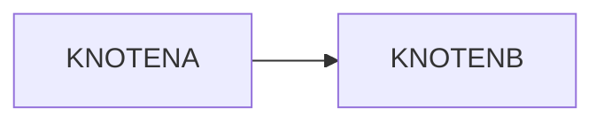

# Comments fixture

A file visible to everyone that carries Obsidian comments. The marker words
in capitals inside the comments occur nowhere else in the corpus, so none of
them may reach a reader.

Die Lösung ist %%KOMMENTARNOTIZ Lösung: 42%% im Skript.

SUCHWORTNEBEN steht in einem Satz mit %%KOMMENTARNACHBAR%% einem Kommentar.

A %%KOMMENTARZWEI%% B %%KOMMENTARDREI%% C

Ein Prozentzeichen-Paar %%OFFENSICHTBAR ohne Partner in derselben Zeile bleibt Text.

%%
KOMMENTARBLOCK: a note to self across several paragraphs.

@@@ teacher
KOMMENTARLEHRER inside a teacher block inside a comment.
@@@

KOMMENTARUEBERSCHRIFT
---

## KOMMENTARFOLIE

![[test-attachment-comments.png]]
%%

## Code keeps its marks

Mit `%%` beginnt ein Kommentar.

```java
String rate = String.format("%.1f%%", 12.5);
```



The paragraph after the code is shown.

## Last slide

The text before the unclosed comment is shown.

%%
KOMMENTARENDE: an unclosed comment runs to the end of the file.

## KOMMENTARLETZTEFOLIE

Nothing from the line that opened it on is shown.
